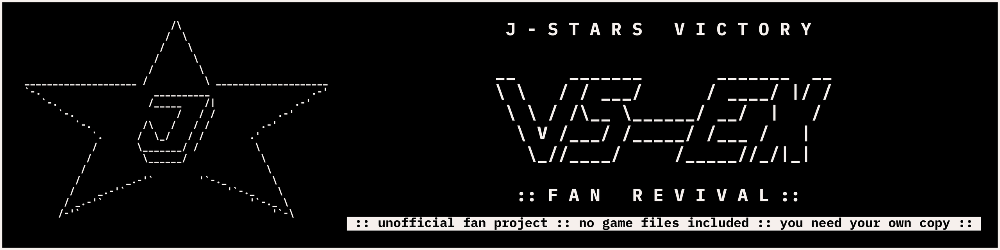

# J-Stars Victory VS-EX, Fan Revival

**J-Stars Victory VS+ running natively on Windows: the game's own code, recompiled to x64 on your PC from your own copy.**

   

**[Status](docs/notes/STATUS.md)** · **[Features](docs/FEATURES.md)** · **[Roadmap](docs/ROADMAP.md)** · **[Installer](installer/README.md)** · **[Building](docs/BUILDING.md)** · **[Notes](docs/notes/README.md)** · **[Contributing](CONTRIBUTING.md)**

> **Bring your own game.** This repository holds no game code, no game assets and no firmware: no ISO, EBOOT,
> recompiled game code, captures or screenshots. You need your own copy of the game (US BLUS31519 or EU BLES02136) and
> its decrypted EBOOT, from your own copy. Please do not post game files in issues or pull requests.

| ~30 fps | ~29 fps | 34,092 | 0 |
|:---:|:---:|:---:|:---:|
| fights, current tree (the default) | fights, earlier v15 tree (`--tree legacy`) | game functions recompiled | game files in this repository |

The frame rates were measured on one Windows machine; see [Status](#status).

## How to play

**Windows 10 or 11, x64**

1. Have your game's disc folder (the one with `PS3_GAME`) and its decrypted `EBOOT.elf` ready.
2. Build `jsp-setup.exe` once: [installer/README.md, "Building the installer"](installer/README.md#building-the-installer-windows).
   It needs Git, Python, Inno Setup and an internet connection for the pinned compiler.
3. Run `jsp-setup.exe` (no admin rights) and point it at the disc folder and `EBOOT.elf`. It builds the port on your PC.
4. Start **JSP Fan Revival** from the Start menu.

Caveat: the first build takes a while and needs several GB of free space, and `Build again` in the Start menu resumes it.

**A ready-made download:** the <!-- version -->[0.2.0 pre-release](https://github.com/Tsamiuy/jsp-vs-ex/releases/tag/v0.2.0)<!-- /version --> has
`jsp-setup.exe` and a portable zip (<!-- version -->`jsp-0.2.0-portable.zip`<!-- /version -->), with SHA-256 sums. Both still build the game on your PC from
your own copy.

**Linux and Steam Deck (Proton):** coming soon. Not supported yet; an earlier v18 build of the newer tree reached fights under Proton in tests.

## What makes it different

| | |
|---|---|
| Native x64 code, not an emulator: the game's own code translated ahead of time with [ps3recomp](https://github.com/sp00nznet/ps3recomp) | [docs/LAYOUT.md](docs/LAYOUT.md) |
| Built on your PC from your own copy; nothing from the game is shipped | [installer/README.md](installer/README.md) |
| No server contact unless you turn Online Battle on: no update check, no crash report, no telemetry | [installer/README.md](installer/README.md) |
| Higher resolutions, a resizable window and borderless fullscreen | [Features: Display](docs/FEATURES.md#resolution) |
| Keyboard, mouse or controller, with a launcher to rebind keys | [Features: Input](docs/FEATURES.md#input-modes) |
| Training Mode in Free Battle | [Features: Training](docs/FEATURES.md#training-mode) |
| The game's own Online Battle over a self-hosted re-psn server (experimental, opt-in, newer tree) | [docs/ONLINE.md](docs/ONLINE.md) (quick start) |

## Coming soon

- Closing the open problems of the v19 tree, now the default ([issue #9](https://github.com/Tsamiuy/jsp-vs-ex/issues/9)).
- Online matches with rollback netcode, spectating and lobbies ([Roadmap, section 4](docs/ROADMAP.md)).
- More match options and Training options ([Roadmap, section 3](docs/ROADMAP.md)).
- Linux through Proton ([Roadmap, Platforms](docs/ROADMAP.md#platforms)).

## Status

> **Pre-release (<!-- version -->0.2.0<!-- /version -->), work in progress.** The default build (the v19 tree, built on ps3recomp v0.19.0; the installer switch is
> `--tree current`) lifts and builds on Windows (Direct3D 12) and boots, plays the opening movie, the menus and fights
> with sound, at about 30 frames per second in the demo and in Free Battle on one Windows machine (its earlier v18 build, on
> toolkit v0.18.0, ran at 16 to 22). It has had fewer tests than the earlier v15 tree (`--tree legacy`, about 29 frames per second):
> the EU disc, the first-start window and long runs are not re-checked on it, and it has known problems (see Known problems
> below and [issue #9](https://github.com/Tsamiuy/jsp-vs-ex/issues/9)). The game port was run on one Windows PC (see #9); the
> CI-built setup program installed, built and started it on that PC. Since 0.1.0, play testers have installed it with the
> setup program and the portable zip on their own Windows 11 PCs (AMD and NVIDIA graphics) and played menus, fights and
> online matches; their reports are under Known problems.
>
> Dated table (top refreshed 2026-10-30, mostly for the v15 tree): [docs/notes/STATUS.md](docs/notes/STATUS.md).

**How it works:** the installer lifts the game's PowerPC and SPU code from your `EBOOT.elf` to C, compiles it with a
bundled compiler and links it against the ps3recomp runtime, which provides the PS3 system libraries and draws through
Direct3D 12. Details: [installer/README.md](installer/README.md) and [docs/LAYOUT.md](docs/LAYOUT.md).

## Known problems

Of the default build (the v19 tree), as listed in [issue #9](https://github.com/Tsamiuy/jsp-vs-ex/issues/9); not re-checked means not run again on v19:

- Lighting on some floors was washed out on the earlier v18 build; whether the shadow fixes changed that has not been compared on v19. A white bar under the left portrait is not explained.
- A loading page is reported on v19 and has not been compared with the v15 tree; a black window of about two minutes at the first start is reported (not re-checked after the boot fix); log files stay at 0 bytes during play and fill at exit.
- "Fight again" from the result menu left a flat brown screen on v18 (not re-checked); long runs and the lost-device case are not re-checked on v19.
- Not tried yet on v19: key rebinds and controller remaps by hand, playing to a K.O., characters other than the route's five, and Windows 10 with the menu fix.
- Reported by play testers on 0.1.0 (not yet reproduced here unless noted):
  - The frame rate drops to about 20 per second in heavy scenes: many fighters on screen, a building being destroyed,
    the Temple of Athena stage and online matches. In one tester's log the frame rate follows the number of draws per
    frame, not the network: the cost of each draw on the drawing thread is the limit, and it is being worked on.
  - Training: Return to character select after using Unlimited Stamina can leave a black screen and freeze. It did not
    happen in our runs; a related fix is in (Unlimited Stamina no longer writes into fighters the game has freed), but the
    freeze itself, with Unlimited Stamina on or off, is not explained yet.
  - Online: a solo battle against the computer started from the online lobby froze on the Versus screen; after a
    connection error in Ranked, the Online Battle menu froze. No log of either yet: a support bundle made right after
    such a freeze helps.
  - The online lobby's Selected Stage picture is drawn with horizontal stripes.
- Needs a CPU with AVX2 by default (`JSP_AVX2`, #9).
- Online and Cross-Save upload need PSN and do nothing in the default build (Cross-Save is now "Exit Game"). The default (v19) tree has
  an experimental Online Battle over a re-psn server, off unless turned on: see [installer/README.md](installer/README.md).
- A hand build from this repository (the pinned ps3recomp v0.15.0 submodule plus `jstars/toolkit/ps3recomp-local.patch`, see
  [docs/BUILDING.md](docs/BUILDING.md)) has not been tried on a clean machine; the notes build from a local checkout
  with the same changes. The installer applies the same patch for you.
- Read [docs/SCRIPTS.md](docs/SCRIPTS.md) before running the scripts: they change your power plan and mount the disc image.

## Contributing

Pull requests are welcome: [CONTRIBUTING.md](CONTRIBUTING.md). Only `main` is used; rules for AI coding agents are in
[AGENTS.md](AGENTS.md). Community: [Discord](https://discord.gg/h3j2wFwqvn).

## AI, licence, disclaimer

Developed with AI agent assistance under the maintainers' direction.

The port's own code, tools and documentation: MIT, see [LICENSE](LICENSE). Third-party software and licences:
[NOTICE.md](NOTICE.md). Security problems: [SECURITY.md](SECURITY.md).

Unofficial fan project. Not affiliated with, authorized or endorsed by the game's publisher, developer or rights
holders; trademarks belong to their owners. **You need your own copy of the game.**
