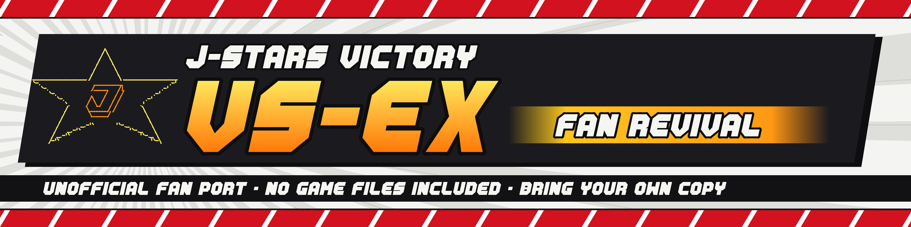

<h1>J-Stars Victory VS-EX, Fan Revival</h1>

<b>J-Stars Victory VS+ running natively on Windows: the game's own code, recompiled to x64 on your PC from your own copy.</b>

  

<!-- badges:start -->

 

<!-- badges:end -->

 

<!-- nav:start -->

<a href="#status">Status</a> · <a href="#download-and-play">What you need</a> · <a href="#what-goes-online-and-where-your-data-goes">Online and your data</a> · <a href="#settings-and-controllers">Settings and controllers</a> · <a href="#how-it-works">How it works</a> · <a href="#roadmap">Roadmap</a> · <a href="#how-ai-was-used">How AI was used</a> · <a href="#licence-and-disclaimer">Licence</a> · <a href="#related-projects-and-credits">Credits</a> · <a href="https://tsamiuy.github.io/jsp-vs-ex/">Fan site</a>
<!-- nav:end -->

J-Stars Victory VS-EX is an unofficial fan port of J-Stars Victory VS+ (PS3) to Windows x64. **Bring your own game:** this repository holds no game code, no game assets and no firmware (no ISO, EBOOT, recompiled game code, captures or screenshots). You need your own copy of the game (US BLUS31519 or EU BLES02136) and its decrypted EBOOT, from your own copy, see RPCS3 and its documentation. Please do not post game files in issues or pull requests.

## Status

> **Pre-release (<!-- version -->0.6.1<!-- /version -->), work in progress.** The default build is the v19 tree, built on ps3recomp v0.19.0 (installer switch `--tree current`).

| What | Result | Measured on |
|---|---|---|
| Lift, build, boot, opening movie, menus, fights with sound | Works | One Windows machine, CI-built setup program |
| Frame rate, default tree | About 30 frames per second in the demo and in Free Battle | One Windows machine |
| Frame rate, busy scenes on a slower CPU (3,000 to 4,000 draws a frame) | Testers saw drops to about 20 per second. With one machine's CPU held at its base clock: 23 to 27 in 0.3.0, 26.8 without the vblank wait, 28.3 with two drawing threads and about 29.5 with two per-draw cuts, all three in 0.4.0; a real slower PC and a real 60 Hz monitor not tried | One Windows machine, CPU at base clock |
| Frame rate, its earlier v18 build (toolkit v0.18.0) | 16 to 22 frames per second | One Windows machine |
| Frame rate, earlier v15 tree (git tag `legacy-v15`) | About 29 frames per second in fights | One Windows machine |
| Install with the setup program and the portable zip, menus, fights, online matches | Played | Play testers' own Windows 11 PCs, AMD and NVIDIA graphics |
| EU disc, first-start window, long runs | Not re-checked on the default tree | Not measured |
| Older CPU without AVX2 | Not tried; it will most likely not run | Not measured |
| Linux and Steam Deck (Proton) | Not supported; an earlier v18 build reached fights under Proton in tests | Coming soon |

The default tree has had fewer tests than the v15 tree and has known problems: see [KNOWN_ISSUES.md](KNOWN_ISSUES.md) and [issue #9](https://github.com/Tsamiuy/jsp-vs-ex/issues/9). Play testers' reports are in KNOWN_ISSUES.md. A dated table, refreshed 2026-10-30 and mostly for the v15 tree, is in [docs/notes/STATUS.md](docs/notes/STATUS.md).

## Download and play

**What you need**

| Need | Detail |
|---|---|
| Windows | Windows 10 or 11, x64. No admin rights. |
| Your game | The disc folder (the one with `PS3_GAME`) of the US or EU disc. |
| The decrypted EBOOT | `EBOOT.elf`: the game's program file in decrypted form, made from your own copy (see [RPCS3](https://rpcs3.net) and its documentation). The disc's `EBOOT.BIN` is the encrypted form and is refused. |
| CPU | AVX2 and FMA (Intel Haswell, 2013, or newer; AMD Excavator or Zen). |
| Disk space | At least 4 GB free for the build, then about 2.5 GB for the game data. |
| Graphics | A Windows driver with Direct3D 12. |

Linux and Steam Deck (Proton) are not supported yet. Every detail is in [docs/INSTALL.md](docs/INSTALL.md).

**Steps**

1. Download `jsp-setup.exe` from the <!-- version -->[0.6.1 pre-release](https://github.com/Tsamiuy/jsp-vs-ex/releases/tag/v0.6.1)<!-- /version -->. A portable zip (<!-- version -->`jsp-0.6.1-portable.zip`<!-- /version -->) is there too. You now have the file.
2. Run `jsp-setup.exe`. The setup wizard opens. Windows may warn that the file is not code-signed. To check the download first, compare its SHA-256 with the release page: `SHA256SUMS.txt` for 0.3.0 and earlier, `SHA256SUMS` from 0.4.0 ([how](docs/INSTALL.md#check-your-download)).
3. Point the wizard at your disc folder and at `EBOOT.elf`. It checks both and names the problem if one is wrong.
4. Let setup finish. It builds the game on your PC, which takes a while. You see the finish page.
5. Open **JSP Fan Revival** from the Start menu. The launcher opens.
6. Start the game. The first start installs the game data, then the opening movie plays and the menus open.

You can also build `jsp-setup.exe` yourself: [installer/README.md, "Building the installer"](installer/README.md#building-the-installer-windows).

**If setup stops**

Setup checks your inputs before the long build and refuses with a code:

- `D1` to `D3`: the folder is not the disc folder, or the game is not US or EU. Other regions are refused.
- `E1` to `E3`: the file is not a decrypted `EBOOT.elf`, or it is from the other region or another build. The game update 1.02 and digital editions are refused.
- `P1`, `P2`: the install or disc path has characters that break the build.
- `S1`: a folder is not writable, or there is too little free space.

The full list is in [docs/INSTALL.md](docs/INSTALL.md#what-setup-refuses). If the build itself stops, click **Build again** in the Start menu to resume it.

## What goes online and where your data goes

Nothing goes online unless you turn Online Battle on. There is no update check, no crash report and no telemetry. The support bundle is a file on your Desktop that you attach yourself. Saves stay in `%APPDATA%\JSP Fan Revival\hdd0` (a portable install: `hdd0` in the install folder). Details: [installer/README.md](installer/README.md).

## What makes it different

| | |
|---|---|
| Native x64 code, not an emulator: the game's own code translated ahead of time with [ps3recomp](https://github.com/sp00nznet/ps3recomp) | [docs/LAYOUT.md](docs/LAYOUT.md) |
| Built on your PC from your own copy; nothing from the game is shipped | [installer/README.md](installer/README.md) |
| Higher resolutions, a resizable window and borderless fullscreen | [Features: Display](docs/FEATURES.md#resolution) |
| Keyboard, mouse or controller, with a launcher to rebind keys | [Features: Input](docs/FEATURES.md#input-modes) |
| A two-page Main Menu (Battle Modes, J-Customize, J-Point Shop, Gallery, Options), on by default | [Features: Main Menu](docs/FEATURES.md#main-menu-pages) |
| 3v3 Free Battle (three fighters per team, six in the fight), on by default | [Features: 3v3](docs/FEATURES.md#free-battle-3v3) |
| Training Mode in Free Battle | [Features: Training](docs/FEATURES.md#training-mode) |
| Online Battle with rollback netcode (experimental, 2 vs 2, set up by the installer) | [docs/ONLINE.md](docs/ONLINE.md), [player guide](docs/TESTING_ONLINE.md) |
| Coming soon: spectating and lobbies | [Roadmap, section 4](docs/ROADMAP.md) |
| Coming soon: more match options (1v1, and 3v3 in other modes) and Training options | [Roadmap, section 3](docs/ROADMAP.md) |

## Settings and controllers

- **Controllers:** keyboard, keyboard and mouse, or a controller that Windows reads through XInput (Xbox-style pads). Buttons can be remapped in the settings window.
- **PlayStation pads:** DualSense, DualSense Edge and DualShock 4 (v1 and v2), up to four, are read directly over USB or Bluetooth, each as its own player next to Xbox-style pads. This is marked "in progress", because it was only checked against the documented report layout, not on real pads yet. They have no rumble or lightbar.
- **Other pads:** a pad that only works through DirectInput is not handled by the code. Use the keyboard.
- **Player 2:** the keyboard or a second controller.
- **Display:** the picture is 16:9 today. The window, a resolution scale, borderless fullscreen (F11) and graphics options (edge smoothing, shadows, model detail, object draw distance) are in the settings window.
- **Wide monitors:** fullscreen stretches the picture to a monitor of another shape. Wide screens without stretching are planned.

See [Features: Input](docs/FEATURES.md#input-modes), [PlayStation pads](docs/FEATURES.md#dualsense) and [Features: Wide screens](docs/FEATURES.md#wide-screens). Saves, updating and uninstalling: [docs/INSTALL.md](docs/INSTALL.md#saves).

## Known issues

Heavy fights can drop to about 20 frames per second. The Training freeze after Return to character select and two online freezes are open. The default build needs a CPU with AVX2. The full list, with the build each affects and a workaround where there is one, is in [KNOWN_ISSUES.md](KNOWN_ISSUES.md). Status is tracked in [issue #9](https://github.com/Tsamiuy/jsp-vs-ex/issues/9).

## Troubleshooting and reporting bugs

| You see | Do this | Log |
|---|---|---|
| Setup stops | Read the code in the message, see "If setup stops". Then click **Build again** in the Start menu. | `logs\firstrun-<time>.log` |
| A black screen | Click **Build again**. If that does not help, make a support bundle. | `game\run\launcher_log.txt` |
| A pad does nothing | Use the keyboard, or an XInput pad. | `game\run\launcher_log.txt` |
| Windows or an antivirus warns | The files are not code-signed; check the SHA-256 sums. | None |

More symptoms and the log places: [docs/TROUBLESHOOTING.md](docs/TROUBLESHOOTING.md).

To report a bug, click **Make a support bundle (JSP Fan Revival)** in the Start menu (portable zip: double-click `support-bundle.cmd`). It writes `jsp-support-<time>.zip` on the Desktop. It holds logs and settings as text, never the EBOOT, disc files or saves, and it sends nothing anywhere. Attach it to a [new issue](https://github.com/Tsamiuy/jsp-vs-ex/issues/new/choose) and say which graphics card and CPU you have. The forms are: bug report, performance report, play-test report, feature request, and feedback or question. Never attach game files.

## Building

Players build the game with the installer. For a hand build, the checks and the tree layout, see [docs/BUILDING.md](docs/BUILDING.md), [docs/LAYOUT.md](docs/LAYOUT.md) and [installer/README.md](installer/README.md).

## How it works

The installer lifts the game's PowerPC and SPU code from your `EBOOT.elf` to C. It compiles that with a bundled compiler and links it against the ps3recomp runtime. The runtime provides the PS3 system libraries and draws through Direct3D 12. Details: [installer/README.md](installer/README.md) and [docs/LAYOUT.md](docs/LAYOUT.md).

## Roadmap

Close the open problems of the v19 tree ([issue #9](https://github.com/Tsamiuy/jsp-vs-ex/issues/9)), then online rollback, more match options and Linux through Proton. See [docs/ROADMAP.md](docs/ROADMAP.md).

## Contributing

Pull requests are welcome: [CONTRIBUTING.md](CONTRIBUTING.md). Only `main` is used. Rules for AI coding agents are in [AGENTS.md](AGENTS.md). Community: [Discord server](https://discord.gg/D2eTEnCK62) (unofficial fan work; this project has its own forum there). 

## How AI was used

Developed with AI agent assistance under the maintainers' direction.

## Licence and disclaimer

The port's own code, tools and documentation are MIT, see [LICENSE](LICENSE). Security problems: [SECURITY.md](SECURITY.md).

Unofficial fan project. Not affiliated with, authorized or endorsed by the game's publisher, developer or rights holders. Trademarks belong to their owners. **You need your own copy of the game.**

## Related projects and credits

Third-party software and licences: [NOTICE.md](NOTICE.md). People: [CONTRIBUTORS.md](CONTRIBUTORS.md).
