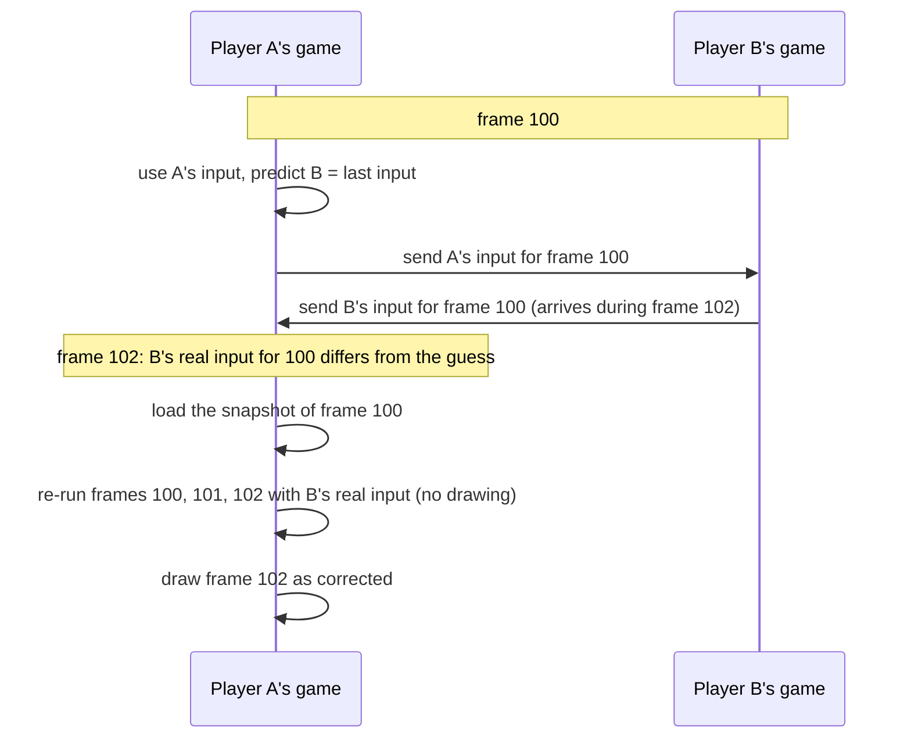
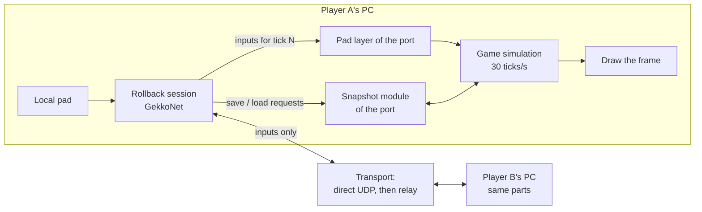
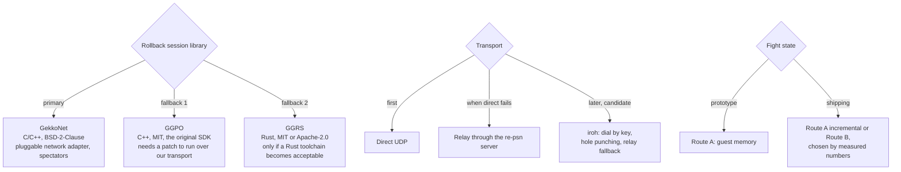
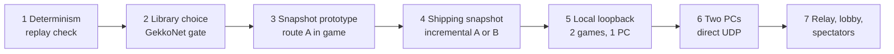

# Rollback netcode: how it works and how this port will do it

Status: **experimental.** A new install turns it on for Online Battle: the players meet in the game's own Friendly Match room
over a [re-psn](https://github.com/undecuple/re-psn) server and rollback runs the fight (US 1.00 disc only; [ONLINE.md](ONLINE.md),
[TESTING_ONLINE.md](TESTING_ONLINE.md)). The settings window's Online tab turns it off, and Online Battle then uses the game's
original peer-to-peer code. Turned off, the game runs exactly as before. The start-up paths for tests (direct IP, a re-psn room
by role) are in [section 5](#5-try-it-experimental-direct-ip-rollback). This page explains rollback in general, then how this
port adds it, what it is built on, and what we fall back to. The roadmap item is [ROADMAP.md, section 4](ROADMAP.md).

## 1. What rollback netcode is

In a fighting game every player's machine runs the whole match. Only the **inputs** (buttons and sticks) travel over the
network, never the fight itself. The hard part is that a remote player's input for a frame arrives some milliseconds late.

There are two ways to deal with that.

**Delay-based netcode** holds the game back until both inputs for a frame have arrived. Every local input is delayed by
the network latency, so the game feels sluggish, and any stall stops it.

**Rollback netcode** never waits:

1. Each frame, your own input is used at once.
2. For the remote player, the game **predicts** the input. The usual guess is "the same as last frame", which is right most
   of the time, because buttons are held for many frames.
3. The game keeps a **snapshot** of the fight state for each recent frame.
4. When the real remote input arrives and differs from the guess, the game **rolls back**: it loads the snapshot of that
   frame, replays the frames from there with the correct inputs, and shows the corrected present. This happens within one
   frame, so the player sees at most a small correction instead of lag.

Most implementations also add a small fixed input delay (1 to 3 frames) to make rollbacks shorter and rarer.



Rollback only works if three things hold:

- **Determinism:** the same starting state and the same inputs must give exactly the same result on every machine, every
  time. Any hidden input (a clock, a random number not shared, a thread running at a different speed) makes the games drift
  apart.
- **Save and load:** the fight state must be saved and restored quickly, every frame, completely.
- **Fast re-simulation:** replaying several frames must fit inside one frame's time, without drawing them.

## 2. How it fits J-Stars Victory VS+

### What the game already gives us

| Property | What we found | Why it matters |
|---|---|---|
| Fixed step | The game runs its fight simulation at a fixed 30 ticks per second, one step per loop, with no real-time clock read in the step | Rollback counts in ticks, and every machine steps the same way |
| One random number source | Fights draw from one xorshift128 generator, seeded per scene from a value stored in the match setup | We share the seed, so both machines draw the same numbers |
| No clock in fighter code | Fighter logic reads no wall-clock time | No hidden input |
| Pads read once per tick | Inputs enter the simulation at one place per tick | That is where remote inputs are fed in |
| Recorded inputs replay the same | Two runs with the same seed and the same per-tick inputs gave the same per-tick state hashes, with ticks counted from the fight's start. The fight starts a few ticks earlier or later from run to run, before any input matters. | The determinism check that rollback needs |

The original game's online mode (PSN) is not used for rollback. Rollback matches use the **local versus mode**. The remote
player is fed in at the pad layer, as if a second controller were plugged in. The original online menus stay as they are
for re-psn play.

### The plan



Each tick:

1. The port reads the local pad and hands it to the **rollback session**. The session sends it to the other players and
   returns the inputs to use for this tick: real ones where they have arrived, predicted ones where not.
2. If a late input contradicts an earlier prediction, the session asks the port to **load** the snapshot of that tick and
   **advance** again with the corrected inputs, without drawing, up to the current tick.
3. The session asks the port to **save** the state of the new tick.
4. The game draws the current tick.

The session library does the bookkeeping: inputs, prediction, when to roll back, and how far. The port does the
game-specific part: feeding inputs at the pad layer, saving and loading the fight state, and advancing a tick without
drawing.

### Saving the fight state: two routes

| Route | What is saved | Pros | Cons |
|---|---|---|---|
| **A: guest memory** | The game's memory, as the port's runtime holds it: program data, thread stacks and the heap, minus the regions that the graphics side reads while the game runs | Needs no knowledge of the game's objects; it misses nothing that lives in memory | Large. The heap alone is about 135 MB, too much to copy every tick. A shipping version would copy only the pages that changed since the last save. |
| **B: the game's own fight state** | Only the objects that make up a fight: the random number generator, the match setup, fighters, cameras, projectiles and so on | Small and fast | Every piece must be found and understood first, and missing one causes a desync |

We prototype **route A first**. It answers the real questions with numbers: does a restore plus a replay give the same
per-tick hashes, what does a save and a restore cost, and how much memory changes per tick. If it fails, the first
mismatching hash component tells us which piece of state is missing. Route B, or route A made incremental, is chosen from
those numbers.

What route A must handle besides memory: the main thread's registers at the save point, other game threads (they must be
idle or parked at the same point), and host state outside guest memory (timers, audio, files). The prototype keeps the
graphics, audio and file state out of the snapshot. The fight does not read them, so they must not be rewound.

### Higher frame rates

A planned display option draws at 60 frames per second by interpolating between 30 Hz simulation ticks. Rollback stays at
the 30 Hz tick: the extra frames are drawing only. A native 60 Hz simulation would double the rollback cost and is not
planned for rollback play.

## 3. What we use, and what we fall back to



| Part | Primary | Fallback | Why |
|---|---|---|---|
| Session library | **GekkoNet** | GGPO, then GGRS | GekkoNet is C/C++ with no Rust toolchain, so the Windows build on players' PCs stays simple. Its network adapter is pluggable, so our transport sits under it without patching the library. It supports spectators with late join. It passed our acceptance test: it builds with MinGW, and a headless loopback test passed for 2 players, 2v2 with 5 % packet loss and jitter, a spectator rejoining, and determinism, natively and under Proton. GGPO is the most proven but has its own UDP code built in. GGRS needs Rust. |
| Transport | **Direct UDP** | The re-psn server's relay; later iroh | Direct is simplest and fastest. A relay covers players behind routers that block direct links. iroh (peer-to-peer by public key, with hole punching and its own relays) is a candidate. Before we can use it, its unreliable datagrams must be reachable from C, and its build cost on Windows must be acceptable. |
| Matchmaking and lobbies | **re-psn** | | The same server the game's own Online Battle already uses here |
| Fight state | **Route A** prototype | Route B | See section 2 |

Rollback inputs go out every tick as small unreliable packets. A lost packet is covered by the next one, which repeats the
recent inputs. Inputs never wait for a retransmit.

## 4. Steps and where we are



| Step | State |
|---|---|
| 1. Determinism | Done: two runs with the same seed and inputs gave identical per-tick state hashes from the fight's start |
| 2. Library | Done: GekkoNet passed the acceptance test above |
| 3. Snapshot prototype (route A) | Done for correctness. The first run missed the heap and did not match. With the heap saved, the game was restored 60 ticks back and replayed them, and every per-tick state hash matched the first pass. Saving the full 144 MB takes 15 ms and restoring it 23 ms, more than one 33 ms tick together, so copying everything each tick is too slow. Over those 60 ticks, 1,634 of 35,278 memory pages changed. |
| 4. Shipping snapshot | In the build, experimental: each tick saves only the memory pages written since the last save (Windows write watch) into a ring of the last 12 ticks |
| 5. Local loopback | Passed twice, on two successive development builds: two copies of the game on one PC, with 30 ms ± 10 ms of simulated network delay and a warm pipeline cache, played a Free Battle to tick 3329. The 3,299 compared ticks had equal state hashes on both copies, with 139 and 136 rollbacks and no desync. The second run compared 2,843 ticks, all equal, with 115 and 119 rollbacks |
| 6. Two PCs | Opt-in for testing ([section 5](#5-try-it-experimental-direct-ip-rollback)). One match has run on two PCs on one home network, meeting through a room on a re-psn server, with no desync (see [Tested so far](#tested-so-far)); a typed IP address has not been tried on two PCs |
| 7 | Not started |

What does not change: the port connects only for online play, and only to the server and players in the settings. Every
gameplay option in a match is the same for all players.

## 5. Try it: experimental direct-IP rollback

This is for testers. Expect rough edges, and report what you see (with the support bundle) in an issue.

**Turn it on** on both PCs by adding lines to `play_settings.txt` (in the install folder, or
`%APPDATA%\JSP Fan Revival\`; the settings windows keep lines they do not know):

| Who | Lines |
|---|---|
| Host | `JSP_ROLLBACK=1` and `JSP_ROLLBACK_LISTEN=36200` (any free UDP port) |
| Client | `JSP_ROLLBACK=1` and `JSP_ROLLBACK_JOIN=<host IP>:36200` |

Remove the lines (or set `JSP_ROLLBACK=0`) to turn it off again. The same choice is also in the game's own menu: see
"Choose it in the game" below.

**Choose it in the game.** Port Settings (Options, the top row, above Control Settings; on by default, `JSP_PORT_MENU=0` hides it) -> Online. The first row is **Netcode**
(Left/Right):

| Netcode | What it is | Rows under it |
|---|---|---|
| Off | no online play | none |
| Delay (the game's own online) | the game's own netcode over re-psn or a community server (`repsn.ini` / `community.ini`, as before) | Method (re-psn / Community server), Server, Online name, Community preset |
| Rollback (experimental) | the rollback path of this section, two players, direct IP or through a re-psn room | Connection (Direct IP / re-psn), Role (Host / Join), then Port (host) or Host address (join) for direct IP, or Allow relay for re-psn |
| Online Battle + rollback | the default after install: the game's own Online Battle over re-psn (`repsn.ini` `enabled=1`) with `JSP_ROLLBACK=1` and no role key; a Friendly Match room pairs the players and rollback runs the fight (US 1.00 disc only) | Server, Online name, Allow relay |

Cross on Port, Host address, Server or Online name opens the pad letter picker the page already had. **Save (applies on
the next start)** writes the choice; Discard changes reads the files again; Circle leaves without saving. Under the rows
the page says which method is on and what this session runs against what is saved.

- One method at a time. Netcode is one choice, so the page never turns both on. Save writes the method that is going off
  first (Rollback: the online files, then `play_settings.txt`; Delay or Off: `play_settings.txt`, then the online files),
  so a failed or interrupted save never leaves both on.
- Rollback is stored in `play_settings.txt`: `JSP_ROLLBACK=1` plus `JSP_ROLLBACK_LISTEN=PORT` (host) or
  `JSP_ROLLBACK_JOIN=IP:PORT` (join). Turning it off writes `JSP_ROLLBACK=0` when the file already has the line or the
  environment holds `JSP_ROLLBACK` (the launcher's file line wins over an inherited variable, so a removed line could leave
  it on); otherwise the line stays absent. `0` is off for every reader. The remembered port or address stays (inert without
  `JSP_ROLLBACK=1`); other lines of the file are kept. The launcher turns every line into an environment variable before
  the game starts, so a variable set by hand does the same.
- Next start, always. The snapshot defaults are set before `main()` and the hooks are installed once at start-up, and the
  online files are read before `main()`; the page shows "This session: X. Saved: Y. Restart to apply." when they differ.
- A hand-edited pair (a non-zero `JSP_ROLLBACK` and the game's own online both on) is refused before `main()` by one decision
  (`jpno::resolve_env` in `jsp_net_online.h`, taken once both static constructors have run: the rollback one and the online
  boot of `jsp_online.cpp`, whose order is unspecified, so the last to arrive decides; the log line
  `[net] env decision: ...` shows the order). A refusal sets none of the rollback defaults, sets `JSP_ROLLBACK=0` and
  `JSP_NET_REFUSED=1` (for the pair it also removes `PS3_NET_ONLINE`), so neither runs: the game's own online needs
  `PS3_NET_ONLINE` in every gate (`np_psnr_enabled`, the net-control state, the host socket registration), so `PSNR_SERVER`
  and the other online keys stay inert without it. The page then shows "This session: refused" and, for the saved pair, Off
  with a message: it never picks for the player. Because the original value is gone after a refusal, saving Off or Delay
  while `JSP_NET_REFUSED` is set writes `JSP_ROLLBACK=0` even with no line in the file, so the next start is not refused
  again. The same decision refuses Rollback alone when a role key is invalid (both `LISTEN` and `JOIN`, a bad port or
  address, `VIA=repsn` without `ROLE`; it also sets `JSP_NET_REFUSED`). `JSP_ROLLBACK=1` with no role key at all is the lobby
  start: everything is set up as for a match, but no session opens at start. With the game's own online on (re-psn) it is
  Online Battle + rollback, not a refused pair: once this game is in a Friendly Match room with exactly one other player, the
  port opens a rollback link to that player through re-psn (`jsp_net_lobby.h`, native-room pairing in `jsp_net_game.cpp`; `JSP_ROLLBACK_NATIVE=0`
  turns it off), and rollback runs the room's fights. Without the game's own online such a start plays offline. "Online on" is the
  runtime's own test: any value of `PS3_NET_ONLINE`, even `0`.
- A refused start is shown on screen, not only in the log: see "If rollback does not start" below.
- ASSUMPTION: the runtime reads `PS3_NET_ONLINE` lazily (after `main()`) and nothing in the jsp exe sets it later, so
  removing it before `main()` is enough; the thread registry's TLS callback still reads `JSP_ROLLBACK` at process attach,
  before any decision, and turns the registry on (bookkeeping only) even for a refused start.
- The Rollback choice is in every build of the port (the target always defines `JSP_ROLLBACK_BUILD`), release builds included.
- Both players need the same release. The two games compare a build id before the match and refuse a different one;
  the id comes from the release content (version, game region, glue sources and the patched toolkit's sources,
  `installer/port/jsp/jsp_build_id.cmake`), so two
  PCs that each built the same release agree. Before 0.5.1 it came from the compile time, so two installs refused each
  other. CMake prints it at configure ("Rollback build id"); the game logs it in the `[net] rollback opt-in` line.
- Mods (the mods folder, in progress): a set of gameplay mods is folded into that build id (the first 32 bits of SHA-256 of
  the id and the set's digest, `installer/port/jsp/jsp_mods_glue.h`), so two games match only with the same release and
  the same gameplay mods; with no gameplay mod the id is unchanged. Gameplay mods that were listed but could not all be
  applied refuse rollback (`[mods] rollback refused`), and so does a copy of an archive a gameplay mod changes (the disc copy
  or an hdd0 install copy, all checked at start) that differs from the planned copy. Such a copy that the game first opens
  later stops a rollback session that has not sent its settings Hello yet (`[net] rollback refused: the mod set does not
  run as listed`); a session already past it is not ended. The game logs the folded id as
  `[mods] set: gameplay digest ..., net build 0x... (stock 0x...)`. Host-tested, not yet run in a game.
- Not covered: the page has not been run in the game and there is no screenshot of it (layout is from the code: rows at
  pitch 40, 188 + 40 i; the longest new strings are 38 characters at scale 1.0 and were checked by the host test); the
  start decision and the refusal are host-tested and the wiring is compile-checked, not run in a game; hostnames in the join
  address are not accepted (IPv4 only, like the direct-IP join).

**Network:** the host receives on that one UDP port. On a home network that just works; over the internet the host must
forward the UDP port on the router (and allow it in the firewall). The client needs no open port. There is no lobby yet.
Over re-psn instead of a typed address (with an optional relay): see "Rollback over re-psn" below.

**What happens:**

1. Both games start as usual. Once each has finished starting up, the client connects to the host. The client shows
   *Waiting for host...* and the host *Waiting for client...*; holding F9 for 1.5 s cancels (a tap does nothing).
2. The host's match rules (input delay `JSP_INPUT_DELAY`, 0 to 8 ticks, default 2; the reconnect grace time
   `JSP_NET_GRACE_S`, 1 to 30 s, default 5; the match timer) are sent to the client for this match only. The client shows
   *Settings received: controlled by host*. Your own settings come back when the match ends; nothing is saved. Settings that
   only apply at start-up must already be the same on both PCs (for example the KO count, the 60 fps drawing mode, and the
   cheats, which must be off); otherwise the match does not start and both PCs show which setting differs.
3. Both players set up the same **Free Battle** fight on their own PC: menus and character select are not linked yet. The
   rollback session starts at the first tick of the fight. The host plays as player 1, the client as player 2.
4. During the fight only inputs travel. If no input arrives for over a second the screen shows *Reconnecting... N s*;
   holding F9 for 1.5 s ends the match. If the other PC stays silent past the grace time (5 s by default), the match ends
   with *Opponent disconnected*. A detected desync ends the match too. After any of these the fight continues offline on each PC.

**Known limits (experimental):**

- Free Battle only, one player per PC (two players on two PCs). The session layer handles up to four players on two PCs,
  but the game side is not wired for it yet.
- Barely tested on two PCs: one match on one home network, through a re-psn room (see [Tested so far](#tested-so-far)).
  Two copies on one PC have passed two Free Battle runs with rollbacks and no desync (see step 5 above).
- On a first launch (or after an update that empties `pipelines.bin`) the graphics pipelines are built in the background, as offline:
  a new effect may be missing for a few frames on that PC, but its builds no longer hold the drawing thread and so the other PC.
  An offline fight first still makes the first match look complete.
- Workaround to replace: the snapshot waits for the game's frame threads to pause before each save; if they have not
  paused within 15 s of waiting between two session updates, the match ends as hung. The session keeps its connection
  alive while it waits.
- Menus, character and stage selection are not synchronized; both sides must pick the same fight.
- Every rollback match uses the same fixed random seed (the host's own seed is not applied yet).
- An earlier freeze after a rollback (an SPU job running across the saved tick) is now avoided by waiting for the job
  server before each save; it has not recurred in the runs above.
- When a match ends early (disconnect, desync, F9), the fight continues offline; there is no return to the menu for both.
- The log grows quickly while a match runs (per-tick lines for checking); a support bundle includes it and the one of the launch before, and its `facts.txt` sums up the `[net]` lines (started or refused, path, synchronized, rollback and desync counts, the last status line of the [status badge](#rollback-status-badge)) before the size cap shortens the log.
- Rollback over re-psn has run once against a real server, on one home network; it has not been tried across real routers, and the relay has not been used yet (see its section below).

### Rollback status badge

Opt-in, off by default (display only). With `JSP_ROLLBACK_BADGE=1` in `play_settings.txt` (the launcher passes the line on, as
for every key; there is no box in the launcher or row in Port Settings yet), a running rollback match shows one small line in
the top-left corner, above the fight HUD's top bar:

`Rollback | direct | delay 2f | last 3f`

| Part | What it is | Where the value comes from |
|---|---|---|
| path | `direct`, or `relay` when the match goes through the re-psn server; `-` before it is known | direct IP is always direct; over re-psn, the path the rendezvous chose |
| delay | the input delay of this match in game ticks (30 per second) | the host's `JSP_INPUT_DELAY`, sent to the client in the settings handshake, so both PCs show the same |
| last | how many ticks the last rollback went back and ran again; `-` before the first | counted by the port each time the session rolls back |

The text is rebuilt at most four times a second and redrawn only when it changes. It uses the game font of the port's overlay
(ASCII only, hence `|` and not a middle dot) on the same overlay layer as the match messages (*Reconnecting...*, *Opponent
disconnected*), which stay at the bottom left; the badge goes away when the match ends. The switch is read once at start-up.

Whether the switch is on or off, the game writes the same values to its log: `[net] status badge: on` (or `off`) at start,
then `[net] status: path direct, delay 2f, last rollback 3f, largest 7f, rollbacks 12` every 30 s of a match and once when it
ends. A support bundle's `facts.txt` shows, in its Netcode section, whether `JSP_ROLLBACK_BADGE` is on in the settings and, for
each of the last two launches, the last status line (program words and numbers only: no address or name).

What has run and what has not: the text, the values, the refresh gate and the layout have a host test
(`bash installer/tools/net_badge_test.sh`, which also checks that the bundle reads every status line the game can write), the
bundle's summary is tested in `installer/tools/support_bundle_test.py`, and the game code is compile-checked (MinGW-w64). **The
badge has not been seen on screen yet:** no game was run with it. The place above the top bar was measured on a fight screenshot
of the original HUD size; it was not checked against every stage, a smaller HUD size or the training screen. If another part of
the port closes the overlay layer during the match, the badge is drawn again within a quarter of a second; a part that draws
its own page on that layer while a match runs would lose it when the badge text changes (none is known to do so during a fight).

### Ping counter

On by default (display only; `JSP_ROLLBACK_PING=0` in `play_settings.txt` hides it, read once at start-up). While a rollback
match runs, the round trip to the other player shows in small game-font text right under the fight timer, at the bottom right,
for example `62 ms`, so players see what kind of connection they are in. The value is GekkoNet's averaged round trip, the one the
adaptive input delay reads; over the relay it is the round trip through the server. It includes up to one tick (33 ms) of answer
wait, so a 30 ms link reads about 60-95 ms. Nothing shows until the first measurement; above 999 ms it reads `999+ ms`. The
tint follows the input delay the link needs: green below 100 ms (1 tick), yellow below 180 ms (2), red above. The text is
rebuilt at most twice a second, on the same overlay layer as the badge and the match messages, and goes away when the match ends.

The place (1280x720 overlay space: right edge x 1204, box y 680-704) was measured on fight screenshots below the timer bar's
lower rule (y 675), clear of the minimap above it and the player panel at the bottom left. Text, rounding, clamping, tint,
refresh and layout are in `installer/port/jsp/jsp_net_badge.h` with a host test (`bash installer/tools/net_badge_test.sh`).
**Not seen on screen yet:** no game was run with it, and it was not checked against a smaller HUD size or every stage.

### Replays of rollback matches and the rollback bench

Opt-in, off by default. Both use the session library's own replay and stress sessions, so they need no extra game code beyond
what a rollback match already runs.

**Record a match.** With `JSP_ROLLBACK_RECORD=1` in `play_settings.txt`, each PC saves its rollback match when the match ends,
to the folder `replays` in the game's working folder (`game\run\replays\`, next to `play_stderr.txt`), or to the folder
`JSP_ROLLBACK_RECORD_DIR` names. The file is `rollback-<date>-<time>-<build>-<host|join>.gkrp`: the confirmed inputs of every
tick and the state hash of every confirmed tick, about 12 KB for 700 ticks of two players. It also stores the build number,
the base tick, the slots and every agreed setting of the match. The log says `[net] replay saved: <path> (<bytes> bytes)`.

What a replay is for, in order:

1. **Desync hunting:** played back, a replay names the first tick whose state differs from the recording.
2. **The rollback bench:** the same inputs, run again with forced rollbacks of a chosen depth, give the cost of a rollback in
   this game (restore, re-simulated ticks, saves) on a real fight. Those numbers decide the input delay, the prediction
   window and whether run-ahead fits in a 33 ms tick.
3. Later: watching a match again, spectators, and checking ranked results.

**What runs today:** the session layer records, plays back and runs the forced-rollback (stress) mode, tested on the host
(`bash installer/tools/net_session_test.sh`: the `record_replay` scenario plays both peers' recordings of a match with 20 %
packet loss back, and every one of the 684 replayed ticks had the live run's hash; a state flipped at tick 300 is reported at
exactly tick 300; the stress runs roll back 1 to 10 ticks every tick, and a re-simulation that differs is reported at its tick).
The game saves the recording (compile-checked only, not run in a game). **Not yet:** playing a replay back inside the game,
which needs the same fight start (characters, stage, seed) the recording began from.

**The rollback bench (test tooling).** `JSP_ROLLBACK=1` with `JSP_ROLLBACK_BENCH=N` (N from 1 to 8) in `play_settings.txt`, and no
`JSP_ROLLBACK_LISTEN`, `JOIN` or `VIA`: no peer and no socket. From the first tick of the next fight, every tick rolls the fight
back N ticks and runs them again, the worst case of a match whose remote inputs are always N ticks late. Play the fight against
the CPU: only player 1's pad goes through the rollback path, and a second human pad would be read live on a re-run. F9 held
for 1.5 s ends it. Every 10 s the log gets one line, and one more for the whole run when it ends:

`[bench] window depth=4 secs=10.0 live_ticks=300 (30.0/s) rerun_ticks=900 | iter ms live avg … max …, rerun avg … max …, idle … | save avg … max … (n), restore avg … max … (n) | desyncs 0 first -1`

| Value | What it tells |
|---|---|
| live ticks per second | 30 means this rollback depth fits in the frame budget; below 30 the game slows down under it |
| iter ms live / rerun | the wall time of a main-loop iteration that ran the live tick or a re-run tick (re-runs are not drawn) |
| save / restore | the snapshot ring's commit and restore calls |
| desyncs | ticks whose re-run differed from their first run: fight state the snapshot does not cover. Should be 0 |

Run it at depths 1, 2, 4 and 8 on the same stage. The numbers decide the input delay, the prediction window and whether
run-ahead fits (see [ROADMAP.md, section 4](ROADMAP.md)). Host tests: the start decision in `net_online_test.sh`; the stress
session in `net_session_test.sh`.

**Run in the game (one PC, 2 vs 2 Free Battle, all four CPUs, 2026-11-20/21).** 0 desyncs in every run. Depth 1 saves every tick
and never restores (a rollback to the tick just saved is skipped: restoring it only undid what background threads wrote since,
and the loading screen before the fight never finished), so it measures what a match with no late inputs costs:

| Depth | Before | After the save-cost work below |
|---|---|---|
| 1 (save every tick) | 29.0 ticks/s, save 21 ms | 29.7 ticks/s, save about 12 ms |
| 2 (every tick rolled back 2) | 11-13 ticks/s, save 15-18 ms, restore 13-22 ms | 15-18 ticks/s, save 11-12 ms, restore 10-14 ms |

Where a save's time goes (depth 1, averages): freezing the threads until the job server and the frame pipeline are parked about
6.9 ms (2 to 3 freezes), copying about 3,500 dirty pages 2.1 ms. The worst save was 50 ms every 2 s (the thread audit's
Toolhelp listing), now about 17 ms.

**Save-cost switches.** Rollback sets these by default; each can be set to 0 (or another value) for an A/B run:
`JSP_SNAPSHOT_LWM_CACHE=keep` (the lwmutex census keeps its page-readability cache: 2.3 ms to 0.007 ms per frozen sample, with
toolkit patch 7921), `JSP_SNAPSHOT_LAYOUT_GEN=1` (no per-tick layout walk while patch 7920's generation is unchanged: 2.8 ms),
`JSP_SNAPSHOT_QUICK=1` with `JSP_SNAPSHOT_QUICK_WAIT_US=0` (a frozen sample whose job words block is refused before the full
census; waiting unfrozen for the jobs did not help, they did not drain in 4 ms), `JSP_SNAPSHOT_AUDIT_ASYNC=1` (the thread audit's
listing on its own thread). Off by default, for tests: `JSP_PAD_PEEK=1` (the local pad is read from the device at the tick
boundary instead of from the game's read one tick earlier, toolkit patch 7922), `JSP_NET_LINK=delay_ms,jitter_ms,loss_permille`
(two copies on one PC: impairs this copy's sends after the plan exchange). `JSP_SNAPSHOT_CENSUS_PROF=1` logs the census parts.

**Restore waits for the helper threads (`JSP_SNAPSHOT_SITE=1`, on by default in rollback matches).** A restore rewinds memory, including a helper
thread's stack and the work queue it serves, but not the thread itself. Example: a CRI loader worker takes a job after a save,
then a restore rewinds memory while the worker is parked inside that job. The worker then runs on with a stack from before the
job, and the main thread's load wait never ends. This happened once in a replay-driven depth-2 run, at tick 798.

With the switch on, a restore waits until every thread that was parked at the target tick's save is parked at the same wait
site again (marker kind, id and caller). After `JSP_SNAPSHOT_SITE_MS` (default 50 ms) it goes ahead anyway, so a thread that
has moved on for good cannot stall the match. The log line `[snap] site ...` names the thread and both wait sites.

**Soak result (replay-driven depth 2, about 3,200 restores).** About a third of all restores found a moved thread. Most were the CRI
server's polling thread caught awake. A few were a loader worker caught inside its file read (from its idle wait at `0x004D3D4C` to
`0x004B7908`), the case behind the freeze. Desyncs stayed at 0, restores averaged 10.7 ms, and 4 waits ran past 50 ms.
`JSP_SNAPSHOT_SITE=0` turns it off.

**GekkoNet's sparse saving does not pay here (`JSP_ROLLBACK_LIMITED_SAVING`, tried 2026-11-21).** A state can only be saved while the game is at
that tick, and a peer that predicts is always ahead of the confirmed tick. So to save a confirmed tick, GekkoNet rolls back to its last save and runs
the whole prediction window again: in a two-copy match over a 66 ms link it went back 9 ticks about every 9 ticks, twice the simulation to skip a save.
Instead, two cheaper changes are on by default in rollback (2026-11-21):

- **Saves that can never be loaded take no snapshot (`JSP_ROLLBACK_SKIP_FINAL=1`).** A rollback always loads the frame before the first
  wrongly predicted one, and that frame's inputs are not confirmed yet. So once every player's inputs past a frame have arrived, its save is never
  loaded again: it gets its checksum (desync detection still sees every tick) but no freeze and no copy. This needs `gekko_final_frame`, a small local
  addition to the vendored GekkoNet (`installer/port/jsp/gekkonet/PIN.md`), and a snapshot ring that accepts gaps. The more input delay covers the
  latency, the more saves are skipped: in a two-copy match over a 66 ms link, 58% of one copy's saves and 8% of the other's.
- **The save gate waits for the job threads without freezing (`JSP_SNAPSHOT_QUICK_WAIT_US=20000`) and the frozen layout walk runs every 30th gate
  (`JSP_SNAPSHOT_FROZEN_WALK_EVERY=30`).** Replay-driven depth 2, same build: 13.1 → 16.1 ticks/s, save 12.9 → 8.3 ms, restore 16.4 → 12.7 ms,
  0 desyncs.

**Determinism between two PCs: everything the game times must follow the game tick.** Two copies on one PC (66 ms simulated link, recorded inputs)
desynced 30-80 s into every fight while every input matched. Each cause below was found with the two-copy logs (per-tick checksum parts, then a hardware
write watchpoint on the word or camera that split) and fixed in turn; the first run with all of them matched on all 7,860 compared ticks over the full
10-minute test window, through the round's time-up (where every earlier run split). In order of discovery:

1. *Audio clock* (patch 3005, `JSP_AUDIO_TICKLOCK`): the mix thread mixes 6.25 blocks per tick; the boundary waits until the game's audio thread took
   them; a rollback rewinds the host read index to what the save holds (the save of tick T is taken before the boundary raises the audio to tick T, so the
   rewind goes to the blocks of T-1: rewinding to T dropped 6-7 blocks per rollback); re-runs are muted. About 0.1 ms per tick.
2. *Guest clock of the main thread* (patch 3006, `JSP_NET_GUEST_CLOCK`): session start + 1/30 s per tick (+1 us per read), for the timebase and
   `sys_time_get_system_time` (one reading).
3. *vblanks* (`jsp_stepper.cpp` lockstep clock): the game counts vblanks; in a match every flip gets exactly 2 (as in re-runs), held to 33.3 ms; the idle
   vblank only after 500 ms without a flip (at 50 ms, slow rollback ticks added 150-200 extra per copy); and an iteration where no tick may run waits at the
   boundary (up to 400 ms) instead of running a render-only frame that flips.
4. *The sound library's server thread* ("CRI Server Manager", `JSP_NET_CRI_LOCK`): the only other thread reading the clock; its sleep (usleep from
   0x004D4F2C) waits for the game (patch 3006 `g_ps3_usleep_hook`) and runs one cycle per tick at the tick's time. About 1 ms per tick.
5. *Background work finishes before the next tick*: the sound library's file threads ("CRI FS ...", idle at lr 0x004D3D4C) and SPU jobs
   (`jsp_snapshot_spu_busy`) are idle at every boundary, before and after the server's cycle.
6. *Registers of parked threads* (patch 7923 `ps3_ppu_thread_ctx`, `JSP_NET_THREAD_REGS`): saved at every commit and written back at a rollback for the
   sound library's threads parked in the same wait (a loop keeps values in registers, which the memory snapshot does not cover).

The playback count at `0x0094DEC4` (once taken for a scene step) is also out of the per-tick checksum. Diagnostics used, all off by default:
`JSP_NET_TASK_WATCH` / `JSP_NET_CAM_WATCH` (watchpoints with the writer's call chain, symbolized with llvm-nm), `JSP_NET_CLOCK_DIAG` (who reads the
clock), `JSP_NET_LOAD_DIAG`, `JSP_NET_PAGE_DUMP=N` (fingerprints of guest pages, to find the first that stop matching between two copies),
`JSP_NET_TICK_LOG=1` (the per-tick commit / rollback lines the two-copy test compares; off in play, they are an unbuffered write each).

Ruled out on the way: a session start at the first fight HUD draw (`JSP_ROLLBACK_START=fight`) gives each PC a different number of pre-session ticks,
and per-tick state the checksum does not cover drifts (the CPU opponent acted on one copy only); neutral input until the fight HUD
(`JSP_NET_LOAD_NEUTRAL=1`) leaves the first pre-fight screen waiting for a press forever.

**Match reports for testers.** A match that ends on a desync, a failure or a disconnect writes `reports/jsp-match-report-<date>-<time>.txt`
(`JSP_NET_REPORT_DIR`): build, settings in effect, session facts, the last 120 confirmed-tick checksums and rollbacks, the end reason. IP addresses,
the user's folders and the machine and user names are removed (`jsp_net_report.h`, host test `net_report_test`).

### Switches

Each is a `play_settings.txt` line (or an environment variable). Test-only switches are for two-copy and A/B runs, not for play.

| Switch | What it does | Test-only |
|---|---|---|
| `JSP_ROLLBACK_NATIVE` | native-room pairing in the lobby start (Online Battle + rollback); on by default, `0` turns it off | no |
| `JSP_ROLLBACK_RELAY` | allow the server's relay when the direct link fails (the defaults after install set `1`) | no |
| `JSP_INPUT_DELAY_AUTO` | input delay follows the measured link (each PC sets only its own); on by default, `0` keeps the start value | no |
| `JSP_INPUT_DELAY_AUTO_MIN`, `_MAX`, `_MARGIN_MS` | its range (default 1 to 4 ticks) and margin (default 8 ms) | no |
| `JSP_INPUT_DELAY_RULE` | `2` (default): ticks = ceil((one way from the median of the last 8 s of round trips + (90th percentile - median) + margin) / 33.3 ms), margin 16 ms from a median of 80 ms, first reading 4 s after the sync (before 10 s: the spread mirrored from the low side, and at most start + 1 tick), one tick up after two rollbacks deeper than 2 ticks within 10 s (then held 20 s), down one tick after 10 calm seconds (`jsp_net_delay_rule.h`). `1`: the earlier rule (GekkoNet's average ping and an EMA of its jitter, first reading at 10 s) | A/B |
| `JSP_INPUT_DELAY_AUTO_FIRST_MS`, `_PCT`, `_SAMPLES`, `_HIGH_PING_MS`, `_HIGH_MARGIN_MS`, `_UP_VOTES`, `_DOWN_VOTES`, `_DEEP_TICKS`, `_DEEP_COUNT`, `_DEEP_WINDOW_MS`, `_HOLD_MS` | rule 2's tuning (defaults 4000, 90, 16, 80, 16, 1, 5, 2, 2, 10000, 20000; `_DEEP_COUNT=0` turns the depth trigger off) | A/B |
| `JSP_ROLLBACK_PREDICTION` | how many ticks a PC may run ahead on predicted inputs before it waits, which caps the deepest rollback (1 to 8, default 6; `8` = as before); each PC alone | no |
| `JSP_ROLLBACK_PING` | the [ping counter](#ping-counter) under the fight timer; on by default, `0` hides it | no |
| `JSP_POSTGAME_IDLE_SECS` | after a fight, seconds without a locked pick before the side leaves (10 to 3600, default 180) | no |
| `JSP_ROLLBACK_RECORD`, `JSP_ROLLBACK_RECORD_DIR` | save each match's confirmed inputs as a replay (off by default) | no |
| `JSP_NET_REPORT_DIR` | folder of the match reports (default `reports`) | no |
| `JSP_AUDIO_TICKLOCK`, `JSP_NET_GUEST_CLOCK`, `JSP_NET_CRI_LOCK`, `JSP_NET_THREAD_REGS` | the determinism fixes above; on in a match, `0` turns each off | A/B only |
| `JSP_ROLLBACK_SKIP_FINAL`, `JSP_SNAPSHOT_COPY_THREADS` (3), `JSP_SNAPSHOT_PRECHECK_US` (20000), `JSP_SNAPSHOT_AUDIT_EXEMPT`, `JSP_SNAPSHOT_LWM_CACHE`, `JSP_SNAPSHOT_LAYOUT_GEN`, `JSP_SNAPSHOT_QUICK`, `JSP_SNAPSHOT_QUICK_WAIT_US`, `JSP_SNAPSHOT_FROZEN_WALK_EVERY`, `JSP_SNAPSHOT_AUDIT_ASYNC`, `JSP_SNAPSHOT_SITE`, `JSP_SNAPSHOT_SITE_MS` | snapshot speed-ups, set by default in rollback; `0` turns each off | A/B only |
| `PSO_ASYNC` | pipelines built on worker threads, on as offline (rollback no longer sets `0`: the bench crash was the blob count race toolkit patch 2072 fixed); `0` builds them on the drawing thread | no |
| `JSP_STEP_SKIP_DRAWS` | skip the draws of re-run frames (with `JSP_STEP_TURBO`); off offline, a rollback match sets `1` (`jsp_net_online.h`), `0` draws them | no |
| `JSP_NET_STICK_DEADZONE`, `JSP_NET_STICK_LEVELS` | send the sticks with a dead zone or fewer steps (off by default) | yes |
| `JSP_ROLLBACK_LIMITED_SAVING`, `JSP_ROLLBACK_START=fight`, `JSP_NET_LOAD_NEUTRAL`, `JSP_PAD_PEEK`, `JSP_SNAPSHOT_PREWAIT`, `JSP_SNAPSHOT_QUICK_SLEEP` | alternatives that were tried; off by default | yes |
| `JSP_FIGHT_HASH_SCENE`, `JSP_FIGHT_HASH_FIGHTER`, `JSP_FIGHT_HASH_CAM_CACHE` | `1` puts the playback count, the fighter part or the old camera range back into the checksum | yes |
| `JSP_ROLLBACK_BENCH` | the local rollback bench (no peer) | yes |
| `JSP_ROLLBACK_INPUTS`, `JSP_ROLLBACK_INPUTS_SKIP` | feed the local player from a recorded fight (`replay_dump` csv) | yes |
| `JSP_NET_LINK` | simulated delay, jitter and loss on this copy's sends | yes |
| `JSP_ROLLBACK_NATIVE_COMM` | `same` keeps the title's communication id for the rollback rooms | yes |
| `JSP_ROLLBACK_ROOM` | join that rollback room id, not the oldest (set by a Discord Join) | internal |
| `JSP_ROLLBACK_ALLOW_DEBUG` | turns off the handshake's debug-switch refusal and allows the test knobs below | yes |
| `JSP_ROLLBACK_FORCE_RELAY` | skip the direct try and use the relay at once (only with `JSP_ROLLBACK_ALLOW_DEBUG=1`) | yes |
| `JSP_ONLINE_VERSUS_DEFAULT` | `1`: with two humans in a Friendly Match, put them on opposite teams (off by default) | no |
| `JSP_NATIVE_TRACE` | trace of the game's own online and an autopilot into a Friendly Match | yes |
| `JSP_NET_TICK_LOG`, `JSP_NET_PAGE_DUMP`, `JSP_NET_TASK_WATCH`, `JSP_NET_CAM_WATCH`, `JSP_CAM_DUMP`, `JSP_NET_CLOCK_DIAG`, `JSP_NET_LOAD_DIAG`, `JSP_SNAPSHOT_CENSUS_PROF`, `JSP_SNAPSHOT_COST_WINDOW_S`, `JSP_SNAPSHOT_AUDIT_PERIOD_MS` | diagnostics and measurement lines | yes |

The Discord switches (`JSP_DISCORD`, `JSP_DISCORD_APP_ID`, `JSP_DISCORD_AUTO_ACCEPT`, `JSP_DISCORD_AUTO_NAV`, `JSP_DISCORD_CHAR_ART`,
`JSP_DISCORD_REGISTER`, `JSP_DISCORD_JOIN`) are in [DISCORD.md](DISCORD.md).

### Rollback over re-psn (experimental)

Instead of typing an address, the two players can meet in a room on a re-psn server (the same server and online name as the
game's own online, `repsn.ini`; see `docs/ONLINE.md`). **It has run once against a real re-psn server, with two PCs on one
home network (see [Tested so far](#tested-so-far)). It has not been tried across real routers (NATs), and the relay has not
been used yet.** Host tests also run it against a fake server that speaks the server's documented wire format (below).

**Start both games at about the same time.** Each game looks for the other one for 2 minutes (120 seconds, the
same for both roles), counted from when it has finished starting up, not from when you start it. Two games meet when they
finish starting up less than about 2 minutes apart (a little less: the host's connection and the 2-second list interval
count too). The joining game reads the room list again every
2 seconds until the host's room appears, so either game may start first; starting the host first is still best, because the
joining game then meets it at its first look. The host's room stays listed the whole time it waits. Start-up takes a
different time on every PC (the first start after an update builds the graphics pipelines), which is why the window is
2 minutes and not shorter. If one side gives up, close both games and start again.

**While they wait,** the main menu's top list shows a notice band ("Rollback: room open, waiting for the other player" or
"Rollback: looking for the host's room", with the seconds waited), updated every 10 seconds, and the log gets one line every
10 seconds (`[net] re-psn: room open, waiting for a player with build xxxxxxxx (40 s of 120 s)` or `[net] re-psn: looking for
a host with build xxxxxxxx (40 s of 120 s, 20 room lists read)`). The build number (8 hex digits) is the same one the
`[net] rollback opt-in: ... build xxxxxxxx` line shows: the two players compare it. It includes the gameplay mods, so two
copies of the same version with different gameplay mods have different numbers. These notices have not been seen in a game yet.

**When they do not meet** (on the same notice band and in the log, after `rendezvous failed:`). The band is drawn on the
main menu's top list only: a player who is in another menu or a fight then sees the message when they return to the top list
(for 15 seconds each time it comes up). Any other re-psn failure (the server cannot be reached, the other player cannot be
reached directly, the other player left) is shown the same way. If rollback ends for another reason while the games are
still waiting (for example a gameplay mod refusal), the waiting band goes and that reason is shown on the message line.

| Line | What happened | What to do |
|---|---|---|
| `re-psn: no host with this version found within 2 minutes: ...` | The joining game read the room list for 2 minutes and found no room from the same build with rollback: the host's game had not started, had already given up, or runs another version or other gameplay mods. When it saw a rollback room of another build it says so: `(seen: a rollback room with build xxxxxxxx)` | Start both games at about the same time; compare the build numbers |
| `re-psn: no player with this version joined within 2 minutes: ...` | The host's room was open for 2 minutes and nobody with the same build joined (a player with another build is refused and counted) | The same |
| `re-psn: the host's room did not answer within 2 minutes: ...` | The joining game joined a room but the host's details for a direct link never came within 2 minutes | Start both games again |
| `re-psn: the online server did not answer within 2 minutes: ...` | The game connected to no server in that time | Check the server in `repsn.ini` (see `docs/ONLINE.md`) |

Each of these lines ends with what to check: `start both games at about the same time (the host first is best; each waits
2 minutes after its own start-up); both need the same version (build xxxxxxxx) and the same gameplay mods (or none)`. Version 0.6.0 used a 30 second window
and the lines `re-psn: timed out waiting for the other player` and `re-psn: no rollback room for this build`; in 0.6.0 the
joining game looked only once and gave up at once when the host's room was not there yet. A 0.6.1 game and a 0.6.0 game
cannot meet (their build numbers differ).

**One home network:** the two games try a direct link first. Only if no direct link comes up within 4 seconds is the
server's relay used (and only when Allow relay is Yes and the server offers it). On one home network the direct link normally
comes up well within that time, so the match runs direct even with the relay allowed; the path shown at the start of the match says which.

#### Tested so far

- One match on two PCs on one home network, through a room on a real re-psn server: the games met, the path was direct
  (the relay was allowed but not needed), and 1,500 ticks compared between the two PCs had equal state hashes, with no
  desync (97 and 37 rollbacks).
- It ran with test-harness settings, not as a player would play: scripted inputs, input delay 0, the fixed seed.
- The match ran slowly, at about 4 ticks a second instead of 30, with long pauses of the game. The cause is not known yet.
  That PC's graphics card was busy with other work at the time, but that has not been shown to be the cause.
- A first attempt failed because the two games were started too far apart (0.6.0 waited only 30 seconds; see the 2 minutes above).
- Not tried yet: across real routers, the relay, a typed IP address on two PCs, a match played by hand.

- Set it up by hand, or check what the page wrote: see "Set up rollback over re-psn" just below.
- Turn it on: Port Settings -> Online -> Netcode = Rollback -> Connection = re-psn, Role = Host (creates a room) or Join (joins the
  oldest matching room), Allow relay Yes or No, Save, restart. The server and online name must already be set in `repsn.ini`
  (set them under Delay first; they are kept). By hand: `play_settings.txt` lines `JSP_ROLLBACK=1`, `JSP_ROLLBACK_VIA=repsn`,
  `JSP_ROLLBACK_ROLE=host` or `join`, `JSP_ROLLBACK_RELAY=1` to allow the server's relay (default 0); optionally
  `JSP_ROLLBACK_LISTEN=PORT` to pin the UDP port (firewalls; otherwise any free port).
- One method at a time still holds: the game's own online stays off while rollback runs (the page saves Rollback with the
  game's own online off, and a start with both on is refused).
- How it works (`jsp_net_repsn.h`, `jsp_net_repsn_client.h`): the rollback session's own UDP socket is the peer-to-peer
  socket. The host creates a room that carries a rollback flag and a record `rb=1;ver=<build>` (ASSUMPTION: room flag bit 30,
  `kRoomFlagRollback`); the joiner searches, keeps only rooms with the flag, the same record and a free seat (it looks at
  most at the first 64 rooms of a search), joins the oldest and checks the owner's record. Both then send punch datagrams
  from that socket every 200 ms while the normal handshake runs. If nothing arrives within 4 s the connection goes
  through the server's relay only when the player allowed it and the server offers it; otherwise it ends with the reason.
  The path ("direct" or "relay") is shown for the first seconds of the match (and never replaces a later message). Nothing
  falls back to the game's own online. The host takes the handshake's first message only from the room's other player (the
  endpoint the server gave for that member), so another machine that knows the UDP port cannot take the seat; ASSUMPTION:
  that endpoint is the one the other player's datagrams come from (a router that maps the port differently per destination
  cannot be punched either). A lost server connection or a failed request before a room exists ends the start with a reason.
  `JSP_ROLLBACK_LISTEN`, if set, must be a port from 1 to 65535, or the start is refused.
- The client is the re-psn v0.8.0 C client, which replaces the vendored copy in the toolkit (toolkit patch 7918). The
  callers in the runtime keep their function signatures (compared by declaration text); the game's own Online Battle goes
  through the same client; the rollback runs above did not exercise that path.
- Tests (no game, no GPU, native Linux, loopback only): `bash installer/tools/net_repsn_test.sh TOOLKIT_DIR` runs the
  rendezvous with a fake transport (room flag and record, roles, punch, relay only when allowed and offered, forged or
  mismatched members ignored) and the real transport over the C client against a fake server (HELLO, CREATE / SEARCH /
  JOIN / LEAVE ROOM and their pushes, UDP probe and relay, room ids above 2^32, request bodies compared with bytes written
  out by hand from the protocol's field tables, control and forged relay datagrams never reaching the session).
- Not covered: real NATs (hole punching and relay; one match against a real server on one home network has run, see
  [Tested so far](#tested-so-far)), the connect timing on slow DNS, more than two players, a room list to choose from (the
  oldest matching room is joined), the page and the "direct / relay" line in a running game.

#### Set up rollback over re-psn

Both players do this, with the same server. Rollback over re-psn uses the server and online name from `repsn.ini`, but
the game's own online in that file must stay **off** (`enabled = 0`): `enabled = 1` turns on the game's own online
(Delay), only one online method can be on at a time, and a start with both on is refused, so neither runs.

1. `repsn.ini` holds the server and your online name, with `enabled = 0`:

   ```ini
   [repsn]
   enabled = 0
   server = your.server.example:36100
   name = yourname
   ```

   It is in `<install folder>\shared\repsn.ini` for a portable install, else in `%APPDATA%\PS3Recomp\repsn.ini`
   (`PS3RECOMP_SHARED_DIR` picks another folder). A second `repsn.ini` in the game folder (`<install folder>` for a
   portable install, else `%APPDATA%\JSP Fan Revival\`) can override these keys, so it must not say `enabled = 1` either.
   The easy way: in the launcher's **Online** tab leave the method on **Off**, fill in Server and Online name and save;
   Off writes `enabled = 0` and keeps a valid server and name. Do not choose re-psn or Community there while rollback
   is on: the launcher refuses to save it ("Rollback is on ... only one online method can be active"), and Start Game
   stops with the same message. To use the game's own online again, turn rollback off in Port Settings > Online first.
2. `play_settings.txt` (in the install folder, or `%APPDATA%\JSP Fan Revival\`) gets these lines:

   ```
   JSP_ROLLBACK=1
   JSP_ROLLBACK_VIA=repsn
   JSP_ROLLBACK_ROLE=host
   JSP_ROLLBACK_RELAY=0
   ```

   One player uses `JSP_ROLLBACK_ROLE=host` (creates the room), the other `JSP_ROLLBACK_ROLE=join`. `JSP_ROLLBACK_RELAY=1`
   allows the server's relay when a direct link fails (the server must offer it). Leave out `JSP_ROLLBACK_LISTEN` unless a
   firewall needs a fixed UDP port.
3. Start the game. Port Settings > Online (on by default) writes the same two files: Netcode = Rollback, Connection =
   re-psn and Save write the `play_settings.txt` lines and `enabled = 0` in `repsn.ini`.

#### If rollback does not start

When rollback was asked for but cannot start, the main menu shows why at the top of the screen for 15 seconds, each time
the menu's top list comes up (ENHANCEMENT, display only, on by default; it needs the US 1.00 build, like Port Settings).
The first line says what is wrong, the second how to fix it, for example:

> Rollback is off: repsn.ini has enabled=1 (the game's own online).
> Set enabled=0 in repsn.ini to use rollback (keep server= and name=).

The same reasons are in the log (`[net] REFUSED: ...` or a `[net] ...: off` line in `game\run\play_stderr.txt`); on the EU build, which has no notice, the log is the only place. When both methods were on, the game's
own online is off for that session too, so Online Battle cannot connect either. Other reasons the notice names: no
`JSP_ROLLBACK_ROLE` with `JSP_ROLLBACK_VIA=repsn`; a `JSP_ROLLBACK_LISTEN` that is not a port from 1 to 65535; not exactly
one of `JSP_ROLLBACK_LISTEN` and `JSP_ROLLBACK_JOIN` for direct IP; a `JSP_ROLLBACK_JOIN` that is not IP:port; no valid
`server` or `name` in `repsn.ini`; an online name longer than 16 characters; a UDP port that could not be opened. The
texts are host-tested (`installer/tools/net_online_test.sh`); the notice was seen in one Proton run on US 1.00 with the both-on refusal (shown on the main menu, gone in Options, back after leaving it); other reasons and the EU build were not run.

**Always on, even with rollback off.** None of this changes what the game does; it is listed so nothing is hidden:

- Toolkit patch 7911: one flag load per HLE call, syscall, lwcond wait, event-queue receive (two sites) and semaphore
  wait; the marker is reset at thread start and exit; each lwmutex slot gets a dead flag set on destroy (the slot grows by
  8 bytes, so the 65,536-slot static table grows by 512 KiB).
- 7912: on every fiber switch the HLE marker stack is swapped (two 72-byte copies through a 96-byte stack buffer) and a
  relaxed atomic counter is incremented; the Fiber struct grows by 96 bytes; two thread-locals.
- 7913: two counters (SPURS jobs in flight, SPU async threads running). 7914: one relaxed load per gate site.
  7915: a delivered-vblank counter.
- 7917: one call, one address compare, one counter increment and one NULL check per RSX store, row or word run into guest
  memory, and one counter increment per FIFO drain pass.
- 7918: the toolkit's psnr client (used by the game's own Online Battle) is the re-psn v0.8.0 one; with no re-psn online
  configured it is not used. The UDP mux has two optional hooks (a null test per datagram received and per send) and a
  64-byte larger receive buffer.
- The port: one call and one relaxed atomic load per frame-clock pass (about every 4 ms), a NULL check per setting read,
  a `getenv` on an F9 binding and at static initialisation (the start decision reads the rollback keys and `PS3_NET_ONLINE`
  there once and sets nothing when `JSP_ROLLBACK` is off); the thread registry's TLS callback (two environment reads at
  process start, then one relaxed load and a return on every thread start and exit); a 64 KiB static ring for the RSX
  write log.

## Further reading

- [Rollback Networking in Fighting Games](https://words.infil.net/w02-netcode.html): an illustrated explanation of rollback.
- [GekkoNet](https://github.com/HeatXD/GekkoNet), [GGPO](https://github.com/pond3r/ggpo), [GGRS](https://github.com/gschup/ggrs), [iroh](https://github.com/n0-computer/iroh)
- [ONLINE.md](ONLINE.md): today's online play over re-psn.
