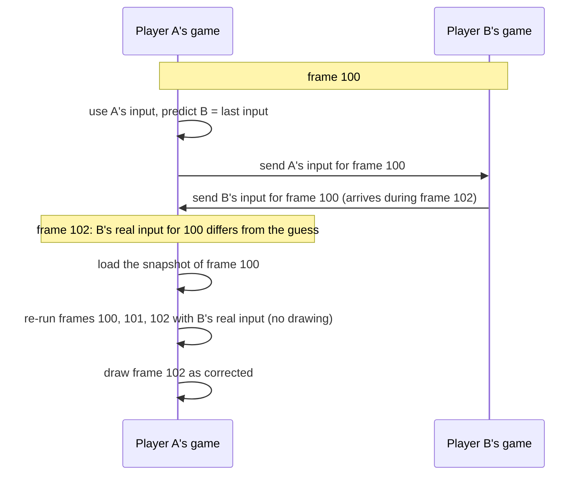
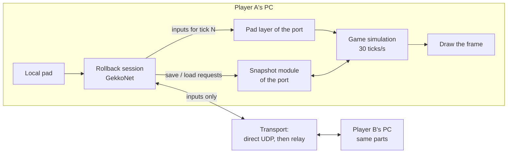
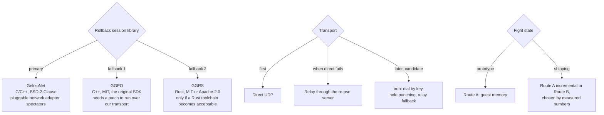
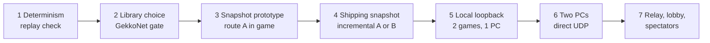

# Rollback netcode: how it works and how this port will do it

Status: **planned, in research.** Nothing in a release uses rollback yet. Today's online play is the game's own Online
Battle over a [re-psn](https://github.com/undecuple/re-psn) server ([ONLINE.md](ONLINE.md)). That uses the game's original
peer-to-peer code, not rollback. This page explains rollback in general, then how this port plans to add it, what it is
built on, and what we fall back to. The roadmap item is [ROADMAP.md, section 4](ROADMAP.md).

## 1. What rollback netcode is

In a fighting game every player's machine runs the whole match. Only the **inputs** (buttons and sticks) travel over the
network, never the fight itself. The hard part is that a remote player's input for a frame arrives some milliseconds late.

There are two ways to deal with that.

**Delay-based netcode** holds the game back until both inputs for a frame have arrived. Every local input is delayed by
the network latency, so the game feels sluggish, and any stall stops it.

**Rollback netcode** never waits:

1. Each frame, your own input is used at once.
2. For the remote player, the game **predicts** the input. The usual guess is "the same as last frame", which is right most
   of the time, because buttons are held for many frames.
3. The game keeps a **snapshot** of the fight state for each recent frame.
4. When the real remote input arrives and differs from the guess, the game **rolls back**: it loads the snapshot of that
   frame, replays the frames from there with the correct inputs, and shows the corrected present. This happens within one
   frame, so the player sees at most a small correction instead of lag.

Most implementations also add a small fixed input delay (1 to 3 frames) to make rollbacks shorter and rarer.

Rollback only works if three things hold:

- **Determinism:** the same starting state and the same inputs must give exactly the same result on every machine, every
  time. Any hidden input (a clock, a random number not shared, a thread running at a different speed) makes the games drift
  apart.
- **Save and load:** the fight state must be saved and restored quickly, every frame, completely.
- **Fast re-simulation:** replaying several frames must fit inside one frame's time, without drawing them.

## 2. How it fits J-Stars Victory VS+

### What the game already gives us

| Property | What we found | Why it matters |
|---|---|---|
| Fixed step | The game runs its fight simulation at a fixed 30 ticks per second, one step per loop, with no real-time clock read in the step | Rollback counts in ticks, and every machine steps the same way |
| One random number source | Fights draw from one xorshift128 generator, seeded per scene from a value stored in the match setup | We share the seed, so both machines draw the same numbers |
| No clock in fighter code | Fighter logic reads no wall-clock time | No hidden input |
| Pads read once per tick | Inputs enter the simulation at one place per tick | That is where remote inputs are fed in |
| Recorded inputs replay the same | Two runs with the same seed and the same per-tick inputs gave the same per-tick state hashes, with ticks counted from the fight's start. The fight starts a few ticks earlier or later from run to run, before any input matters. | The determinism check that rollback needs |

The original game's online mode (PSN) is not used for rollback. Rollback matches use the **local versus mode**. The remote
player is fed in at the pad layer, as if a second controller were plugged in. The original online menus stay as they are
for re-psn play.

### The plan

Each tick:

1. The port reads the local pad and hands it to the **rollback session**. The session sends it to the other players and
   returns the inputs to use for this tick: real ones where they have arrived, predicted ones where not.
2. If a late input contradicts an earlier prediction, the session asks the port to **load** the snapshot of that tick and
   **advance** again with the corrected inputs, without drawing, up to the current tick.
3. The session asks the port to **save** the state of the new tick.
4. The game draws the current tick.

The session library does the bookkeeping: inputs, prediction, when to roll back, and how far. The port does the
game-specific part: feeding inputs at the pad layer, saving and loading the fight state, and advancing a tick without
drawing.

### Saving the fight state: two routes

| Route | What is saved | Pros | Cons |
|---|---|---|---|
| **A: guest memory** | The game's memory, as the port's runtime holds it: program data, thread stacks and the heap, minus the regions that the graphics side reads while the game runs | Needs no knowledge of the game's objects; it misses nothing that lives in memory | Large. The heap alone is about 135 MB, too much to copy every tick. A shipping version would copy only the pages that changed since the last save. |
| **B: the game's own fight state** | Only the objects that make up a fight: the random number generator, the match setup, fighters, cameras, projectiles and so on | Small and fast | Every piece must be found and understood first, and missing one causes a desync |

We prototype **route A first**. It answers the real questions with numbers: does a restore plus a replay give the same
per-tick hashes, what does a save and a restore cost, and how much memory changes per tick. If it fails, the first
mismatching hash component tells us which piece of state is missing. Route B, or route A made incremental, is chosen from
those numbers.

What route A must handle besides memory: the main thread's registers at the save point, other game threads (they must be
idle or parked at the same point), and host state outside guest memory (timers, audio, files). The prototype keeps the
graphics, audio and file state out of the snapshot. The fight does not read them, so they must not be rewound.

### Higher frame rates

A planned display option draws at 60 frames per second by interpolating between 30 Hz simulation ticks. Rollback stays at
the 30 Hz tick: the extra frames are drawing only. A native 60 Hz simulation would double the rollback cost and is not
planned for rollback play.

## 3. What we use, and what we fall back to

| Part | Primary | Fallback | Why |
|---|---|---|---|
| Session library | **GekkoNet** | GGPO, then GGRS | GekkoNet is C/C++ with no Rust toolchain, so the Windows build on players' PCs stays simple. Its network adapter is pluggable, so our transport sits under it without patching the library. It supports spectators with late join. It passed our acceptance test: it builds with MinGW, and a headless loopback test passed for 2 players, 2v2 with 5 % packet loss and jitter, a spectator rejoining, and determinism, natively and under Proton. GGPO is the most proven but has its own UDP code built in. GGRS needs Rust. |
| Transport | **Direct UDP** | The re-psn server's relay; later iroh | Direct is simplest and fastest. A relay covers players behind routers that block direct links. iroh (peer-to-peer by public key, with hole punching and its own relays) is a candidate. Before we can use it, its unreliable datagrams must be reachable from C, and its build cost on Windows must be acceptable. |
| Matchmaking and lobbies | **re-psn** | | The same server the game's own Online Battle already uses here |
| Fight state | **Route A** prototype | Route B | See section 2 |

Rollback inputs go out every tick as small unreliable packets. A lost packet is covered by the next one, which repeats the
recent inputs. Inputs never wait for a retransmit.

## 4. Steps and where we are

| Step | State |
|---|---|
| 1. Determinism | Done: two runs with the same seed and inputs gave identical per-tick state hashes from the fight's start |
| 2. Library | Done: GekkoNet passed the acceptance test above |
| 3. Snapshot prototype (route A) | Done for correctness. The first run missed the heap and did not match. With the heap saved, the game was restored 60 ticks back and replayed them, and every per-tick state hash matched the first pass. Saving the full 144 MB takes 15 ms and restoring it 23 ms, more than one 33 ms tick together, so copying everything each tick is too slow. Over those 60 ticks, 1,634 of 35,278 memory pages changed. |
| 4. Shipping snapshot | Next: copy only the pages that changed since the last save, then longer replays (300 and 1,800 ticks) |
| 5 to 7 | Not started |

What does not change: rollback play stays opt-in. The port connects only when you choose online play, and only to the
players or server you pick. Every gameplay option in a match is the same for all players.

## Further reading

- [Rollback Networking in Fighting Games](https://words.infil.net/w02-netcode.html): an illustrated explanation of rollback.
- [GekkoNet](https://github.com/HeatXD/GekkoNet), [GGPO](https://github.com/pond3r/ggpo), [GGRS](https://github.com/gschup/ggrs), [iroh](https://github.com/n0-computer/iroh)
- [ONLINE.md](ONLINE.md): today's online play over re-psn.
