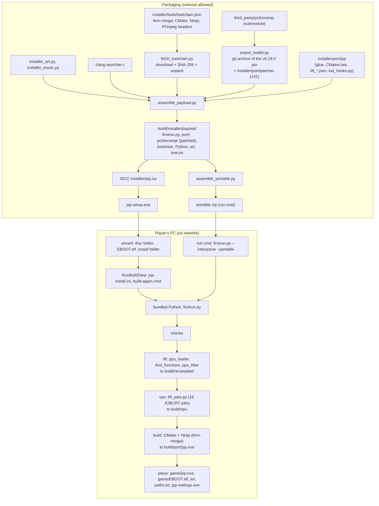
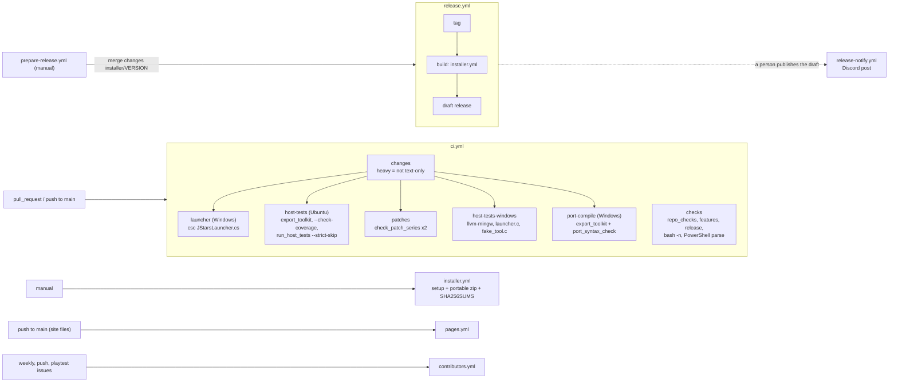

# Build and test map

How the port is packaged and built on the player's PC, what CI runs, and how the host tests are listed and run. The player's
side of the build is in [../BUILDING.md](../BUILDING.md) and [installer/README.md](../../installer/README.md). Conventions:
[README.md](README.md#how-to-read-it).

## 1. Player build

Two halves. Packaging (a Windows runner or a maintainer's PC, with network) makes a payload that holds no game data. The
player's PC runs `firstrun.py` from that payload: it lifts the player's own EBOOT and compiles it, with no network.



### 1.1 Packaging

| Piece | Where | What it does |
|---|---|---|
| Toolchain pins | `installer/tools/toolchain.json` | llvm-mingw, CMake, Ninja, FFmpeg headers (headers only), with SHA-256 |
| `fetch_toolchain.py` | `installer/tools/fetch_toolchain.py` | downloads into `build/installer/toolchain-cache/`, checks the hashes; `--check --strict` validates without a download |
| `export_toolkit.py` | `installer/tools/export_toolkit.py:24-25`, `:44-79` | `git archive` of the pin, then `git apply` of each patch in name order; refuses to resolve against an enclosing checkout |
| `assemble_payload.py` | `installer/tools/assemble_payload.py:157-290` | writes the payload: `tree.txt` = `v18`, `firstrun.py`, helper tools, the settings window source, `jsp-launcher.exe`, `port/` (a copy of `installer/port/jsp`; refuses one without the lift manifests), the patched toolkit, the toolchain, FFmpeg headers, the embeddable Python, generated art; refuses game file kinds (`:281-284`) |
| `jsp.iss` | `installer/jsp.iss` | Inno Setup 6.7; needs `/DPayload`; after the copy, `RunBuildStep` (`:871-915`) writes `jsp-install.ini` and `build-again.cmd`, runs `firstrun.py` hidden and waits |
| `assemble_portable.py` | `installer/tools/assemble_portable.py` | the portable zip with `run.cmd` |

### 1.2 `firstrun.py` steps

`STEPS = ["checks", "lift", "spu", "build", "place"]` (`installer/tools/firstrun.py:78`); `--until` and `--force STEP`. Each step
after `checks` leaves `build/markers/<step>.done` with a digest of its inputs and outputs; a re-run skips a step whose digest is
unchanged (`:580-611`). `build` includes the digests of `lift` and `spu`, `place` the one of `build`.

| Step | Code | Runs | Writes |
|---|---|---|---|
| checks | `:223-465` | path characters (P1, P2), disc (D1-D3), EBOOT (E1-E3, known builds in `eboot_ids.json`), free space (S1), toolchain (T1-T3), dev_flash (F1), FFmpeg DLL majors (M1, warning only); any FAIL stops | log lines |
| lift | `step_lift` `:693-729` | `ppu_loader.py`, `find_functions.py`, `ppu_lifter.py --chunks 64 [--fn-hooks] [--insn-patches]`, then LOD hook stamp and verify | `build/analysis/`, `build/recompiled/` |
| spu | `step_spu` `:732-737` | `lift_jobs.py` (scan, wrap, lift, register) | `build/spu/` |
| build | `build_plan` `:778-797`, `step_build` `:841-854` | `cmake -G Ninja -DCMAKE_BUILD_TYPE=Release` with `cmake/llvm-mingw.cmake`, `RECOMP_DIR`, `SPU_DIR`; parallel jobs from free memory at about 1 GB each | `build/port/jsp.exe`, `build/build-port.cmd` |
| place | `step_place` `:864-893` | copies the exe and the EBOOT into `game/`, art, FFmpeg DLLs from RPCS3; writes `paths.txt`; compiles the settings window with the C# compiler that comes with Windows | `game/`, `paths.txt`, `jsp-settings.exe` |

### 1.3 What CMake builds (`installer/port/jsp/CMakeLists.txt`)

- `project(jsp VERSION ...)` (`:10-14`): the exe is `jsp.exe`. C17 and C++20.
- Configure fails without `RECOMP_DIR/ppu_recomp.h`; the lifted sources are globbed (`:64-66`).
- `lod_hooks.py` runs at configure time and as target `jsp_verify_lod_hooks` before every build (`:79-100`).
- The toolkit runtime is `add_subdirectory(${PS3RECOMP_DIR})`; the PPU scaffold files are compiled per lift (`:164-169`); the
  HLE NID table comes from the lifter or `tools/gen_hle_nids.py` (`:133-160`).
- SPU: the lifted jobs under `SPU_DIR` (`:185-217`).
- GekkoNet as the static library `jsp_gekkonet` (`:266-274`); `JSP_ROLLBACK_BUILD=1` (`:276`); the build id from
  `jsp_build_id.cmake` (`:277-279`).

## 2. CI

Seven workflows in `.github/workflows/`. Actions are pinned by SHA.



### 2.1 `ci.yml` jobs

| Job | Runner | Runs when | Steps |
|---|---|---|---|
| `changes` | Ubuntu (`:20-51`) | always | a pull request is "light" only if every changed file is one of CHANGELOG.md, CONTRIBUTING.md, AGENTS.md, KNOWN_ISSUES.md, CONTRIBUTORS.md, SECURITY.md |
| `checks` | Ubuntu (`:53-97`) | always | `tools/ci/repo_checks.py` (`--commits BASE..HEAD` on a pull request), `tools/features.py --check`, `tools/release.py --check`, `bash -n` on every `*.sh`, the PowerShell parser on every `*.ps1` |
| `launcher` | Windows (`:99-120`) | heavy | Windows' own `csc.exe` compiles `launcher/JStarsLauncher.cs` |
| `host-tests` | Ubuntu (`:123-262`) | heavy | export the patched toolkit, `run_host_tests.py --check-coverage`, `run_host_tests.py --strict-skip --toolkit ... --scratch ...` |
| `patches` | Ubuntu (`:265-287`) | heavy | `check_patch_series.py`, again with `core.autocrlf=true` |
| `host-tests-windows` | Windows (`:292-329`) | heavy | llvm-mingw, builds `installer/launcher/launcher.c` and `installer/tools/fake_tool.c`, runs the `all` and `windows` rows |
| `port-compile` | Windows (`:333-361`) | heavy | `export_toolkit.py`, then `tools/ci/port_syntax_check.py` with the bundled clang |

`port_syntax_check.py` builds a stand-in `ppu_recomp.h` (a declaration for every game function the glue names) and runs
`-fsyntax-only` on every `installer/port/jsp/*.cpp` and the toolkit's PPU scaffold. Per-file include paths in its `FILE_INCS`
(`:26`) mirror CMake's `set_source_files_properties` by hand. It does not cover lifted code, the runtime libraries, GekkoNet, the
link or a run.

### 2.2 Other workflows

| Workflow | Trigger | What it does | Write scopes |
|---|---|---|---|
| `installer.yml` | manual, or called by `release.yml` | on Windows: pinned Python and font, Inno Setup, `fetch_toolchain.py`, art, music, launcher, payload, ISCC, optional portable zip, `SHA256SUMS`, upload as artifact | none |
| `release.yml` | push to `main` touching `installer/VERSION`, manual | `tag` (release tests, `release.py --check`, `release_tag.py --execute`), `build` (calls `installer.yml`), `draft` (`gh release create --draft`) | contents (tag, draft) |
| `prepare-release.yml` | manual, with a version | `release.py bump` on `release/vX.Y.Z` and a pull request | contents, pull requests |
| `release-notify.yml` | release published | posts the notes to Discord from the repository secret; does nothing without it | none |
| `pages.yml` | push to `main` on site files, manual | `tools/site/site.py` and `check_site.py`; deploy only when enabled | pages, id-token (deploy) |
| `contributors.yml` | weekly, push to `main`, `playtest` issues, manual | `tools/test_contributors.py`, then a pull request from `contributors-update` | contents, pull requests |

Not run by any workflow: `installer/tools/patch_index.py --check`, `fetch_toolchain.py --check --strict`,
`series_export.py --check`, a CMake configure of `installer/port/jsp`, and the compile of `installer/jsp.iss` on a pull request
(only `installer.yml` runs ISCC). No workflow links or runs `jsp.exe`: that needs the game.

## 3. Host tests

### 3.1 The list: `tools/ci/host-tests.txt`

One row per test, `WHERE | PATH [ARGS]` with WHERE `all`, `posix` or `windows`, or `exclude | GLOB | REASON`. Placeholders
`{scratch}`, `{toolkit}`, `{font}`, `{fake_tool}`, `{launcher}`; a row whose placeholder is not given fails, it never skips.
On `main`: 15 `all`, 34 `posix`, 2 `windows`, 20 `exclude`.

| WHERE | What runs |
|---|---|
| all | setup and launcher helpers (`rpcs3_wizard_test`, `test_rpcs3_locate`, `steam_shortcut_test`, `quote_arg_test`, `support_bundle_test`, `lan_discover_test`), option source checks (`online_option_test`, `unlock_option_test`, `menu_option_test`), `firstrun_selftest.py --units`, `portable_selftest.py`, and the repository tools' own tests (`tools/test_features`, `test_release`, `test_contributors`, `tools/ci/test_host_tests`) |
| posix | the site test; `test_release_tag`; C++ harnesses run by their `.sh` (online settings, Port Settings page, net online, version line, badge, settings, overlay font, session manifest, net session, stepper, snapshot ring, mods); tests that read the exported toolkit (re-psn, NP dialogs, virtual files, NP log, drawing state, LOD hooks, LOD image guard, net probe, Matching2 context, pipeline file); C tests compiled by the runner (`port_overlay_test.c`, `pad_join_test.c`, `psow_file_test.c`); plain Python (build id, session reader and startup, LOD lifetime, net session driver) |
| windows | `launcher_settings_test`, `script_paths_test` |
| exclude | the `.cpp` sources compiled by their `.sh`, `matching2_*_test.c`, `net_session_test.py` (run by its `.sh`), the archived v0.15 patches |

### 3.2 The runner: `tools/ci/run_host_tests.py`

- `--check-coverage` (`:43-56`): every tracked file named like a test (`*_test.*`, `test_*`, `*selftest*`; pattern at `:22`) must
  be listed or excluded, and every listed path must be tracked. A new test file that is not in the list fails CI.
- How each row runs (`:59-94`): `.py` with `python -I -X utf8`, `.sh` with `bash`, `.c` compiled with `$CC` (or `cc`, `gcc`,
  `clang`) against the toolkit's include folders, then run.
- Every row for the current system runs in its own scratch folder with a 600 s limit; `--strict-skip` counts a `SKIP` line as a
  failure. Prints `host tests: X/Y pass`.

Run them locally, from the repository root:

```
python3 tools/ci/run_host_tests.py --check-coverage
python3 installer/tools/export_toolkit.py --out /tmp/ps3recomp
python3 tools/ci/run_host_tests.py --toolkit /tmp/ps3recomp --scratch /tmp/jsp-host-tests
```

## 4. Repository checks

| Script | Checks |
|---|---|
| `tools/ci/repo_checks.py` | tracked files: banned extensions (game data, binaries, images except the project's own art), `EBOOT.*` / `PARAM.SFO` names, files over 2 MiB, personal paths, tool names, non-noreply e-mail addresses, Discord invites other than the project's, conflict markers, Python syntax; with `--commits A..B`, noreply author and committer and no tool trailers or session links in the messages |
| `tools/ci/check_patch_series.py` | exports and applies the whole series into a scratch folder; OK only when every patch applied |
| `tools/ci/port_syntax_check.py` | section 2.1 |
| `tools/ci/release_tag.py` | the tag step of `release.yml` |
