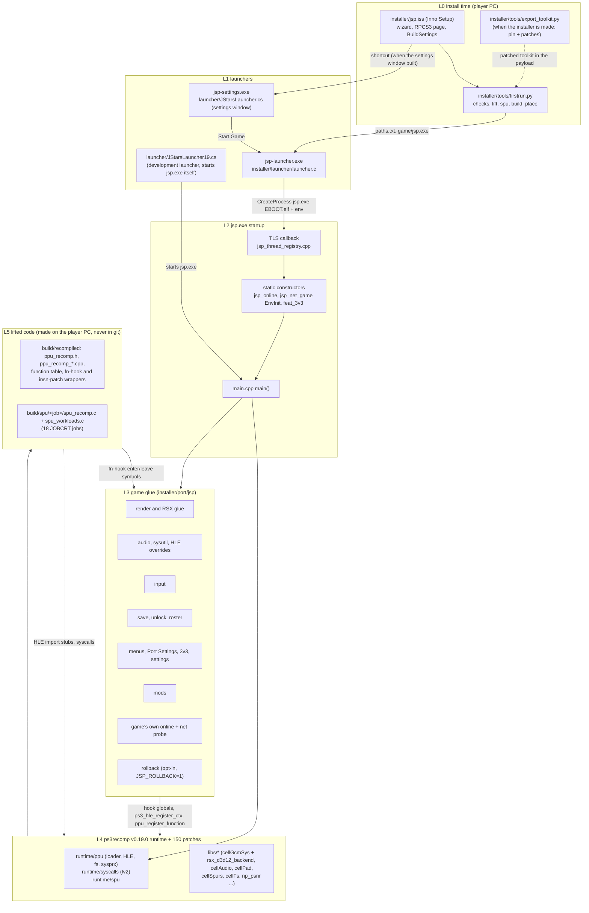
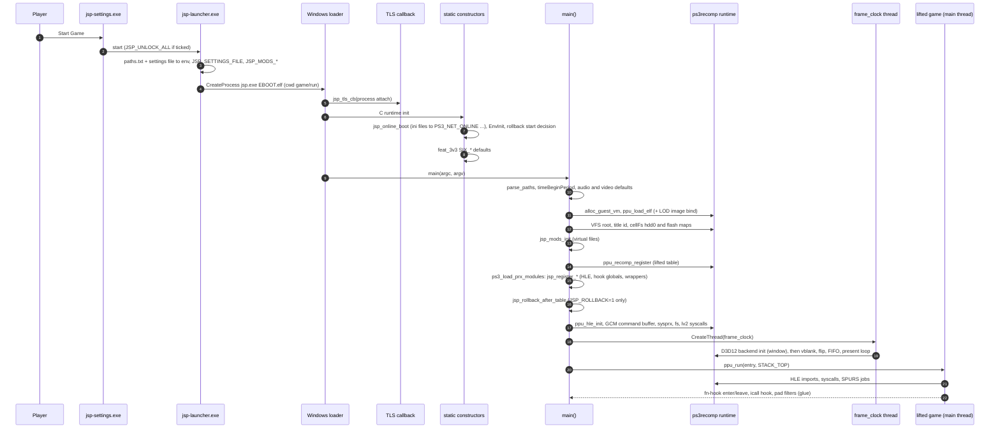

# Layers and entry points

How the pieces sit on each other, from setup on the player's PC down to the lifted game code, and where control enters
each one. Conventions: [README.md](README.md#how-to-read-it).

## 1. Layer diagram

## 2. Layers

### L0 Setup and first run (Inno Setup, Python)

- `installer/jsp.iss`: the shortcuts open `jsp-settings.exe` when it was built, else `jsp-launcher.exe` (`:101-108`). The settings
  window is compiled from `tools/jsp-settings.cs` (a copy of `launcher/JStarsLauncher.cs`) with the C# compiler that comes with
  Windows. After the copy, `RunBuildStep` runs the bundled Python on `firstrun.py` (`:872-916`).
- `installer/tools/firstrun.py`: steps `checks, lift, spu, build, place` (`:78`).
  - `step_lift` (`:693`): `ppu_loader.py`, `find_functions.py`, `ppu_lifter.py` with `--insn-patches lift_insn_patches.json`
    (US only) and `--fn-hooks` (the LOD and game hook manifests merged), then stamps and verifies the LOD hooks (`lod_hooks.py`).
  - `step_spu` (`:732`): `lift_jobs.py` lifts the JOBCRT jobs into `build/spu`.
  - `step_build` (`:841`): CMake and Ninja with the bundled llvm-mingw, giving `build/port/jsp.exe`.
  - `step_place` (`:864`): copies the exe and the player's `EBOOT.elf` into `game/` and writes `paths.txt` (`PS3_VFS_ROOT`,
    `PS3_HDD0_ROOT`, `PS3_DEV_FLASH`, `PS3_TITLE`, `PS3_VERBOSE=0`, `EXE`, `ELF`; `:885-889`).
- `installer/tools/export_toolkit.py`: when the installer is made, `git archive` of the pinned toolkit, then every
  `installer/port/patches/*.patch` in name order.
- More in [build-and-test.md](build-and-test.md#1-player-build).

### L1 Launchers

- `installer/launcher/launcher.c` (`jsp-launcher.exe`, `WinMain` `:280`): reads `paths.txt`, picks one settings file
  (`--settings`, `settings_here.txt`, install folder, `%APPDATA%`; rules in the header and in
  [installer/README.md](../../installer/README.md#settings-which-file-wins)), turns every `KEY=VALUE` into an environment variable,
  sets `JSP_SETTINGS_FILE`, `JSP_MODS_DIR` and `JSP_MODS_LIST`, optionally boosts the CPU, then starts `game\<EXE> game\<ELF>` in
  `game\run` with stdout and stderr in `play_stdout.txt` and `play_stderr.txt` (`:352`).
- `launcher/JStarsLauncher.cs` (WinForms, `Main` `:36`): the settings window. In an installed tree it hands the start to
  `jsp-launcher.exe`; only a hand-built tree starts the game itself (`:1935`).
- `launcher/JStarsLauncher19.cs`: the development launcher (not shipped). Starts `jsp.exe "<elf>" --disc --hdd0 --flash` with the
  `PS3_*` variables, `JSP_SETTINGS_FILE` and `JSP_UNLOCK_ALL` (`:1878-1907`).
- The settings file format is shared with the game: `jsp/jsp_settings.h` holds the key table; `installer/tools/settings_test.cpp`
  compares it with both launchers.

### L2 jsp.exe startup

From process start to `ppu_run`; see [section 4](#4-startup-sequence). The order is fixed by the Windows loader and `main.cpp`.
The order of static constructors across files is not, which `jsp/jsp_net_game.cpp:127-156` handles with a two-party rendezvous.

### L3 Game glue (`installer/port/jsp/`)

The built list is `jsp/CMakeLists.txt:221-254` (`add_executable`); the toolkit hooks each file uses are in [patches.md](patches.md).
Every file directly in `installer/port/jsp/` is named in one of the tables below.

Startup and registration

| File | Purpose |
|---|---|
| `main.cpp` | Entry point: guest memory reservation, ELF load, VFS / hdd0 / flash mapping, title id from PARAM.SFO, registration order, the frame-clock thread (vblank, flip, present, FIFO drain), `ppu_run` |
| `stubs.cpp` | `ps3_load_prx_modules()` (`:46-58`) calls every `jsp_register_*` in a fixed order, which is also the hook chaining order |
| `jsp_region.h` | Which disc the exe is lifted from: `JSP_US_CODE` (compile time, from `JSP_GAME_REGION`) and `jsp_game_is_us()` (run time). The US-only features (fixed US 1.00 addresses) are compiled out or not installed on the EU disc and log `JSP_NOT_THIS_DISC` |
| `jsp_hook_chain.h` | `install_with()`: chains several wrappers on one guest address through `ppu_register_function` (the toolkit keeps one function per address) |
| `jsp_hle.cpp` | HLE overrides (UCS2toUTF8, cellNetCtlGetState, BGM status, cellAudioGetPortConfig, cellGameDataCheck; `:320-328`), the thread-dump and screenshot-at-flip diagnostic threads, function tracing |
| `jsp_jobqueue.cpp` | cellSpursJq Port2 job-queue HLE (8 NIDs, `:94-103`) |
| `jsp_sysutil.cpp` | cellSearch / cellMusic stand-ins (`:142-159`) |
| `jsp_lod_lifetime.cpp`, `jsp_lod_lifetime.h` | Binds the loaded ELF buffer (SHA-256) so the verified LOD entry hooks act only for the program they were lifted for (`g_ppu_image_load_hook`) |
| `lod_hooks.py`, `lift_lod_hooks.json` | Plan, verify and stamp the 3 LOD hooks (`0x003955B4`, `0x0039595C`, `0x003959C8`) at lift and configure time (`CMakeLists.txt:79-100`) |
| `jsp_build_id.cmake` | Rollback build id and pipeline-cache stamp, computed from the sources at configure time |
| `CMakeLists.txt` | The `jsp` target, the toolkit runtime, the lifted PPU and SPU sources, GekkoNet; see [build-and-test.md](build-and-test.md#13-what-cmake-builds-installerportjspcmakeliststxt) |
| `lift_game_hooks.json`, `lift_insn_patches.json` | The lift-time hook and instruction-patch manifests (section 3, lift-time hooks) |

Rendering

| File | Purpose |
|---|---|
| `jsp_game.cpp` | The large game file: PC text through `g_spu_put_hook_img`, Exit Game, texture patch hook, the finished-frame hooks (`g_rsx_copy_rects`, `stamp`, `tint_rects`, `cutout`, `ui_scale`, `aa_mode`), FPS counter, HUD size, menus with mouse and arrows, Training and Impossible modes, the Training readout (`g_readout`, `:1080`; fed at `:2852` and `:2937`, drawn at `:2995`), free camera, LOD hook bodies (`:4533-4545`); registration `jsp_register_game_overrides` (`:4553`) |
| `jsp_train_readout.h` | Pure: the Training readout's state, text and layout (last hit damage, combo, both fighters' health and Stamina; on unless `TRAINING_READOUT=0`); it ignores rollback re-run ticks (`jsp_stepper_in_replay`) and yields the shared overlay layer (`layer_step`) |
| `jsp_overlay_api.h` | Declarations of the present-time RGBA overlay and the menu-label switches (toolkit 2516-2518) |
| `jsp_version_line.h` | Pure: which version line the main menu shows |
| `mp_pic_<lang>.inc` (lang en, es, fr, de, it; packed, 0.6 MB together), `jsp_mp_pack.h` (the unpacker) | Generated pictures (row labels, title, watermark) for the two-page main menu, included by `feat_menu_pages.cpp` |
| `exit_label_dark.inc`, `exit_label_light.inc` | Generated label art for Exit Game, included by `jsp_game.cpp` |
| `jsp_session_startup.cpp` | Reports the two-thread drawing state (toolkit 7904) as startup evidence for the rollback session |

Audio has no glue file of its own: defaults in `main.cpp:642-647` (`AUDIO_NBLOCK=16`, `CRI_LEAD=12`, `VDEC_ALPHA=255`),
`cellAudioGetPortConfig` in `jsp_hle.cpp`, cellMusic in `jsp_sysutil.cpp`, the rest in toolkit patches 3001-3004 and 3900.

Input

| File | Purpose |
|---|---|
| `jsp_game.cpp` | `g_cellpad_filter = game_pad_filter`, `g_cellpad_rstick_filter`, the `g_pad_*` menu and mouse switches (`:4574-4582`; toolkit 6500, 6501) |
| `jsp_port_menu.cpp` | Chains a pad filter behind the one from `jsp_game.cpp`, and the join notice (`g_pad_join_notify`, toolkit 7908) |
| `jsp_autopilot.cpp` | Test only (`AUTO_FIGHT`, `AUTO_MENU`): drives the pad through `g_ppu_icall_hook` and `g_cellpad_filter` (see [open findings](README.md#open-findings)) |
| `jsp_step_input.h` | Pure: the canonical per-tick input for rollback |

Save, unlock, roster

| File | Purpose |
|---|---|
| `jsp_unlock.cpp` | Opt-in `JSP_UNLOCK_ALL`: edits the in-memory save; wraps the save-update function `0x0014E898` (`:155-163`) |
| `jsp_roster.cpp` | Opt-in roster mod: adds fighters on character select (`:165-201`) |
| `main.cpp:680-698` | `PS3_GAMEDATA_ROOT` (default `<hdd0>_gamedata`) and the `/dev_hdd0`, `/dev_flash` mappings |

Menus and settings

| File | Purpose |
|---|---|
| `jsp_port_menu.cpp` | The in-game Port Settings page (US 1.00 only, checked at `0x001E71C0`); wraps `0x001E0830` (build Options) and `0x001E7238` (panel update); sets `g_port_menu_six_rows` for the instruction patch |
| `jsp_settings.cpp`, `jsp_settings.h` | Settings file read and atomic write, live values (`jsp_setting_get`), change counter; the rollback session layer sits on top |
| `feat_menu_pages.cpp` | Two-page main menu (on by default, `MENU_PAGES=0` off) |
| `feat_3v3.cpp` | 3v3 Free Battle (on with the menu, `SIX=0` off): 93 lift-hook bodies, the team-size window, six fighters |
| `jsp_training.cpp` | Not built (absent from `CMakeLists.txt:221-254`; an earlier version) |

Mods

| File | Purpose |
|---|---|
| `jsp_mods.cpp` | `jsp_mods_init` (`:513`): reads `mods.txt`, plans virtual CPK archives, installs `g_ps3_fs_vfile_ops` (`:593`, toolkit 6502) |
| `jsp_mods_core.h`, `jsp_mods_glue.h` | Pure manifest, plan and CPK logic and the glue decisions (host-tested) |

Online and rollback. `jsp_online.cpp` and `jsp_net_probe.cpp` serve the game's own online; every other file here is the rollback
netcode, which does nothing unless `JSP_ROLLBACK=1`. How they fit together: [netcode.md](netcode.md#5-rollback-pieces). "Pure" files
have no OS or game calls and are host-tested ([build-and-test.md](build-and-test.md#31-the-list-toolscihost-teststxt)).

| File | Purpose |
|---|---|
| `jsp_online.cpp` | Before `main()`: `repsn.ini` / `community.ini` and `--psnr` / `--username` to the environment of the game's own online (`jsp_online_boot`, `:712-739`, run by a static constructor at `:740`) |
| `jsp_net_probe.cpp` | Opt-in sys_net call-site probe (toolkit 7905); `jsp_register_net_probe` (`:99`) |
| `jsp_rollback.cpp` | The three rollback entry points that the start-up code calls: guest reservation (`jsp_rollback.cpp:27`), after the function table (`jsp_rollback.cpp:41`), HLE registrations (`jsp_rollback.cpp:49`) |
| `jsp_net_game.cpp` | The game side of the session: start decision (`EnvInit`, `:156`), `jsp_net_game_install` (`:1746`), `conn_open` / `conn_close` (`:1656`, `:1717`), `boundary` (`:1399`), match end rules, tick locks, bench, replays, adaptive delay, badge and message line |
| `jsp_net_online.h` | Pure: the in-game Online page's Netcode choice, the start decision `resolve_env` (`:309-348`), the rollback defaults `kDefaults` (`:204`), the bench depth, the F9 hold |
| `jsp_net_session.cpp`, `jsp_net_session.h` | `UdpMux`, `MessageHub`, `DirectRendezvous`, `PumpThread`, `NetSession` (GekkoNet wrapper: Game, Stress and Replay modes, keepalive thread, host abort) |
| `jsp_net_glue.h` | Pure: `Glue::iteration`, the per-iteration driver between `NetSession` and the stepper |
| `jsp_net_m2_link.h` | `M2LinkT` and `M2Pump`: the settings handshake over the `UdpMux` 'S' tag, and its pump thread |
| `jsp_net_repsn.h`, `jsp_net_repsn_client.h` | `RePsnRendezvous` (a room on the re-psn server, punch, relay) and `PsnrClientTransport` (toolkit 7918's client) |
| `jsp_net_badge.h` | Pure: the opt-in status badge and status line (`JSP_ROLLBACK_BADGE=1`) |
| `jsp_net_delay_rule.h` | Pure: the adaptive input delay decision (rule 2 by default) |
| `jsp_net_ko_rule.h` | Pure: KO / time-up end of a match and the live confirmation watermark for a disconnect |
| `jsp_net_team_rule.h` | Pure: reads the fight's team size; a rollback match is 2 vs 2 only |
| `jsp_net_debug_gate.h` | Pure: the test switches that apply only with `JSP_ROLLBACK_ALLOW_DEBUG=1` |
| `jsp_host_abort.h` | The frame clock's failure request to the session's keepalive worker |
| `jsp_session_handshake.h` | Pure: host and client handshake state machines (Hello, Propose, Ack, Start, Cancel) |
| `jsp_session_registry.h` | Pure: every session setting, synchronized or local, its canonical value, and `host_proposal` (`:215`) |
| `jsp_session_manifest.h` | Pure: the canonical match manifest and control messages |
| `jsp_session_digest.h` | Pure: SHA-256 of the manifest bytes |
| `jsp_session_effective.h` | Pure: effective values with the temporary session layer on top; `host_proposal` with startup evidence (`:52`) |
| `jsp_session_reader.h` | Temporary session inputs for the real settings readers |
| `jsp_session_settings.h` | Pure: the settings agreement contract and the shared graphics profile (`jpss`) |
| `jsp_stepper.cpp`, `jsp_stepper.h` | Maps GekkoNet frames to game ticks; replay clock, lockstep clock, canonical pad and pad info hooks, local pad peek, the replay flag `jsp_stepper_in_replay` (`jsp_stepper.cpp:208`) |
| `jsp_step_effects.h` | Pure: host side effects during a replay (suppressed, deduplicated or held for confirmation) |
| `jsp_stall_rule.h` | Pure: the frame clock's lost-flip write-off (toolkit 7927) and the 60 s failure |
| `jsp_snapshot.cpp` | The per-tick snapshot ring on write-watched guest memory: freeze, census, gate, copy workers, thread audit |
| `jsp_snapshot_core.h`, `jsp_snapshot_flow.h`, `jsp_snapshot_ops.h`, `jsp_snapshot_ring.h`, `jsp_snapshot_sync.h` | Pure parts of the snapshot: range sets, the per-tick decision flow, platform-operation order, the dirty-page undo ring, the park and sync gate |
| `jsp_thread_registry.cpp`, `jsp_thread_registry.h` | The host thread table for the snapshot freeze, kept by the TLS callback; the audit |
| `jsp_thread_bit.h` | Pure: guest thread id (1-64) to its bit in a 64-bit mask |
| `jsp_audit_start.h` | Pure: the background thread-audit worker's start, retried at every scheduled audit, with a synchronous fallback |
| `jsp_fight_hash.cpp` | The rollback tick (scene pass at `0x0014EA68`), the per-tick fight hash, the seeded clock HLE, KO winner and end state; `jsp_register_fight_hash_overrides` (`:557`) |
| `jsp_fight_setup_rule.h` | Pure: whether the battle setup table is in the rollback checksum |
| `gekkonet/` | The vendored GekkoNet (BSD-2-Clause, pinned in `gekkonet/PIN.md` with two marked local additions), a static library (`CMakeLists.txt:266-276`) |

### L4 ps3recomp runtime (v0.19.0 + `installer/port/patches/`, 150 patches)

- Compiled into the exe per lift (`CMakeLists.txt:164-169`): `runtime/ppu/ppu_loader.cpp` (ELF load, `ppu_run`, function table,
  indirect calls and `g_ppu_icall_hook` from patch 0500), `ppu_hle.cpp` (`ps3_hle_register_ctx`, `ppu_hle_init`), `ppu_fs.cpp`,
  `ppu_sysprx.cpp`.
- HLE NID table: `ppu_hle_nids.cpp`, from the lifter or generated by `tools/gen_hle_nids.py` (`CMakeLists.txt:133-160`).
- `runtime/syscalls/*` (lv2: threads, events, mutexes, timers), `runtime/spu/*` (SPU channels, DMA, SPURS job runner).
- `libs/`: audio, codec (cellVdec), filesystem (cellFs), input (cellPad), network (np_psnr, sceNp*, sys_net), spurs (cellSpurs,
  cellSpursJq, cellFiber), system (cellGame, cellSaveData, cellSysutil, cellRtc), video (`cellGcmSys`, `rsx_commands`,
  `rsx_d3d12_backend` and the shader decompilers).
- The hook surface the glue uses is added by patches: [patches.md](patches.md#hooks-the-glue-uses).

### L5 Lifted code (made on the player's PC; nothing in git)

- `build/recompiled/`: `ppu_recomp.h`, `ppu_recomp_*.cpp` (globbed, `CMakeLists.txt:64-66`); `ppu_recomp_register()` maps the
  lifted function table. Function-hook wrappers call the `jsp_*_enter` / `_leave` symbols in L3; instruction patches become
  `if (guard) new else original` (for example `g_port_menu_six_rows` at `0x001E71C0`).
- `build/spu/<job>/spu_recomp.c` and `spu_workloads.c` (`CMakeLists.txt:185-217`); they register themselves from constructors,
  and cellSpurs picks the lifted job by content fingerprint.

## 3. Entry points

### Process start, before `main()`

| # | Entry | Where | Notes |
|---|---|---|---|
| 1 | TLS callback `jsp_tls_cb` (process attach, then every thread attach and detach) | `jsp/jsp_thread_registry.cpp:41-93` | Runs before the C runtime is set up; reads `JSP_ROLLBACK` and `JSP_SNAPSHOT_THREADS` once and registers threads only then |
| 2 | Static constructor `JspOnlineInit` calls `jsp_online_boot()` | `jsp/jsp_online.cpp:740` | Reads `repsn.ini` / `community.ini`, parses `--psnr` / `--username` itself, sets the environment, reports with `jsp_net_env_part(2)` (`:738`) |
| 3 | Static constructor `EnvInit` | `jsp/jsp_net_game.cpp:156` | The rollback start decision runs when both 2 and 3 have reported |
| 4 | Namespace-scope initialisers | `jsp/feat_3v3.cpp:59` (puts the 15 `SIX_*` defaults), `jsp/jsp_game.cpp:695`, `:1512` | Environment read before `main()` |
| 5 | Lifted SPU registration constructors | generated `build/spu/...` | inferred from `CMakeLists.txt:178-181` |

### `main()` (`jsp/main.cpp:614-735`)

`parse_paths` (`--disc`, `--hdd0`, `--flash`, `--env`; `:574-612`), `timeBeginPeriod(1)` and the audio and video defaults
(`:627-647`), `alloc_guest_vm` (`:654`; a write-watched reservation when rollback is on), `g_ppu_image_load_hook` (`:659`),
`ppu_load_elf` (`:660`), VFS root, title id (`:674`), hdd0 / flash / gamedata mapping (`:680-698`), `jsp_mods_init` (`:703`),
`ppu_recomp_register` (`:705`), `ps3_load_prx_modules` (`:706`), `jsp_rollback_after_table` (`:707`), `ppu_hle_init` (`:708`),
the GCM default command buffer HLE (`:709`), `ppu_sysprx_register`, `ppu_fs_register`, `lv2_init_syscalls` (`:710-712`),
`g_ps3_guest_caller` (`:716`), `CreateThread(frame_clock)` (`:717`), then `ppu_run(entry, STACK_TOP)` on the main thread (`:568`).

### Hook registration, in call order

| Order | Function | File:line | What it installs |
|---|---|---|---|
| 1 | `jsp_register_net_probe` | `jsp_net_probe.cpp:99` | script-report observer and probe HLE (default off) |
| 2 | `jsp_register_job_queue_overrides` | `jsp_jobqueue.cpp:94` | 8 HLE handlers |
| 3 | `jsp_register_sysutil_overrides` | `jsp_sysutil.cpp:142` | cellSearch / cellMusic HLE |
| 4 | `jsp_register_hle_overrides` | `jsp_hle.cpp:320` | 5 HLE handlers, the thread-dump thread, optional function trace |
| 5 | `jsp_register_autopilot_overrides` | `jsp_autopilot.cpp:193` | icall hook and pad filter, only with `AUTO_FIGHT` / `AUTO_MENU` |
| 6 | `jsp_register_game_overrides` | `jsp_game.cpp:4553` | `g_spu_put_hook_img`, `g_tex_patch_hook`, `g_ppu_icall_hook`, `g_rsx_*`, `g_cellpad_*`, `g_pad_*` |
| 7 | `jsp_register_unlock_overrides` | `jsp_unlock.cpp:155` | wraps `0x0014E898` (opt-in) |
| 8 | `jsp_register_roster_overrides` | `jsp_roster.cpp:165` | roster mod only |
| 9 | `jsp_register_port_menu_overrides` | `jsp_port_menu.cpp:1190` | wraps `0x001E0830`, `0x001E7238`; chained pad filter; label mask; `g_port_menu_six_rows = 1` |
| 10 | `jsp_rollback_register_overrides` | `jsp_rollback.cpp:49`, `jsp_fight_hash.cpp:557` | `cellRtcGetCurrentTick` HLE, scene hook `0x0014EA68`, pad filter only with `JSP_PAD_TICKS` (`jsp_fight_hash.cpp:580-581`), snapshot init (rollback only) |
| 11 | `jsp_rollback_after_table` (from `main.cpp:707`) | `jsp_rollback.cpp:41-46` | stepper (`g_cellpad_canon_hook`) and the 4 frame hooks of `jsp_net_game_install` (rollback only) |
| 12 | `main.cpp:709` | | `cellGcmSetDefaultCommandBuffer` HLE, after `ppu_hle_init` |

Registration before `ppu_hle_init` wins over the runtime's own handlers (`stubs.cpp:45`).

Lift-time hooks, baked into L5 by `step_lift`:

- `lift_lod_hooks.json`: 3 entry/leave hooks; bodies in `jsp_game.cpp:4533-4545`.
- `lift_game_hooks.json`: 82 entry/leave hooks (Impossible AI, KO bar and sound, two-page menu, 3v3, VS screen). Of the 114
  distinct `jsp_*` symbols in both manifests, 93 are defined in `feat_3v3.cpp`, 14 in `jsp_game.cpp` and 7 in `feat_menu_pages.cpp`.
- `lift_insn_patches.json`: 1 patch (`0x001E71C0`, guard `g_port_menu_six_rows`, US only).

### Per-frame entry points

| Entry | Where | When |
|---|---|---|
| `frame_clock` thread loop | `main.cpp:214-409` | 60 Hz vblank from the performance counter; `cellGcmTickVBlank` / `TickFlip`, FIFO drain, present on a new guest flip, window messages |
| `jsp_rollback_clock_turbo` | `jsp_stepper.cpp:546`, called at `main.cpp:242` | every frame-clock pass; replay speed-up while rollback runs |
| Guest vblank / flip callbacks | `g_ps3_guest_caller`, `main.cpp:515`, `:716` | the runtime calls the handlers the game registered |
| Finished-frame hooks | set in `jsp_game.cpp:4569-4584` | called by the D3D12 backend before present (patches 2509-2511, 2920) |
| Present-time overlay | `jsp_port_menu.cpp`, `jsp_net_game.cpp:350-367` | redrawn on change, blended at present (2517) |
| Pad filters | `jsp_game.cpp` `game_pad_filter`, `jsp_port_menu.cpp`, `jsp_fight_hash.cpp` | once per pad read (6500, 6501) |
| Indirect-call hook | `training_icall`, `jsp_game.cpp:2686` | every guest indirect call (0500) |
| Rollback tick | `0x0014EA68` (fight hash), `0x00642C3C` BeginFrame (session) | per simulation tick, rollback only |

### Threads the port starts

| Thread | Where | When |
|---|---|---|
| `frame_clock` (4 MB stack) | `main.cpp:717` | always |
| guest main = the process main thread | `main.cpp:568` | always |
| `thread_dump_main` | `jsp_hle.cpp:250` | always started; exits after 2 s unless `JSP_THREADDUMP_MS` is set |
| `shot_at_flips_main` | `jsp_hle.cpp:247` | `JSP_SHOT_AT_FLIPS` |
| `six_stacks`, `six_arm` (short-lived) | `feat_3v3.cpp:334`, `:364`; a second copy in `jsp_game.cpp:2429`, `:2459` | diagnostic switches |
| rollback: pump, keepalive, re-psn connect, snapshot copy workers, thread audit worker | [netcode.md](netcode.md#7-threads) | rollback only |

The runtime starts the rest (inferred from the toolkit's thread creation calls): guest PPU threads, SPU / SPURS workers, the
audio mixer, video decode, sysutil, timers, and the second drawing thread when two-thread drawing is on (patches 2912, 7907).

## 4. Startup sequence

