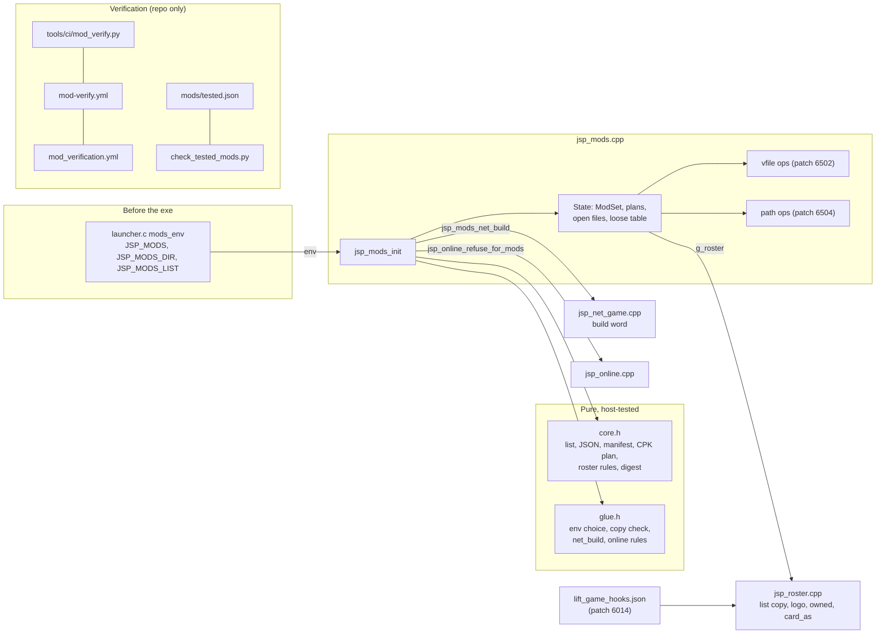
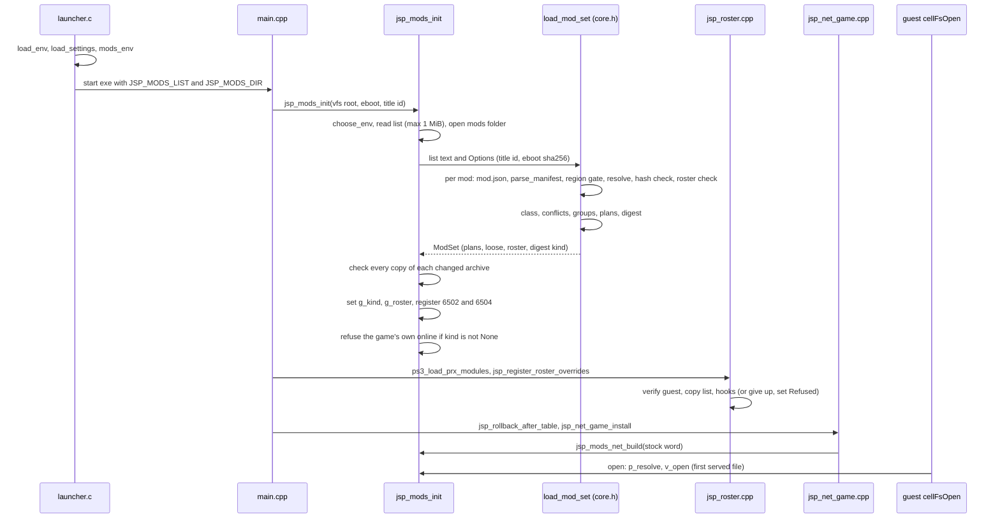

# Mods map

The modding framework as it is on `main`: how a mod folder becomes served archive bytes, and which part of that is shared with the online code. Player and author rules are in [../MODS.md](../MODS.md) and are not repeated here. Conventions: [README.md](README.md#how-to-read-it). Netcode background: [netcode.md](netcode.md).

Line numbers are for `jsp/jsp_mods.cpp` unless a file is named. `core.h` is `jsp/jsp_mods_core.h`, `glue.h` is `jsp/jsp_mods_glue.h`.

## 1. Components

| Component | Role | Where |
|---|---|---|
| `jsp/jsp_mods.cpp` | The glue: reads the environment and list, opens mod files, runs `load_mod_set`, checks archive copies, registers the toolkit hooks, exports the C functions the roster, rollback and online code call | `jsp_mods_init` `:620-723`; `jsp_mods_copy_mismatch` `:727`; `jsp_mods_net_build` `:731`; roster exports `:747-787`; `jsp_mods_roster_failed` `:791` |
| `jsp/jsp_mods_core.h` | Header-only rules, no OS or toolkit calls; all file access goes through `jmods::Io` (`:78`) | `parse_mods_list` `:191`; `JsonParser` `:236`; `parse_manifest` `:587`; `load_archive` `:947`; `build_plan` `:1345`; `check_roster` `:1075`; `resolve_mod` `:1207`; `resolve_loose` `:1267`; `load_mod_set` `:1386` |
| `jsp/jsp_mods_glue.h` | The pure glue decisions: `choose_env` (`:22`), key and copy-path helpers (`:35-69`), `copy_check` / `verify_copy` (`:95-132`), `ServeIo` (`:136`), `net_build` (`:162`), `game_online_allowed` (`:174`), `rollback_gate` (`:179`) | |
| Loose-file path resolver | `p_resolve` answers a read-only open or stat of a path that is in no archive. `loose_rel_from_guest` (`core.h:468`) maps the guest path to a path relative to `data/PS3`. `v_open` / `v_read` serve the bytes (`:456-575`) | `k_path_ops` `:441`; table `State::loose` `:321` |
| `jsp/jsp_roster.cpp` | Guest side of `roster`: copy of the fighter list in free guest memory, two re-pointed TOC entries, logo swap, owned bits after the save update, and the `card_as` name rewrite | `jsp_register_roster_overrides` `:213-264`; `card_as` hooks `:192-208`; EU stub `:265-275` |
| Toolkit hooks | **6502** `g_ps3_fs_vfile_ops` (`ps3emu/fs_vfile.h`): a virtual view of a read-only file. **6504** `g_ps3_fs_path_ops` (`ps3emu/fs_path_ops.h`): a resolver that redirects an open or stat. **6014** `ppu_lifter --fn-hooks`: carries the `card_as` entry hook | stores at `:712-713`, `:717`; hook `lift_game_hooks.json:87`; merged for the lift at `installer/tools/firstrun.py:678-686`, `:714-715` |
| Launcher | Passes the two paths and counts list lines for `launcher_log.txt`. There is no mods page in the settings window and no mods key in `jsp_settings.h` | `installer/launcher/launcher.c:237-273`, called `:302` |
| Online page | Shows "gameplay mods are on" when mods turned the game's own online off | `jsp_port_menu.cpp:264`, `:759`; `jsp_net_online.h:42`, `:192-197` |
| `tools/ci/mod_verify.py` | Reads a mod zip as data and prints a table of checks and the canonical hash. Two modes: an issue form (`run_checks` `:818`) and `--zip FILE` (`check_zip` `:839`, `main` `:928`) | |
| `.github/workflows/mod-verify.yml` | Runs the script when a maintainer adds the label `mod-check` to an issue that has the label `mod-verification`; the script gets 280 s; a second job posts the comment | `:12-14` (trigger), `:24` (label condition), `:23-46` |
| `.github/ISSUE_TEMPLATE/mod_verification.yml` | The form; its labels are the keys `FORM_FIELDS` parses (`mod_verify.py:94-106`) | |
| `mods/tested.json`, `tools/ci/check_tested_mods.py` | The tested list (schema 1, empty on this commit: `"mods": []`) and its validator; CI runs it at `.github/workflows/ci.yml:73-74` | `check` `:33-77` |
| Host tests | `installer/tools/mods_overlay_test.sh` + `.cpp` (pure core and glue on synthetic archives; with the toolkit path also the glue file branch, POSIX only) and `tools/ci/test_mod_verify.py` (no network; also covers `check_tested_mods.py`). Listed at `tools/ci/host-tests.txt:25`, `:71` | `mods_overlay_test.cpp:1654-1683` |

The guest side (`jsp_roster.cpp`) has no host test; only its pure rule `card_redirect_enter` does (`test_card_as`, `mods_overlay_test.cpp:1376`). The `_WIN32` file code in `jsp_mods.cpp` (`:99-154`, `:181-192`, `:202-238`) is not built by the host test. **inferred** from the `#ifdef`s and the script header.

## 2. Load sequence

Steps, in order, with the places that decide:

1. **Launcher** (`launcher.c:300-302`): `load_env` and `load_settings` run first, then `mods_env`. `JSP_MODS=0` stops it (`:244`). If `JSP_MODS_DIR` is empty it is set to `<install>\mods` when that folder exists (`:245-248`). If `JSP_MODS_LIST` is empty it is `mods.txt` next to the settings file that won, else in the install folder, and it is set only if the file exists (`:250-259`). A value already in the environment wins. The launcher only counts non-empty lines; it does not parse ids (`:262-272`).
2. **Start** (`main.cpp:703`): `jsp_mods_init(ppu_vfs_root, argv[1], cellGame_get_title_id())`, before `ppu_recomp_register` (`:705`) and before `jsp_rollback_after_table` (`:707`). The title id is PARAM.SFO's TITLE_ID (`main.cpp:90`).
3. **Environment** (`:624-625`): `choose_env` (`glue.h:22-31`). `JSP_MODS=0` or an empty `JSP_MODS_LIST` logs a `[mods]` line and returns. Nothing is registered and `g_st` stays null. This is the stock game.
4. **List read** (`:626-634`): at most 1 MiB; unreadable or larger means the stock game, with a log line. A missing `JSP_MODS_DIR` or an unopenable folder is different: the loader goes on and every listed mod is refused (`:635-638`).
5. **`load_mod_set`** (`core.h:1386`), per listed mod in order:
   - `parse_mods_list` (`:191`): `#` comments, one BOM, duplicates ignored with a log line, an id outside `[a-z0-9-]` kept as `valid=false`.
   - `<id>/mod.json` read through `LoadIo::file` (`:379-391`), which uses `valid_rel_path` and the link-refusing open (`ModsRoot::open_file` `:200-265`). Over 1 MiB is refused (`core.h:1410`).
   - `parse_manifest` (`core.h:587`): schema 1, id equals the folder, interfaces against `supported_interfaces()` (`:382`), then overrides, `loose`, `groups`, `roster`, `conflicts_ok`.
   - **Region gate** (see below).
   - `resolve_mod` (`:1207`) and `resolve_loose` (`:1267`): archive row exists, alias exists and is not compressed, mod file opened and hashed through its own handle and compared with `sha256` (`:1249-1250`), non-empty, under 4 GiB, fits the entry's own 2048-aligned slot (`fits_in_place` `:1194`).
   - `check_roster` (`:1075`) against the stock list plus fighters of earlier mods.
   - Any failure refuses the whole mod: `[mods] <id>: refused: <reason>` (`:1426`).
6. **After the loop** (`core.h`): class (`:1419-1424`), conflicts, later mod wins (`:1441-1472`), group drop (`:1475-1509`), roster fighters appended (`:1523-1532`), one `Plan` per changed archive (`:1535-1546`), digest (`:1548-1576`).
7. **Back in `jsp_mods_init`**: close files no plan uses (`:651-656`); build a `Served` per archive with its `CopyCheck` (`:657-663`); check every copy the game can open, the disc copy and `<hdd0>/game/*/USRDIR/data/PS3/<archive>` (`:664-690`); a differing copy of an archive a gameplay mod changes turns `Value` into `Refused` (`:691-696`, `glue.h:80`). Build the loose table; a host path over 1100 bytes refuses the set (`:697-707`). Publish `g_kind`, `g_roster`, `g_st` (`:708-710`). Register 6502 for archives and loose files, 6504 for loose files (`:711-721`). Call `jsp_online_refuse_for_mods` if `game_online_allowed` is false (`:722`).
8. **Roster** (`stubs.cpp:55`, inside `ps3_load_prx_modules`, after the unlock cheat because they share the save-update hook): `jsp_register_roster_overrides` (`jsp_roster.cpp:213`) does nothing without an applied roster mod. Otherwise it checks the stock list, both TOC entries, the logo code word and free guest memory (`:228-236`), copies the list, re-points both entries (`:241-249`), installs the hooks (`:252-256`), and sets `g_card_n` for `card_as` (`:257-261`). Any failed expectation calls `give_up` (`:123-129`), which restores the TOC entries and calls `jsp_mods_roster_failed`.
9. **Rollback build word** (`jsp_rollback.cpp:45` → `jsp_net_game_install`, `jsp_net_game.cpp:1759-1767`): reads the set through `jsp_mods_net_build`.
10. **First file through a mod**: a guest `cellFsOpen` of a changed archive reaches `v_open` (`:456`); a loose path reaches `p_resolve` (`:418`) first and then `v_open`. The first `[mods] serve ... checked` or `[mods] loose ... served` line is this event.

**Region gate.** The mods layer does not call `jsp_game_is_us()` (`jsp_region.h:21`); no call exists in `jsp_mods.cpp` or the core. The run-time gate is the PARAM.SFO title id handed to `parse_manifest`:

- `game.title_ids` (when present and not empty) must contain the running id, else "made for another game version" (`core.h:619-622`).
- `loose` and `roster` also need the running id to equal `kRosterTitle` = `BLUS31519` (`core.h:402`) and the manifest to name it (`:688`, `:763`). On another disc the whole mod is refused.
- `jsp_roster.cpp` uses only the macro `JSP_US_CODE` (`:60`, `:265`): an EU build compiles an empty body that reports the set as not run as listed (`:269-275`). That is a second, compile-time backstop; it runs only if a roster mod got past the core's title check.
- `cpk-entry` has no region code. It follows each disc's own archive index.

## 3. Data structures

| Name | Defined | What it holds | Read by |
|---|---|---|---|
| `EnvChoice` | `glue.h:17` | on/off, list path, folder path, reason | `jsp_mods_init` `:624` |
| `ListEntry` | `core.h:190` | id, line, valid | `load_mod_set` |
| `Manifest`, `OverrideSpec`, `LooseSpec`, `RosterFighter`, `Interface` | `core.h:564`, `:387`, `:413`, `:393`, `:380` | one parsed `mod.json` | `resolve_*`, class, digest |
| `Options` | `core.h:1151` | list name, title id, EBOOT id (SHA-256 of the ELF, `:602-612`), supported interfaces | `parse_manifest`, digest head |
| `ModState` | `core.h:1139` | `manifest_ok`, `loaded`, `applied`, `gameplay`, reason, resolved overrides and loose files | conflicts, class, digest, `gameplay_archive` (`glue.h:72`) |
| `ModSet` | `core.h:1165` | mods, `loose` map (lower-case path), `plans` (by archive basename), `roster`, `digest_kind`, `digest`, log | `jsp_mods_init` |
| `DigestKind` | `core.h:1113` | `None`, `Value`, `Refused`. `Refused` carries the fixed `refused_digest()` (`:1116`) | `g_kind`, `net_build`, `game_online_allowed` |
| `Plan`, `Segment`, `PlannedOverride` | `core.h:1037`, `:1026`, `:1032` | the **overlay table** for one archive: segments `Original` / `Memory` (rewritten TOC) / `ModFile` / `Zero` over the unchanged file size. `Plan::read` (`:1046`) resolves a position to a segment | `v_read` `:561` |
| `LooseServed`, `LooseEntry` | `core.h:1158`, `jsp_mods.cpp:316` | the **alias table** for paths in no archive: file source (`file`) or archive window (`archive`, `src`, `len`) plus the host path the resolver answers with | `p_resolve`, `v_open`, `v_read` |
| `CopyCheck` | `glue.h:90` | planned size, prefix hash up to the end of the TOC, hashes of alias donor ranges | `check_copy` `:444`, `v_open` |
| `State` | `:320` | `loose`, `root`, `files` (open handles, key `<id>/<path>`), `set`, `served`, `verified`, mutex | all providers; `g_st` `:332` never freed |
| `g_kind`, `g_copy_mismatch`, `g_roster` | `:333`, `:334`, `:614` | the live digest kind; "a copy seen after start differs"; added fighters | `jsp_mods_net_build`, rollback gate, `jsp_roster.cpp` |
| Roster globals | `jsp_roster.cpp:86-95` | `g_added`, `g_card_*`, `g_copy`, `g_want`, `g_live` | guest hooks |

**Digest** (`core.h:1548-1576`): SHA-256 over `jsp-modset 1`, the EBOOT id, and for each loaded, applied gameplay mod in load order: `id version`, one `entry hash-of-served-bytes` line per served override, one `loose <lower-case path> hash` line per served loose file, one `roster id after logo owned` line per fighter. `card_as` is not in it. Cosmetic mods and gameplay mods that serve nothing are not in it. A listed gameplay mod that was not loaded gives `Refused`. No gameplay mod gives `None`.

## 4. Interfaces and versions

`supported_interfaces()` (`core.h:382-386`) lists three names and no others on this commit: `cpk-entry` 1, `roster` 2, `loose-file` 1. A name not in the list, or a higher version, refuses the mod (`:634-637`). Manifest `schema` must be 1 (`:595`).

| Interface | Parsed | Applied | Refused when | Disc |
|---|---|---|---|---|
| `cpk-entry` 1 | `core.h:644-683` (`overrides` need the interface) | `build_plan` (`:1345`) writes each file over the entry's own slot and rewrites the TOC row sizes; archive size and layout do not change. Served by 6502 `v_open` / `v_read` | first folder not one of six (`archive_of` `:178`); row missing; alias missing, in another archive or compressed; empty; 4 GiB or more; larger than its slot (`:1253-1259`); hash differs | any; plans come from the disc copy (`:645`), checked per disc by archive rows |
| `roster` 1, 2 | `core.h:760-802` (`card_as` only with version 2) | `jsp_mods_roster_*` (`:747-787`) → `jsp_register_roster_overrides`; fighters ids 19-21 only, at most 56 ids in the list (`kRosterGrid` `:398`) | not on `BLUS31519`; id used; `after` not yet in the list; `logo_as` / `card_as` not on the stock list; unknown key. At run time: the guest differs from the expected image (`jsp_roster.cpp:225-236`), the copy is damaged later (`:157`) | US 1.00 only |
| `roster` `card_as` | same block | entry hook on `func_0051BDC8` (`lift_game_hooks.json:87`, `jsp_roster.cpp:192-208`); rewrites the three digits of an added id's card name for the length of the lookup | as `roster`. If the lift has no hook the redirect never runs, but the start still logs that the id borrows a stock card (`jsp_roster.cpp:82-84`, `:260`) | US 1.00 only |
| `loose-file` 1 | `core.h:685-736`, name rule `loose_name_ok` (`:430`) | `p_resolve` points the open or stat at the mod file, or at the disc archive for an alias; `v_open` / `v_read` serve pinned bytes or the archive window | not on `BLUS31519`; name not one the game builds for ids 19-21; path has a CPK row (`resolve_loose` `:1281`); `.acb` without its `.awb`; alias missing or compressed; hash differs | US 1.00 only |

Non-interface fields with their own code: `groups` and the `.acb` / `.awb` pairing drop a whole group when a later mod takes part of it (`core.h:1475-1509`); `conflicts_ok` only silences a log line (`:1451`, `:1467`); `derived` is a log line (`:1430`) and not in the digest; `gameplay: true` raises the class (`:1420`).

## 5. Online interaction

The mods layer never talks to a peer. It changes two things the online code already reads: a 32-bit build word for rollback, and the on/off state of the game's own online.

| Set state | Rollback | Game's own online |
|---|---|---|
| `None` (stock, cosmetic only, gameplay mods that serve nothing) | build word is the stock word (`glue.h:162-166`) | allowed (`:174`) |
| `Value` | build word = first 32 bits of SHA-256(stock word as 4 little-endian bytes, digest) (`glue.h:167-170`). `jsp_net_game_install` stores it in `g_net_build` (`jsp_net_game.cpp:1766-1767`), then `g.caps.build` (`:1684`) and the re-psn room filter (`:1696`). Peers with another set fail the build compare | refused: `jsp_online_refuse_for_mods` (`:722`) |
| `Refused` | `jsp_mods_net_build` returns 0 and rollback does not start (`:731-738`, `jsp_net_game.cpp:1766`) | refused, as above |

- **Game's own online off**: `jsp_online_refuse_for_mods` (`jsp_online.cpp:744`) calls `refuse_for_mods` (`:324`). When `PS3_NET_ONLINE` is set, it removes it and sets `JSP_MODS_ONLINE_OFF=1` (`:328-332`); it always logs `[mods] game online refused: gameplay mod set active` and marks the Online page's view as off. The Online page reads that key (`jsp_port_menu.cpp:264`) and changes its status line (`jsp_net_online.h:192-197`). The call comes from `jsp_mods_init`, after `jsp_online_boot` has run in a static constructor (`jsp_online.cpp:740`).
- **Late refusals**: a copy of a changed archive first opened after start that differs (`:524-531`), an alias window that differs (`:487-491`), and a loose host path too long for the open (`:422-426`) set `g_kind = Refused` and `g_copy_mismatch = 1`. Rollback reads the flag through `jmods::rollback_gate` in `mods_refuse_now` (`jsp_net_game.cpp:853-860`), before the rendezvous poll (`:915`) and before the Hello (`:926`). A session past its Hello is not ended.
- **Roster failure** (`jsp_mods_roster_failed` `:791-796`) sets `Refused` and refuses the game's own online. It runs during `ps3_load_prx_modules`, before the build word is read, so rollback sees it.

## 6. Verification path

`mod_verify.py` checks a zip as data, with no disc. The loader checks a folder on a PC that has the disc. Rows named as in the verifier's table.

| Rule | Verifier check | Loader behaviour |
|---|---|---|
| Folder named like the id, `mod.json` inside | Layout; Manifest (`check_zip` `:839`): the folder is compared with the manifest id in `--zip` mode only (`:872-873`); the issue form compares the manifest id with the form's mod id (`:566-567`) | "no mod.json" (`core.h:1409`), "id ... is not the folder name" (`core.h:599`) |
| Safe relative paths | Paths (`valid_rel_path` `:323`, copy of `core.h:137`) | the same rule, but only on paths the manifest names and the list ids (`LoadIo::file` `:385`). Unnamed files are never read |
| No links | zip entries that are links: Paths | `open_file` refuses a link or junction at any level (`:206-210`, `:229-234`, `:246-250`) |
| No programs, scripts, archives, source files | File types (`refused_type` `:348`, `sniff` `:335`) | **not checked**. The loader serves named files as data |
| Size limits (2000 entries, 500 MB, 300 MB a file, 256 KB `mod.json`, 200 MB zip) | Archive, Manifest, Download | only `mod.json` ≤ 1 MiB (`:1410`), each file under 4 GiB and inside its slot |
| Strict JSON, no duplicate key, depth ≤ 32, no surrogate escape | Manifest (`check_manifest` `:542`, library parser + `_too_deep` + `_surrogate_escape`) | own parser (`core.h:236-377`); no UTF-8 check. The verifier also demands UTF-8 |
| Schema, id, version, title, types of `game` | Manifest | `parse_manifest` |
| Interface names and versions | Manifest (`SUPPORTED` `:64`) | `core.h:626-640`. Drift test: `test_mod_verify.py:207-213` |
| `file` + `sha256` match | Manifest: size and hash from the zip (`mod_verify.py:647-657`; loose files `:744-749`) | re-hashed at start through the open handle (`core.h:1249-1250`) |
| Disc id in `game.title_ids` | not checked (no disc) | refuses (`core.h:619-622`) |
| `roster` / `loose` need `BLUS31519` named | Manifest (`_check_roster` `:762`, `_check_loose` `:700`) | refuses, and also needs the running disc to be US (`:688`, `:763`) |
| Alias names the same archive | Manifest (`mod_verify.py:635-636`) | refuses (`core.h:1207-1260`) |
| Entry row exists, alias row exists and is uncompressed, replacement fits its slot, loose path has no CPK row | **not checkable** (needs the disc) | refuses (`:1207-1260`, `:1281`) |
| Loose name rule, `.acb` / `.awb` pair | Manifest (`_loose_name_ok` `:76`) | `loose_name_ok` (`core.h:430`), pair (`:728-735`) |
| Roster id / `after` | Manifest; `after` may name only the stock list or this mod's earlier fighters | `check_roster` also knows fighters of earlier mods (`:1075`) |
| Class (gameplay unless cosmetic) | Manifest computes it (`mod_verify.py:693-696`); Kind of change fails if the form says cosmetic and the class is gameplay | decides it (`core.h:1419-1424`); the author cannot lower it |
| Conflicts, group drop, load order | **not checked** | `core.h:1441-1513` |
| `derived` | shape only; row "Derived content" | log line (`:1432`). Neither side can tell whether it is set where it should be |
| Canonical mod hash | computed (`canonical_hash` `:488`) | **never computed**; no port code reads `mods/tested.json` (`grep` of `installer/`) |
| Tested list shape, `content: own-work`, order, no repeat | `check_tested_mods.py` only | none |
| Form, rights boxes, pasted `mod.json` equals the zip's | Form, Rights, Pasted mod.json (`run_checks` `:818`) | none |

Rules only one side enforces: file types, entry limits, the zip's top-level layout, form and rights, and the canonical hash exist only in the verifier. Entry rows and slots, alias donors, the disc id, conflicts and groups, and the archive-copy checks exist only in the loader. Nothing connects `mods/tested.json` to what is in a player's `mods` folder.

## 7. Where to start

| You want to change | Start at |
|---|---|
| A manifest key or refusal | `core.h` `parse_manifest` `:587`, then the same rule in `mod_verify.py` `check_manifest` `:542`, then both host tests |
| A new interface or version | `supported_interfaces` `core.h:382`, `SUPPORTED` `mod_verify.py:64`, `test_mod_verify.py:207-213` |
| What counts as gameplay or cosmetic | `core.h` `is_cosmetic_path` `:165` and the class block `:1419`; `mod_verify.py` `_is_cosmetic` `:69` |
| What is in the digest | `core.h:1548-1576`; `glue.h` `net_build` `:162` |
| Which sets turn online off | `glue.h:174`, `jsp_mods.cpp:722`, `jsp_online.cpp:324` |
| How archive bytes are served | `core.h` `build_plan` `:1345`, `jsp_mods.cpp` `v_open` / `v_read` `:456-575` |
| How a file is opened safely | `ModsRoot` `:177-305` |
| The loose-file path | `loose_name_ok`, `loose_rel_from_guest` (`core.h:430`, `:468`), `p_resolve` `:418` |
| Roster or `card_as` in the guest | `jsp_roster.cpp`, `lift_game_hooks.json:87`, `firstrun.py:714` |
| The launcher's mods lines | `launcher.c:237-273`, `installer/tools/launcher_settings_test.py` |
| Issue checks or the comment text | `mod_verify.py` `render` `:900`, `mod-verify.yml`, `mod_verification.yml` |
| A test | `installer/tools/mods_overlay_test.cpp`, `tools/ci/test_mod_verify.py` |

## Open findings

Leads, not confirmed bugs.

| Finding | Evidence |
|---|---|
| The game's own online is refused only at start. A copy, alias window or host path found wrong later sets `Refused` and the rollback flag, but never calls `jsp_online_refuse_for_mods`. [../MODS.md](../MODS.md) lists "an archive copy differs" as a reason for refusal without saying it is start-time only. **inferred** from the call sites | `jsp_mods.cpp:422-426`, `:487-491`, `:524-531` against the only calls at `:722`, `:795` |
| A roster failure after start (`copy_intact` fails in `owned_after_update`) refuses the game's own online and sets `g_kind`, but not `g_copy_mismatch`; the rollback gate `mods_refuse_now` reads only the copy-mismatch flag (`jsp_net_game.cpp:855`), so the failure is invisible to rollback at every stage, before the Hello too. **inferred** | `jsp_roster.cpp:157`, `jsp_mods.cpp:791-796`, `jsp/jsp_net_game.cpp:853-860` |
| The replay header and the replay file name use `build_id()` (stock word), not `g_net_build`, while the comment above them says the header holds "the build word (version and gameplay mods)" | `jsp/jsp_net_game.cpp:739-740`, `:748`, `:772`, against `:1767` |
| A mod refused at parse time counts as gameplay, so a cosmetic mod made for the other disc, or a list line that is not a valid id, turns online off. [../MODS.md](../MODS.md) states the rule, but the case may surprise | `core.h:619-622`, `:1420-1423`, `refused_gameplay` `:1549-1554`, `:1565`; an invalid id `:213-215`, "not a mod id" `:1404` |
| `card_as` needs the lift hook, and the hook file is merged only when the LOD hook plan is enabled. The loader accepts the mod, the digest ignores `card_as`, and the start log says the card is borrowed even when the hook is missing (`jsp_roster.cpp:260`). **inferred**: not traced which setups disable the plan | `installer/tools/firstrun.py:714-715`, `jsp_roster.cpp:82-84` |
| Drift between loader and verifier is tested only for `SUPPORTED` and `STOCK_ROSTER`. The cosmetic rule, loose names, `ROSTER_IDS` and `ROSTER_GRID` are separate copies checked by examples. **inferred** | `mod_verify.py:64-90`, `test_mod_verify.py:207-213`, `:651` |
| [patches.md](patches.md) has no row for 6504, though `patches/INDEX.md` lists it and the mods layer depends on it. Its 6502 row and [layers.md](layers.md) give old line numbers (`jsp_mods.cpp:593`, `:513`; now `:712`, `:620`) | `patches/INDEX.md:137`, `patches.md:219`, `layers.md:163` |
| Patch 6502's text says the provider serves "the mod data appended"; the plan writes in place and keeps the archive size | `patches/6502-fs-virtual-read-only-files.patch` (header), `core.h:11-17`, `:1345-1384` |
| Stale comments in the core: "Round 1: cpk-entry 1 only" above a list of three interfaces, and `kRefused` for what is `refused_digest()` | `core.h:380-381` against `:384`; `:24` against `:1116` |
| An empty running title id skips the `game.title_ids` check for `cpk-entry` mods; `roster` and `loose-file` mods are still refused, as they need `BLUS31519` exactly | `core.h:619`, `Options` comment `:1153` |
| An archive copy that matched at start is not checked again: `v_open` re-checks only copies it has not seen or that differed, so a copy replaced while the game runs is served unchecked (the file header says so for aliases) | `jsp_mods.cpp:508-515`, `:29` |
| The rollback gate ignores `g_kind`: every refusal after start that sets only `g_kind` is invisible to it | `jsp_net_game.cpp:855` |
