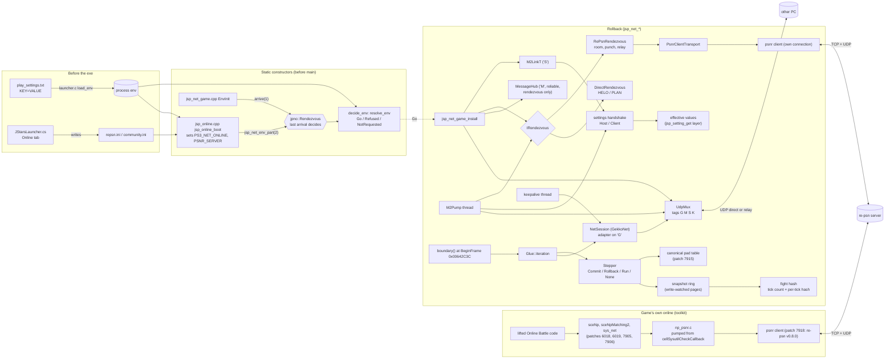
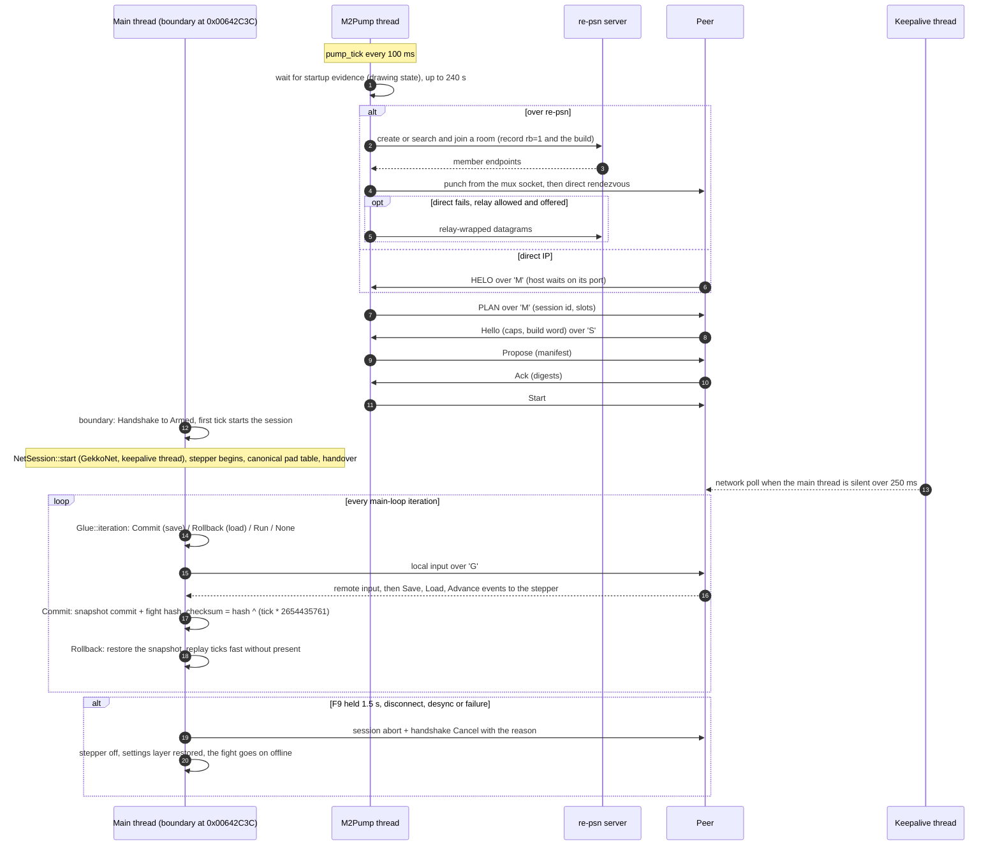

# Netcode map

The two ways two PCs can play together on `main`, and how each is wired. Player-facing pages: [../ONLINE.md](../ONLINE.md)
(the game's own Online Battle) and [../ROLLBACK.md](../ROLLBACK.md) (rollback netcode, with the background). Conventions:
[README.md](README.md#how-to-read-it).

## 1. Two methods, one at a time

| Method | Who implements it | Transport | Start switch |
|---|---|---|---|
| **The game's own online** (Online Battle; "Delay" on the in-game Online page) | the lifted game's own Online Battle code and the toolkit's NP emulation (`libs/network/np_psnr.c`, `sceNpMatching2.c`, the vendored psnr client) | the game's sys_net peer-to-peer socket, and psnr TCP / UDP to a re-psn server | `PS3_NET_ONLINE` + `PSNR_SERVER`, set by `jsp/jsp_online.cpp` from `repsn.ini` / `community.ini` |
| **Rollback** (experimental, opt-in, Free Battle) | port code `jsp/jsp_net_*`, `jsp_session_*`, `jsp_stepper.*`, `jsp_snapshot*`, `jsp_fight_hash.cpp`, and the vendored GekkoNet (`jsp/gekkonet/`, BSD-2-Clause) | one UDP socket per process, multiplexed by a one-byte tag | `JSP_ROLLBACK=1` + a role key, decided before `main()` |

The start decision refuses the pair: with both on, `jpno::resolve_env` sets `JSP_ROLLBACK=0`, removes `PS3_NET_ONLINE` and sets
`JSP_NET_REFUSED=1` (`jsp/jsp_net_online.h:271-305`, the check at `:284-285`). The main menu then shows why
(`jsp_net_notice`, `jsp/jsp_net_game.cpp:711-724`, drawn by `jsp/jsp_port_menu.cpp`).

## 2. Components

## 3. Settings sources

| Source | Read by | Notes |
|---|---|---|
| `play_settings.txt` | `installer/launcher/launcher.c` `load_env` (`:49-72`) turns every line into an environment variable before the exe starts | rollback keys: `JSP_ROLLBACK`, `JSP_ROLLBACK_LISTEN`, `_JOIN`, `_VIA`, `_ROLE`, `_RELAY`, `_BADGE`, and the fields the host sends in the handshake |
| the same file while running | `jsp/jsp_settings.cpp` (`jsp_setting_get`; lookup order: session layer, `jsp_session_text_hook`, live values, `getenv`; `:66-84`) | the in-game Online page writes the keys (`jsp_net_online.h:78-122`); rollback keys take effect at the next start (`jsp_net_game.cpp:8-10`) |
| `repsn.ini`, `community.ini` | `jsp/jsp_online.cpp` `jsp_online_boot` (`:712-740`; file rules in the header, `:9-17`) | sets `PS3_NET_ONLINE`, `PSNR_SERVER`, `PS3_NP_ONLINE_ID`, `PS3_NET_P2P_PORT`; rollback over re-psn reads the identity even with `enabled=0` (`jsp_online_repsn_identity`, `:645-653`); refuses online with gameplay mods (`refuse_for_mods`, `:324-333`) |
| defaults on Go | `jpno::kDefaults` (`jsp_net_online.h:200-208`) | `JSP_FIGHT_HASH`, `JSP_SNAPSHOT*`, `JSP_STEP_TURBO`, `JSP_SNAPSHOT_THREADS=registry` ... |
| session layer | `GameReader::applied` / `restored` (`jsp_net_game.cpp:186-188`), `session_text` (`:158-165`) | the host's values override local reads while a match runs; startup-only fields are never layered (`:161`) |

## 4. Rollback: start and match

Start, in order:

1. Two static constructors report to `jpno::Rendezvous` (`jsp_net_online.h:309-319`): `EnvInit` (`jsp_net_game.cpp:125`) and
   `jsp_online_boot` (`jsp_online.cpp:738`). The second to arrive runs `decide_env` (`jsp_net_game.cpp:112-124`).
2. `resolve_env` answers `NotRequested`, `Refused` (both on, re-psn without a role, bad listen or join value, conflicting role
   keys, not wired) or `Go` (and applies `kDefaults`).
3. `main.cpp` reserves guest memory with write watch (`jsp_rollback_reserve_guest`, `jsp_rollback.cpp:29-40`), then after the
   function table `jsp_rollback_after_table` installs the stepper and `jsp_net_game_install` (`jsp_rollback.cpp:41-46`).
4. `jsp_net_game_install` (`jsp_net_game.cpp:622-704`): mod-set build word, role and path, re-psn identity, `UdpMux::open`, local
   manifest values, `MessageHub`, rendezvous, `M2LinkT`, the 4 frame hooks (table at `:596`: BeginFrame `0x00642C3C`,
   `0x0064EBEC`, `0x0064EF10`, pad update `0x003F7E2C`), `M2Pump::start`.

The per-tick order is in `jsp_net_glue.h:5-14` and `jsp_net_game.cpp:534-590`; the checksum is at `:444`. A desync ends the
match; there is no resync. There is no KO rule on `main`: the end of a fight does not end the session (inferred from its absence).

## 5. Rollback pieces

| Piece | Where | What it does |
|---|---|---|
| Start decision | `jsp_net_online.h:271-319`, `jsp_net_game.cpp:96-125` | section 4 |
| UdpMux | `jsp_net_session.h:54-90` | one socket, one-byte tag, bounded queues per tag, 1400-byte datagrams, re-psn receive and send hooks |
| MessageHub / MessageChannel | `jsp_net_session.h:107-163` | reliable stop-and-wait channel on 'M', rendezvous only |
| DirectRendezvous | `jsp_net_session.h:188-218` | HELO then PLAN |
| RePsnRendezvous | `jsp_net_repsn.h:135-305` | room flag, record match, 4 s punch window, relay only when allowed and offered (`:218-226`) |
| PsnrClientTransport | `jsp_net_repsn_client.h:52-235` | connect on its own thread, `pump()` from the pump thread, probe / punch / relay hooks on the mux |
| Settings handshake | `jsp_session_handshake.h`, `jsp_net_m2_link.h` (`M2LinkT` `:29-58`, `M2Pump` `:61-90`) | Hello, Propose, Ack, Start on 'S'; `handover()` gives liveness to GekkoNet |
| Session settings | `jsp_session_{registry,manifest,digest,effective,reader,settings}.h` | registry, canonical manifest, SHA-256 digest, effective values |
| NetSession | `jsp_net_session.h:261-323`, `jsp_net_session.cpp:475-545` | GekkoNet wrapper; desync detection on; keepalive thread (`:520-537`) |
| Glue | `jsp_net_glue.h:31-101` | the per-iteration driver |
| Stepper | `jsp_stepper.h` (pure), `jsp_stepper.cpp` | maps the GekkoNet frame to the game tick; fast replay on the frame-clock thread (`jsp_rollback_clock_turbo`, `:166`); canonical pad through `g_cellpad_canon_hook` (patch 7915) |
| Snapshot | `jsp_snapshot.cpp`, `jsp_snapshot_{core,flow,ops,ring,sync}.h` | per-tick undo ring of written pages, depth 12; pauses the other host threads; waits on the runtime's census and gate (patches 7910-7917) |
| Thread registry | `jsp_thread_registry.{h,cpp}` | host threads for the pause, from the TLS callback; on when `JSP_ROLLBACK=1` at process start |
| Fight hash | `jsp_fight_hash.cpp` | tick = counted scene pass at `0x0014EA68`; FNV-1a over guest bytes; seeded `cellRtcGetCurrentTick` HLE |
| Badge | `jsp_net_badge.h`, drawn in `jsp_net_game.cpp:252-269` | opt-in status text (`JSP_ROLLBACK_BADGE=1`) |
| Build word | `jsp_build_id.cmake`, `jsp_net_game.cpp:242-243`, `:625-629` | the release build id with the gameplay mod set folded in; a peer with another word is refused in the handshake (`jsp_session_handshake.h:302`, `:579`) |

## 6. The game's own online (toolkit side)

- Port side: `jsp/jsp_online.cpp` only sets the environment before `main()`.
- Toolkit side: psnr is on when `PS3_NET_ONLINE` and `PSNR_SERVER` are both set (`np_psnr_enabled`); one psnr connection per process,
  made when the game first starts an NP context; `np_psnr_pump` runs from `cellSysutilCheckCallback`, that is on the game's own
  polling thread. These toolkit facts are inferred from the exported and patched toolkit, not traced in a running game.
- Patches: 6018 (NP dialogs close at once), 6019 (NP identity log hygiene), 7905 (sys_net call-site probe, default off), 7906
  (reject Matching2 work after the context ends), 7918 (the psnr client replaced by the re-psn v0.8.0 client, shared with the
  rollback rendezvous). Details: [patches.md](patches.md).

## 7. Threads

| Thread | Created | Owns | Locks |
|---|---|---|---|
| Main (guest main thread) | runtime | `boundary()` and the 4 frame hooks (`jsp_net_game.cpp:598-615`), Glue, Stepper, snapshot commit and rollback, `NetSession` update / poll / abort / start, overlay, match end | the pump mutex around handshake calls; `NetSession::gmu_` inside session calls |
| M2Pump | `jsp_net_m2_link.h:69` | every 10 ms `UdpMux::pump` and the 'S' queue; every 100 ms the re-psn client, `MessageHub::pump`, rendezvous poll, handshake | its own mutex |
| Keepalive | `jsp_net_session.cpp:523` | network poll and events when no game call came for 250 ms | `gmu_` by try-lock only |
| Frame clock | `main.cpp:705` | vblank and flip ticks, FIFO drain, present, replay speed-up | toolkit GCM locks |
| re-psn connect worker | `jsp_net_repsn_client.h:64` (detached) | one connect, result handed over through a shared struct | its own mutex |
| Game's polling thread | game | `np_psnr_pump` (game's own online only) | np_psnr lock |

## 8. In review

Two pull requests split from #248 are in review, not on `main`; they change this map once merged: the rollback core (determinism of audio, guest clock and helper
threads, KO and time-up end of a match, adaptive delay, recovery from a lost flip, sessions opened and closed at runtime, toolkit
3005, 3006, 7919-7923, 7927 and a change to 7915), and Online Battle with rollback on top of it (the game's own Online Battle rooms
pair the players and rollback runs the fight; toolkit 7924). This page will be updated after they land.
