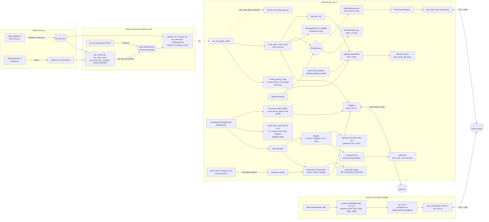
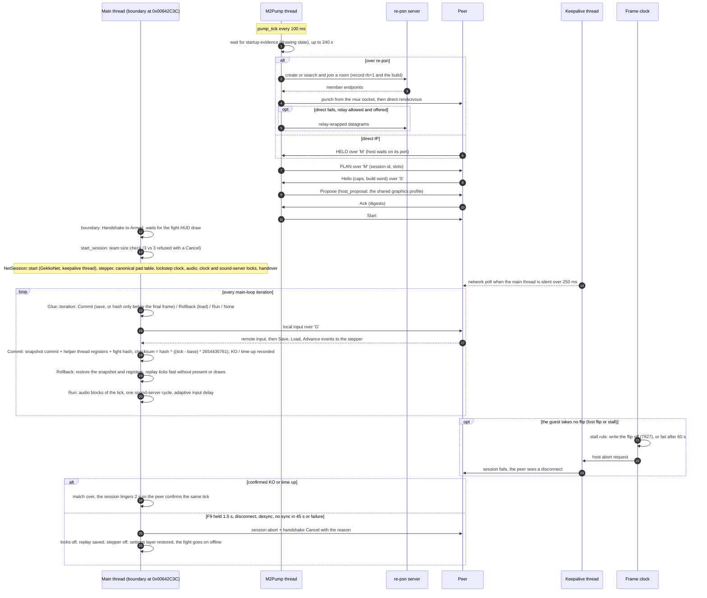

# Netcode map

The two ways two PCs can play together on `main`, and how each is wired. Player-facing pages: [../ONLINE.md](../ONLINE.md)
(the game's own Online Battle) and [../ROLLBACK.md](../ROLLBACK.md) (rollback netcode, with the background). Conventions:
[README.md](README.md#how-to-read-it).

## 1. Two methods, one at a time

| Method | Who implements it | Transport | Start switch |
|---|---|---|---|
| **The game's own online** (Online Battle; "Delay" on the in-game Online page) | the lifted game's own Online Battle code and the toolkit's NP emulation (`libs/network/np_psnr.c`, `sceNpMatching2.c`, the vendored psnr client) | the game's sys_net peer-to-peer socket, and psnr TCP / UDP to a re-psn server | `PS3_NET_ONLINE` + `PSNR_SERVER`, set by `jsp/jsp_online.cpp` from `repsn.ini` / `community.ini` |
| **Rollback** (experimental, opt-in, Free Battle) | port code `jsp/jsp_net_*`, `jsp_session_*`, `jsp_stepper.*`, `jsp_snapshot*`, `jsp_fight_hash.cpp`, and the vendored GekkoNet (`jsp/gekkonet/`, BSD-2-Clause) | one UDP socket per process, multiplexed by a one-byte tag | `JSP_ROLLBACK=1` + a role key, decided before `main()` |

The start decision refuses the pair: with both on, `jpno::resolve_env` sets `JSP_ROLLBACK=0`, removes `PS3_NET_ONLINE` and sets
`JSP_NET_REFUSED=1` (`jsp/jsp_net_online.h:309-348`, the check at `:323-324`). The main menu then shows why
(`jsp_net_notice`, `jsp/jsp_net_game.cpp:1799-1812`, drawn by `jsp/jsp_port_menu.cpp`).

## 2. Components

## 3. Settings sources

| Source | Read by | Notes |
|---|---|---|
| `play_settings.txt` | `installer/launcher/launcher.c` `load_env` (`:49-72`) turns every line into an environment variable before the exe starts | rollback keys: `JSP_ROLLBACK`, `JSP_ROLLBACK_LISTEN`, `_JOIN`, `_VIA`, `_ROLE`, `_RELAY`, `_BADGE`, `_BENCH`, `_RECORD`, the adaptive delay keys `JSP_INPUT_DELAY_AUTO*` and `JSP_ROLLBACK_PREDICTION`, and the fields the host sends in the handshake |
| the same file while running | `jsp/jsp_settings.cpp` (`jsp_setting_get`; lookup order: session layer, `jsp_session_text_hook`, live values, `getenv`; `:66-84`) | the in-game Online page writes the keys (`jsp_net_online.h:82-126`); rollback keys take effect at the next start (`jsp_net_game.cpp:8-10`) |
| `repsn.ini`, `community.ini` | `jsp/jsp_online.cpp` `jsp_online_boot` (`:712-740`; file rules in the header, `:9-17`) | sets `PS3_NET_ONLINE`, `PSNR_SERVER`, `PS3_NP_ONLINE_ID`, `PS3_NET_P2P_PORT`; rollback over re-psn reads the identity even with `enabled=0` (`jsp_online_repsn_identity`, `:645-653`); refuses online with gameplay mods (`refuse_for_mods`, `:324-333`) |
| defaults on Go | `jpno::kDefaults` (`jsp_net_online.h:204-236`) | `JSP_FIGHT_HASH`, `JSP_SNAPSHOT*` (with the layout generation, lwmutex cache, quick save, background audit and site wait), `JSP_STEP_TURBO`, `JSP_STEP_SKIP_DRAWS`, `JSP_ROLLBACK_SKIP_FINAL`, `PSO_ASYNC=0` (marked there as a workaround to replace), `JSP_SNAPSHOT_THREADS=registry` ... |
| test switches | `gated_get` (`jsp_net_game.cpp:117`) through `jpdg::honoured` (`jsp_net_debug_gate.h`) | the keys in `kGated` and `kGatedHash` (audio tick lock, sound-server lock, guest clock, helper thread registers, sparse saving, start point, recorded inputs, fight hash A/B parts) apply only with `JSP_ROLLBACK_ALLOW_DEBUG=1`; none is in the handshake, so a value set on one PC alone is ignored and logged |
| what the host proposes | `jpsm::host_proposal` (`jsp_session_registry.h:215`; the overload with a reader in `jsp_session_effective.h:49-54`), called from `pump_tick` (`jsp_net_game.cpp:934`) | the host's own values, except each Live SharedProfile field (Model detail, Object draw distance, Shadow range), which becomes `jpss::conservative()`, and each Startup SharedProfile field (`PIPE`, `JSP_RENDER60`), which becomes the value the renderer started with |
| session layer | `GameReader::applied` / `restored` (`jsp_net_game.cpp:217-219`), `session_text` (`:189-196`) | the host's values override local reads while a match runs; startup-only fields are never layered (`:192`) |

## 4. Rollback: start and match

Start, in order:

1. Two static constructors report to `jpno::Rendezvous` (`jsp_net_online.h:352-362`): `EnvInit` (`jsp_net_game.cpp:156`) and
   `jsp_online_boot` (`jsp_online.cpp:738`). The second to arrive runs `decide_env` (`jsp_net_game.cpp:144-155`).
2. `resolve_env` answers `NotRequested`, `Refused` (both on, re-psn without a role, bad listen or join value, conflicting role
   keys, a bench depth outside 1-8 or a bench with a role key, not wired) or `Go` (and applies `kDefaults`).
3. `main.cpp` reserves guest memory with write watch (`jsp_rollback_reserve_guest`, `jsp_rollback.cpp:27-37`), then after the
   function table `jsp_rollback_after_table` installs the stepper and `jsp_net_game_install` (`jsp_rollback.cpp:41-46`).
4. `jsp_net_game_install` (`jsp_net_game.cpp:1746-1792`): the build word with the mod set folded in (`:1752-1754`); with
   `JSP_ROLLBACK_BENCH` the bench is armed at once, with no socket and no handshake (`:1755-1767`); else the start-up role is read and
   `conn_open` (`:1656-1715`) opens one session: re-psn identity, `UdpMux::open`, local manifest values, `MessageHub`, rendezvous,
   `M2LinkT`, `M2Pump::start`. Then `install_process_wide` (`:1637-1652`) installs the 4 frame hooks (table at `:1552`: BeginFrame
   `0x00642C3C`, `0x0064EBEC`, `0x0064EF10`, pad update `0x003F7E2C`), drops an F9 pad binding and sets the settings text hook.
   `conn_close` (`:1717-1737`) undoes `conn_open`; on `main` only the start-up path calls them (the comment at `:1629-1632` names
   a runtime lobby as a later caller).
5. At the first fight tick after the handshake (`boundary`, `jsp_net_game.cpp:1399`), `start_session` (`:1227-1291`) refuses a
   3 vs 3 fight (rule in `jsp_net_team_rule.h`, call at `jsp_net_game.cpp:1247-1251`), starts the GekkoNet session (with recording when
   `JSP_ROLLBACK_RECORD=1`, `jsp_net_game.cpp:1243`), the stepper, then the audio tick lock, the lockstep clock with the session's host
   abort handle, the guest clock shift and the sound-server lock (`jsp_net_game.cpp:1286-1289`).

The per-tick order is in `jsp_net_glue.h:5-13` and `jsp_net_game.cpp:1399-1546`; the checksum is at `:973` (commit) and `:987` (hash
only). A desync ends the match; there is no resync.

How a match ends, all in `boundary` (`jsp_net_game.cpp:1399-1546`) unless named:

| End | Where | Rule |
|---|---|---|
| KO or time up | `ko_record` (`jsp_net_game.cpp:1049-1056`), `ko_scan` (`jsp_net_game.cpp:1062-1072`); rules in `jsp_net_ko_rule.h` | the winner of every saved tick is recorded; the earliest one on a confirmed tick ends the match on both PCs, quietly, with no abort (`jsp_net_game.cpp:1513`) |
| Disconnect | `ko_after_disconnect` (`jsp_net_game.cpp:1075-1085`), `jkr::disconnect_result` | a result survives a disconnect only when the live confirmation watermark covers its tick; anything else ends as "Opponent disconnected" |
| Desync | `jsp_net_game.cpp:1481-1489` | ends the match (the bench only counts it) |
| Frame clock stall | `jsp_stall_rule.h`, `jsp_stepper.cpp:513`, `:553`; `jsp_host_abort.h` | the frame clock writes a lost flip off, or fails after `kFailMs` (60 s) and posts the host abort, which the keepalive worker turns into `NetSession::fail` (`jsp_net_session.cpp:574`) |
| No sync | `jsp_net_game.cpp:1500-1503` (`kSyncDeadlineMs` 45 s, `jsp_net_game.cpp:1386`) | the peer never reached its fight |
| F9 held | `jsp_net_game.cpp:1441` (`jpno::cancel_held`, 1.5 s) | ended by the player |

## 5. Rollback pieces

Every glue file is also listed in [layers.md](layers.md#l3-game-glue-installerportjsp).

| Piece | Where | What it does |
|---|---|---|
| Start decision | `jsp_net_online.h:309-362`, `jsp_net_game.cpp:127-156` | section 4 |
| UdpMux | `jsp_net_session.h:68-106` | one socket, one-byte tag, bounded queues per tag, 1400-byte datagrams, re-psn receive and send hooks; the thread and lock contract is in the header (`:12-23`) |
| MessageHub / MessageChannel | `jsp_net_session.h:123-179` | reliable stop-and-wait channel on 'M', rendezvous only |
| DirectRendezvous | `jsp_net_session.h:204-234` | HELO then PLAN |
| RePsnRendezvous | `jsp_net_repsn.h:135-308` | room flag, record match, 4 s punch window, relay only when allowed and offered (`:221-229`) |
| PsnrClientTransport | `jsp_net_repsn_client.h:52-235` | connect on its own thread, `pump()` from the pump thread, probe / punch / relay hooks on the mux |
| Settings handshake | `jsp_session_handshake.h`, `jsp_net_m2_link.h` (`M2LinkT` `:29-58`, `M2Pump` `:61-90`) | Hello, Propose, Ack, Start on 'S'; `handover()` gives liveness to GekkoNet |
| Session settings | `jsp_session_registry.h`, `jsp_session_manifest.h`, `jsp_session_digest.h`, `jsp_session_effective.h`, `jsp_session_reader.h`, `jsp_session_settings.h` | registry (with `host_proposal`, `jsp_session_registry.h:215`), canonical manifest, SHA-256 digest, effective values (`host_proposal` with startup evidence, `jsp_session_effective.h:52-62`), readers, the shared graphics profile |
| NetSession | `jsp_net_session.h:304-406`, `jsp_net_session.cpp:508-672` | GekkoNet wrapper in three modes (`SessionMode` Game, Stress, Replay); desync detection on; keepalive thread (`:560-581`); `stop()` returns it to its constructed state so a later session can start in the same process |
| Host abort | `jsp_host_abort.h`, `NetSession::host_abort_handle` | the frame clock's failure request to the keepalive worker; a retired handle posts nothing |
| Replays | `save_replay` (`jsp_net_game.cpp:746`), `SessionConfig::record`, `NetSession::recording` / `start_replay` | opt-in `JSP_ROLLBACK_RECORD=1`: confirmed inputs and per-tick checksums in GekkoNet's GKRP v2 format, one `.gkrp` file per match under `replays/` (or `JSP_ROLLBACK_RECORD_DIR`); played back by the host test `net_replay_test.cpp` |
| Bench | `start_bench` (`jsp_net_game.cpp:1295`), `bench_iteration` (`:1320`), `jpno::bench_depth` (`jsp_net_online.h`) | test tooling: `JSP_ROLLBACK_BENCH=N` runs the fight through a local stress session that rolls back N ticks every tick and logs the cost |
| Adaptive input delay | `jsp_net_delay_rule.h` (pure), `adapt_settings` / `adapt_delay` (`jsp_net_game.cpp:401-446`) | on unless `JSP_INPUT_DELAY_AUTO=0`; each PC sets only its own input delay from GekkoNet's round trips and deep rollbacks; `JSP_ROLLBACK_PREDICTION` (default 6) caps the prediction window |
| Match rules | `jsp_net_ko_rule.h`, `jsp_net_team_rule.h` | KO / time-up end and the live watermark; 2 vs 2 only |
| Debug gate | `jsp_net_debug_gate.h`, `gated_get` (`jsp_net_game.cpp:117`) | test switches apply only with `JSP_ROLLBACK_ALLOW_DEBUG=1` |
| Tick locks | `jsp_net_game.cpp`: audio `audio_lock_*` `:454-483` (patch 3005), guest clock `:484-521` and `guest_clock_*` `:631-647` (patch 3006), sound server `cri_*` `:522-620` (the usleep hook of patch 3006), helper thread registers `regs_save` / `regs_restore` `:654-693` (patch 7923, `jsp_thread_bit.h`) | what one PC's guest sees of the host's clocks and threads follows the game tick, so two PCs simulate the same ticks |
| Glue | `jsp_net_glue.h:34-116` | the per-iteration driver; with `JSP_ROLLBACK_SKIP_FINAL` a save below GekkoNet's final frame (`gekko_final_frame`, a local GekkoNet addition, `gekkonet/PIN.md`) gets a checksum but no snapshot |
| Stepper | `jsp_stepper.h` (pure), `jsp_stepper.cpp` | maps the GekkoNet frame to the game tick; fast replay on the frame-clock thread (`jsp_rollback_clock_turbo`, `:546`) with re-run draws skipped (patch 7919); the replay flag `jsp_stepper_in_replay` (`:208`); the lockstep clock (`:324-349`) with the stall rule (`jsp_stall_rule.h`, patch 7927); canonical pad through `g_cellpad_canon_hook` and pad info through `g_cellpad_info_hook` (patch 7915, `jsp_stepper.cpp:627-647`); local pad read with `ps3_pad_peek_record` (patch 7922) |
| Step effects | `jsp_step_effects.h`, `jsp_effects_request` (`jsp_stepper.cpp:611`) | which side effects a re-run tick may repeat |
| Step input | `jsp_step_input.h` | the canonical per-tick input |
| Snapshot | `jsp_snapshot.cpp`, `jsp_snapshot_core.h`, `jsp_snapshot_flow.h`, `jsp_snapshot_ops.h`, `jsp_snapshot_ring.h`, `jsp_snapshot_sync.h` | per-tick undo ring of written pages, depth 12; pauses the other host threads; waits on the runtime's census and gate (patches 7910-7917, 7920, 7921); park roles use `jsp_thread_bit.h` |
| Thread registry | `jsp_thread_registry.h`, `jsp_thread_registry.cpp`, `jsp_audit_start.h` | host threads for the pause, from the TLS callback; on when `JSP_ROLLBACK=1` at process start; a thread with no attach notification within 200 ms is adopted (`jsp_thread_registry.cpp:150-160`); the background audit worker is started again at each scheduled audit until it runs (`jau::Starter`, `jsp_snapshot.cpp:1344-1366`) |
| Fight hash | `jsp_fight_hash.cpp`, `jsp_fight_setup_rule.h` | tick = counted scene pass at `0x0014EA68`; FNV-1a over guest bytes; seeded `cellRtcGetCurrentTick` HLE; the battle setup table is hashed into its own part and kept out of the checksum only on a native online fight (this build has none, so it stays in); KO winner and end state for the match rules (`jsp_fight_hash.cpp:645`, `:661`) |
| Badge | `jsp_net_badge.h`, drawn in `jsp_net_game.cpp:350-369` | opt-in status text (`JSP_ROLLBACK_BADGE=1`) |
| Shared overlay layer | `jsp_net_overlay_held` (`jsp_net_game.cpp:1742`), `jsp_port_menu_overlay_held` (`jsp_port_menu.cpp:1188`) | the Training readout (`jsp_train_readout.h`, drawn by `jsp_game.cpp`) yields the layer while either holds it (`jsp_game.cpp:2995`); it also ignores re-run ticks through `jsp_stepper_in_replay` (`jsp_game.cpp:74`, `:2852`, `:2937`) |
| Build word | `jsp_build_id.cmake`, `jsp_net_game.cpp:326-327`, `:1752-1754` | the release build id with the gameplay mod set folded in; a peer with another word is refused in the handshake (`jsp_session_handshake.h:302`, `:579`) |

## 6. The game's own online (toolkit side)

- Port side: `jsp/jsp_online.cpp` only sets the environment before `main()`.
- Toolkit side: psnr is on when `PS3_NET_ONLINE` and `PSNR_SERVER` are both set (`np_psnr_enabled`); one psnr connection per process,
  made when the game first starts an NP context; `np_psnr_pump` runs from `cellSysutilCheckCallback`, that is on the game's own
  polling thread. These toolkit facts are inferred from the exported and patched toolkit, not traced in a running game.
- Patches: 6018 (NP dialogs close at once), 6019 (NP identity log hygiene), 7905 (sys_net call-site probe, default off), 7906
  (reject Matching2 work after the context ends), 7918 (the psnr client replaced by the re-psn v0.8.0 client, shared with the
  rollback rendezvous), 7928 (`sys_net_abort_socket` wakes a receive blocked on that socket, and errno is per thread: the game's
  P2P teardown after a lost opponent no longer hangs; from the patch header). Details: [patches.md](patches.md).

## 7. Threads

| Thread | Created | Owns | Locks |
|---|---|---|---|
| Main (guest main thread) | runtime | `boundary()` and the 4 frame hooks (`jsp_net_game.cpp:1554-1574`), Glue, Stepper, snapshot commit and rollback, `NetSession` update / poll / abort / start / stop, the tick locks, overlay, match end | the pump mutex around handshake calls; `NetSession::gmu_` inside session calls |
| M2Pump | `jsp_net_m2_link.h:69` | every 10 ms `UdpMux::pump` and the 'S' queue; every 100 ms the re-psn client, `MessageHub::pump`, rendezvous poll, handshake | its own mutex |
| Keepalive | `jsp_net_session.cpp:567` | network poll and events when no game call came for 250 ms; turns a posted host abort into `NetSession::fail` | `gmu_` by try-lock only |
| Frame clock | `main.cpp:717` | vblank and flip ticks, FIFO drain, present, replay speed-up, the lockstep clock and the stall rule (`jsp_stepper.cpp`) | toolkit GCM locks |
| re-psn connect worker | `jsp_net_repsn_client.h:64` (detached) | one connect, result handed over through a shared struct | its own mutex |
| Snapshot copy workers | `jsp_snapshot.cpp:283-295` | page copies for the snapshot; live for the process, exempt from the pause | a semaphore |
| Thread audit worker | `jsp_snapshot.cpp:1351` (`JSP_SNAPSHOT_AUDIT_ASYNC=1`, a rollback default) | lists the process's threads every period for the thread registry | inferred: none shared with the game thread |
| Task watch arm | `jsp_net_game.cpp:1197` (diagnostic, `JSP_NET_TASK_WATCH=1`) | arms the watch, then exits; the main thread waits up to 5 s | none |
| Game's polling thread | game | `np_psnr_pump` (game's own online only) | np_psnr lock |

## 8. In review

Online Battle with rollback is in review, not on `main`: the game's own Online Battle rooms pair the players and rollback runs the
fight (toolkit 7924). This page will be updated after it lands.
