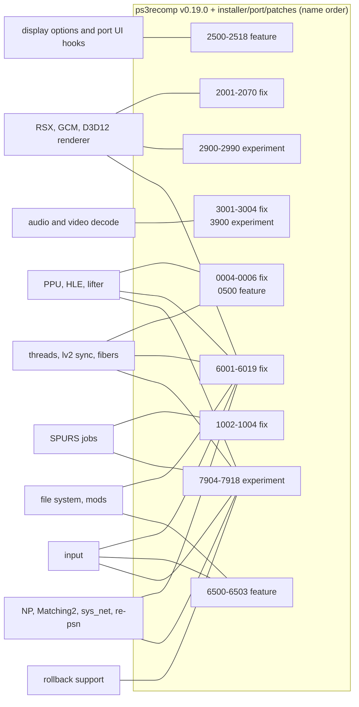
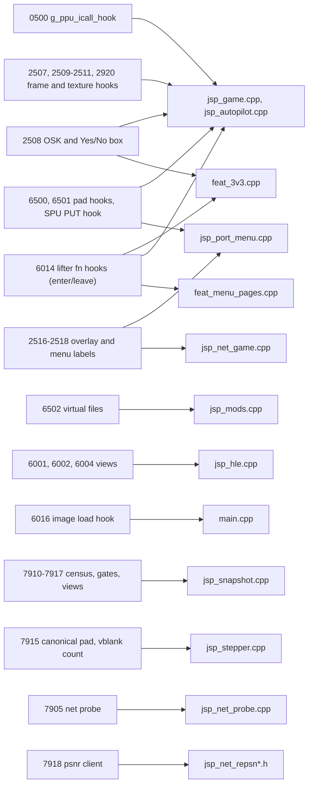

# Toolkit patch map

Every patch in `installer/port/patches/` on `main` (141), with the toolkit files it touches, its area, the environment switches it
reads and the glue that calls into it. What each patch does, in one line, is in
[`installer/port/patches/INDEX.md`](../../installer/port/patches/INDEX.md); the patch file's own header has the details.
Conventions: [README.md](README.md#how-to-read-it).

## How the series is applied

- `installer/tools/export_toolkit.py` pins ps3recomp v0.19.0 (`:24-25`) and applies `installer/port/patches/*.patch` with
  `git apply` in name order (`:66-78`). CI applies the whole series twice (`tools/ci/check_patch_series.py`, with and without
  `core.autocrlf`).
- `INDEX.md` is generated by `installer/tools/patch_index.py` (`--check` verifies it); the upstream column comes from
  `upstream.tsv`. To write patches from a toolkit branch: `installer/tools/series_export.py`.
- Numbers missing from the series were merged upstream before v0.19.0 and dropped (`upstream.tsv:3-4`: 0001-0003, 0007-0010,
  1001, 2004, 2010).

## Numbering

The first digit is the group, the last three digits the line: x001-x499 fix, x500-x899 feature, x900-x999 experiment
(`INDEX.md:3`).

| First digit | Declared group | What is there | Count on `main` |
|---|---|---|---|
| 0 | build | runtime core: 0004 HLE TOC slot, 0005 cellFiber, 0006 lv2 event wait, 0500 indirect-call hook | 4 |
| 1 | SPURS | 1002-1004 job guard and JOBCRT context | 3 |
| 2 | GCM/D3D12 | 2001-2070 renderer fixes, 2500-2518 display options and port UI hooks, 2900-2990 performance experiments and diagnostics | 95 |
| 3 | audio | 3001, 3004 cellAudio; 3002, 3003 cellVdec (video decode); 3900 audio diagnostic | 5 |
| 6 | runtime/HLE/pad | 6001-6019 fixes (PPU, HLE, fs, pad scripting, GCM timing, lv2 usleep, lifter hooks, NP); 6500-6503 input and fs features | 19 |
| 7 | (not declared in the index header) | 7904-7918, all on the experiment line: rollback support (census, gates, views, canonical pad), multi-pad (7908, 7909), sys_net probe (7905), Matching2 (7906), re-psn client (7918), two-thread drawing on by default (7907) | 15 |

## Hooks the glue uses

Most renderer patches have no glue symbol: they are steered by environment switches, which reach the game from the settings file
through the launcher, from `jsp_settings.cpp` (`_putenv_s` for live settings), or from defaults in `main.cpp:630-635`
(`AUDIO_NBLOCK=16` for 3001, `VDEC_ALPHA=255` for 3002).

## Every patch on `main`

"Port glue" lists the symbols the patch adds that `installer/port/jsp/` uses, with the file and line of the first declaration or
use; "-" means the patch is self-contained or only switched by an environment variable. `jsp_training.cpp` is not built.

| # | Line | Toolkit files | Area | Switches (env) | Port glue that uses it |
|---|---|---|---|---|---|
| 0004 | fix | runtime/ppu/ppu_hle.cpp | hle |  | - |
| 0005 | fix | libs/spurs/cellFiber.c | threads (fiber) |  | - |
| 0006 | fix | runtime/syscalls/sys_event.c | threads (lv2 sync) | EVQ_SUBMS_WAIT | - |
| 0500 | feature | runtime/ppu/ppu_loader.cpp | ppu |  | g_ppu_icall_hook: jsp_game.cpp:93, jsp_autopilot.cpp:24, jsp_training.cpp:9 |
| 1002 | fix | libs/spurs/cellSpurs.c | spurs |  | - |
| 1003 | fix | runtime/spu/spurs_job.c | spurs | SPURS_CTX_PAD | - |
| 1004 | fix | libs/spurs/cellSpurs.c | spurs | SPURS_GUARD_EVENT | - |
| 2001 | fix | libs/video/cellGcmSys.c | gcm |  | cellGcm_default_context_ea / cellGcm_context_slot_ea: main.cpp:500-501, jsp_snapshot.cpp:76-77 |
| 2002 | fix | libs/video/rsx_d3d12_backend.c | rsx (d3d12) | VP_NO_MIDFLUSH | - |
| 2003 | fix | libs/video/rsx_d3d12_backend.c | rsx (d3d12) | VP_MIDFLUSH_WAIT | - |
| 2005 | fix | libs/video/rsx_d3d12_backend.c | rsx (d3d12) | FP_PAR_COMPILE, FP_THREADS, FP_OFF, FP_CONSTBUF ... | - |
| 2006 | fix | libs/video/cellGcmSys.c | gcm |  | - |
| 2007 | fix | libs/video/rsx_d3d12_backend.c | rsx (d3d12) |  | - |
| 2008 | fix | libs/video/rsx_commands.c, libs/video/rsx_commands.h, libs/video/rsx_d3d12_backend.c | rsx (d3d12) |  | - |
| 2009 | fix | libs/video/rsx_d3d12_backend.c | rsx (d3d12) |  | - |
| 2011 | fix | libs/video/rsx_commands.c, libs/video/rsx_commands.h, libs/video/rsx_d3d12_backend.c | rsx (d3d12) | RT_READBACK_MAXPX, RT_READBACK | - |
| 2012 | fix | libs/video/rsx_d3d12_backend.c | rsx (d3d12) | TEX_MIPS | - |
| 2013 | fix | libs/video/jsp_ex_logo.h, libs/video/rsx_d3d12_backend.c | rsx (d3d12) | JSP_EX_LOGO, JSP_EX_LOGO_ART | - (reads ex_logo_A.rgba drawn by installer/tools/ex_logo_art.py, copied next to the exe by firstrun.py:870) |
| 2014 | fix | libs/video/rsx_d3d12_backend.c | rsx (d3d12) | DRAW_SKIP_CLASS, DRAW_CLASS_STATS | - |
| 2015 | fix | libs/video/rsx_d3d12_backend.c | rsx (d3d12) | FP_DUMP_FROM, TEX_DDS_DUMP | - |
| 2016 | fix | libs/video/rsx_d3d12_backend.c | rsx (d3d12) |  | - |
| 2017 | fix | libs/video/rsx_d3d12_backend.c | rsx (d3d12) | RSX_SHADOW_CMP | - |
| 2018 | fix | libs/video/rsx_d3d12_backend.c | rsx (d3d12) | RSX_DS_REMAP | - |
| 2019 | fix | libs/video/rsx_d3d12_backend.c, libs/video/rsx_texture_layout.c | rsx (d3d12) | RSX_TEX_PITCH | - |
| 2020 | fix | libs/video/rsx_d3d12_backend.c | rsx (d3d12) | TEX_DDS_OFF, RSX_TEX_FMT16, ATLAS_VTX, TEXSKIP_DBG | - |
| 2023 | fix | libs/video/rsx_d3d12_backend.c | rsx (d3d12) | RSX_TEX_GAMMA | - |
| 2024 | fix | libs/video/rsx_d3d12_backend.c | rsx (d3d12) |  | - |
| 2025 | fix | libs/video/rsx_d3d12_backend.c, libs/video/rsx_fp_decompiler.c, libs/video/rsx_fp_decompiler.h | rsx (d3d12) | SHADER_HASH_MEMO | - |
| 2028 | fix | libs/video/rsx_d3d12_backend.c | rsx (d3d12) |  | - |
| 2029 | fix | libs/video/rsx_d3d12_backend.c | rsx (d3d12) | STRIP_IX | - |
| 2030 | fix | libs/video/rsx_d3d12_backend.c | rsx (d3d12) | VF_FAST | - |
| 2031 | fix | libs/video/rsx_d3d12_backend.c, libs/video/rsx_fp_decompiler.c | rsx (d3d12) |  | - |
| 2032 | fix | libs/video/rsx_commands.c, libs/video/rsx_commands.h, libs/video/rsx_d3d12_backend.c | rsx (d3d12) | STRIP_CONT, RESTART_OFF, RESTART_LOG | - |
| 2033 | fix | libs/video/rsx_d3d12_backend.c | rsx (d3d12) | VF_FAST, VP_NOFREQ, VTX_W1, VTX_TYPEDBG | - |
| 2034 | fix | libs/video/rsx_d3d12_backend.c, libs/video/rsx_vp_decompiler.c, libs/video/rsx_vp_decompiler.h, libs/video/rsx_vpull.h | rsx (d3d12) | VPULL, VPULL_RING_MB, VPULL_SPARSE, VPULL_ONCE | env switch |
| 2035 | fix | libs/video/rsx_d3d12_backend.c | rsx (d3d12) | VPULL_FAST16 | - |
| 2036 | fix | libs/video/rsx_commands.c, libs/video/rsx_commands.h | rsx (d3d12) |  | - |
| 2037 | fix | libs/video/rsx_d3d12_backend.c | rsx (d3d12) |  | - |
| 2038 | fix | libs/video/rsx_d3d12_backend.c | rsx (d3d12) |  | - |
| 2039 | fix | libs/video/rsx_d3d12_backend.c | rsx (d3d12) |  | - |
| 2040 | fix | libs/video/rsx_commands.c, libs/video/rsx_commands.h, libs/video/rsx_d3d12_backend.c | rsx (d3d12) | SRGB_OUT | - |
| 2041 | fix | libs/video/rsx_d3d12_backend.c | rsx (d3d12) | VF_UNROLL | - |
| 2042 | fix | libs/video/rsx_d3d12_backend.c | rsx (d3d12) |  | - |
| 2043 | fix | libs/video/rsx_d3d12_backend.c | rsx (d3d12) |  | - |
| 2044 | fix | libs/video/rsx_d3d12_backend.c | rsx (d3d12) | SRV_MEMO | - |
| 2045 | fix | libs/video/rsx_d3d12_backend.c | rsx (d3d12) | VPULL | - |
| 2048 | fix | libs/video/rsx_commands.c, libs/video/rsx_commands.h, libs/video/rsx_d3d12_backend.c, libs/video/rsx_fp_decompiler.c | rsx (d3d12) | RSX_POLY_OFFSET, ZPASS_ARGB_TXP, RSX_FP_INLINE_K, SHADOW_BIAS | - |
| 2049 | fix | libs/video/rsx_d3d12_backend.c | rsx (d3d12) | VPULL_MULTI | - |
| 2050 | fix | libs/video/rsx_d3d12_backend.c | rsx (d3d12) | VPULL_REUSE, VPULL_DUP | - |
| 2051 | fix | libs/video/rsx_commands.c | rsx (d3d12) |  | - |
| 2053 | fix | libs/video/rsx_d3d12_backend.c | rsx (d3d12) | VCB_SHARE | - |
| 2054 | fix | libs/video/rsx_d3d12_backend.c | rsx (d3d12) | TEX_HINT | - |
| 2055 | fix | libs/video/rsx_d3d12_backend.c | rsx (d3d12) |  | - |
| 2056 | fix | libs/video/rsx_d3d12_backend.c | rsx (d3d12) | FP_KBUF | - |
| 2057 | fix | libs/video/rsx_d3d12_backend.c | rsx (d3d12) | PSO_ASYNC, PSO_ASYNC_THREADS | - |
| 2058 | fix | libs/video/rsx_d3d12_backend.c | rsx (d3d12) | FPK_REPLAY | - |
| 2059 | fix | libs/video/rsx_d3d12_backend.c | rsx (d3d12) | TEX16_BIND | - |
| 2060 | fix | libs/video/rsx_d3d12_backend.c | rsx (d3d12) | SCREEN_TEX_DXT | - |
| 2061 | fix | libs/video/rsx_d3d12_backend.c | rsx (d3d12) | ALPHA_TEST | - |
| 2062 | fix | libs/video/rsx_d3d12_backend.c | rsx (d3d12) | SCREEN_TEX_DATA | - |
| 2064 | fix | libs/video/rsx_d3d12_backend.c | rsx (d3d12) |  | - |
| 2065 | fix | libs/video/rsx_d3d12_backend.c | rsx (d3d12) | FPA_RECLAIM | - |
| 2066 | fix | libs/video/rsx_d3d12_backend.c | rsx (d3d12) |  | - |
| 2067 | fix | libs/video/rsx_d3d12_backend.c | rsx (d3d12) | BC_NATIVE | - |
| 2068 | fix | libs/video/rsx_d3d12_backend.c | rsx (d3d12) | PSO_WARMUP, PSO_WARMUP_THREADS | - |
| 2069 | fix | libs/video/rsx_d3d12_backend.c, libs/video/psow_file.h | rsx (d3d12) |  | - |
| 2070 | fix | libs/video/rsx_d3d12_backend.c | rsx (d3d12) | VS_ASYNC | - |
| 2500 | feature | libs/video/rsx_d3d12_backend.c | rsx (d3d12) | WINDOW_ICON, WINDOW_SIZE, FULLSCREEN, TITLE_STATS | - |
| 2501 | feature | libs/video/rsx_d3d12_backend.c | rsx (d3d12) |  | - |
| 2502 | feature | libs/video/rsx_d3d12_backend.c | rsx (d3d12) | SHADOW_SCALE | - |
| 2503 | feature | libs/video/rsx_d3d12_backend.c | rsx (d3d12) | RES_SCALE, ZCOPY_FULL | - |
| 2504 | feature | libs/video/rsx_d3d12_backend.c | rsx (d3d12) |  | - |
| 2505 | feature | libs/video/rsx_fp_decompiler.c | rsx (d3d12) | SHADOW_BIAS | - |
| 2506 | feature | libs/video/rsx_fp_decompiler.c | rsx (d3d12) | SHADOW_BIAS, SHADOW_RPDB | - |
| 2507 | feature | libs/video/rsx_d3d12_backend.c | rsx (d3d12) |  | g_tex_patch_hook: jsp_game.cpp:75; feat_menu_pages.cpp:241 |
| 2508 | feature | libs/misc/cellOskDialog.c, libs/system/cellSysutil.c, libs/video/rsx_d3d12_backend.c | sysutil/osk (ui) | OSK_DIALOG | cellOskDialog_overlay_active/_key/_confirm_open/_confirm_poll/_choice_open, rsx_d3d12_request_close: jsp_game.cpp:84-89, feat_3v3.cpp:29-32 |
| 2509 | feature | libs/video/rsx_d3d12_backend.c | rsx (d3d12) |  | g_rsx_copy_rects, g_rsx_stamp, g_rsx_stamp2, g_rsx_cutout (+ declares g_rsx_ui_scale, g_rsx_aa_mode): jsp_game.cpp:80-81, 90-92, 1825 |
| 2510 | feature | libs/video/rsx_d3d12_backend.c | rsx (d3d12) | UI_SCALE_DBG | g_rsx_ui_scale: jsp_game.cpp:80 |
| 2511 | feature | libs/video/rsx_d3d12_backend.c, libs/video/third_party_smaa/AreaTex.h, libs/video/third_party_smaa/SMAA.hlsl, libs/video/third_party_smaa/SMAA_hlsl.inc, libs/video/third_party_smaa/SearchTex.h | rsx (d3d12) |  | g_rsx_aa_mode: jsp_game.cpp:81 |
| 2512 | feature | libs/video/rsx_d3d12_backend.c | rsx (d3d12) | FX_NOBLUR, FX_FULL, FX_FULL_TARGETS | - |
| 2513 | feature | libs/video/rsx_fp_decompiler.c | rsx (d3d12) | SHADOW_RPDB, SHADOW_SOFT, SHADOW_SCALE | - |
| 2514 | feature | libs/video/rsx_d3d12_backend.c | rsx (d3d12) | SHADOW_DEPTH_DIRECT | - |
| 2515 | feature | libs/video/rsx_d3d12_backend.c | rsx (d3d12) | SHADOW_TAP_SCALE | - |
| 2516 | feature | libs/video/jsp_menu_label.h, libs/video/rsx_d3d12_backend.c | rsx (d3d12) | JSP_MENU_TRAINING_LABEL, JSP_MENU_LABEL_DIR, JSP_MENU_LABEL_DUMP | jsp_menu_label_set: jsp_overlay_api.h:41, jsp_port_menu.cpp:1208; art from installer/tools/menu_label_art.py |
| 2517 | feature | libs/video/jsp_overlay.h, libs/video/rsx_d3d12_backend.c | rsx (d3d12) | JSP_MENU_LABEL_DIR | jsp_overlay_begin/_end/_close/_active/_text\*/_fill_rect: jsp_overlay_api.h:26-36, jsp_port_menu.cpp:923-1021, jsp_net_game.cpp:255-267, 587 |
| 2518 | feature | libs/video/jsp_menu_label.h, libs/video/rsx_d3d12_backend.c | rsx (d3d12) | JSP_MENU_LABEL_MASK, JSP_MENU_TRAINING_LABEL | jsp_menu_label_panel: jsp_overlay_api.h:39, jsp_port_menu.cpp:699 |
| 2900 | experiment | libs/video/rsx_d3d12_backend.c | rsx (d3d12) |  | - |
| 2905 | experiment | libs/video/rsx_d3d12_backend.c | rsx (d3d12) | HITCH | - |
| 2906 | experiment | libs/video/rsx_d3d12_backend.c | rsx (d3d12) | GPU_TIME | - |
| 2907 | experiment | libs/video/rsx_d3d12_backend.c | rsx (d3d12) | GPU_OVERLAP | - |
| 2909 | experiment | libs/video/rsx_d3d12_backend.c | rsx (d3d12) | VS_MEMO | - |
| 2910 | experiment | libs/video/rsx_d3d12_backend.c | rsx (d3d12) | FP_FRAME_MEMO | - |
| 2911 | experiment | libs/video/rsx_d3d12_backend.c | rsx (d3d12) | OFFRT_CACHE | - |
| 2912 | experiment | libs/video/rsx_d3d12_backend.c | rsx (d3d12) | PIPE, FPK_REPLAY, SHK_DBG | - |
| 2913 | experiment | libs/video/rsx_d3d12_backend.c | rsx (d3d12) |  | - |
| 2914 | experiment | libs/video/rsx_d3d12_backend.c | rsx (d3d12) | FPK_REPLAY, FPK_MEMO | - |
| 2915 | experiment | libs/video/rsx_d3d12_backend.c | rsx (d3d12) | D3D12_VSYNC | - |
| 2918 | experiment | libs/video/rsx_d3d12_backend.c | rsx (d3d12) |  | - |
| 2919 | experiment | libs/video/cellGcmSys.c | gcm | GCM2D_RUN | - |
| 2920 | experiment | libs/video/rsx_d3d12_backend.c | rsx (d3d12) |  | g_rsx_tint_rects: jsp_game.cpp:76 |
| 2933 | experiment | libs/video/rsx_d3d12_backend.c | rsx (d3d12) | VPULL_GATHER | - |
| 2990 | experiment | libs/video/rsx_d3d12_backend.c | rsx (d3d12) |  | - |
| 3001 | fix | libs/audio/cellAudio.c | audio | AUDIO_NBLOCK | AUDIO_NBLOCK=16 default set by main.cpp:630,635 (env, not a symbol) |
| 3002 | fix | libs/codec/cellVdec.c | video decode | VDEC_ALPHA | VDEC_ALPHA=255 default set by main.cpp:633 (env) |
| 3003 | fix | libs/codec/cellVdec.c | video decode | VDEC_DEFER | - |
| 3004 | fix | libs/audio/audio_wasapi_recover.h, libs/audio/cellAudio.c, libs/audio/tests/test_audio_device_recover.c | audio |  | - |
| 3900 | experiment | libs/audio/cellAudio.c | audio | AUDIO_SILENCE | - |
| 6001 | fix | runtime/ppu/ppu_loader.cpp | ppu |  | ppu_resv_ctx_at: jsp_hle.cpp:130 |
| 6002 | fix | runtime/ppu/ppu_hle.cpp | hle |  | g_hle_inflight, g_hle_last: jsp_hle.cpp:131-132 |
| 6003 | fix | libs/input/cellPad.c | input |  | PAD_SCRIPT (env) |
| 6004 | fix | runtime/ppu/ppu_fs.cpp | fs |  | g_ppu_fs_last_read_ms: jsp_game.cpp:69, jsp_hle.cpp:101 |
| 6005 | fix | libs/video/cellGcmSys.c | gcm (diagnostic) | FRAME_TL | - |
| 6006 | fix | runtime/ppu/ppu_fs.cpp | fs | FS_STREAM_LOCK | - |
| 6007 | fix | libs/input/cellPad.c, runtime/ppu/ppu_fs.cpp | input |  | PAD_SCRIPT (env) |
| 6008 | fix | libs/input/cellPad.c, libs/system/cellSaveData.c | input |  | PAD_SCRIPT (env) |
| 6009 | fix | runtime/syscalls/sys_timer.c | threads (lv2 sync) | USLEEP_SPIN, USLEEP_AFTER_US, USLEEP_REAL_US, USLEEP_GAP_US | - |
| 6010 | fix | libs/video/cellGcmSys.c | gcm | GCM_OVERRUN_HOLD_MS | - |
| 6011 | fix | libs/video/cellGcmSys.c | gcm |  | cellGcm_flip_ready: main.cpp:132, jsp_stepper.cpp:34 |
| 6014 | fix | tools/ppu_lifter.py | build (lifter hooks) |  | the 114 `jsp_*_enter` / `jsp_*_leave` bodies named in `lift_game_hooks.json` and `lift_lod_hooks.json`: 93 in feat_3v3.cpp, 14 in jsp_game.cpp, 7 in feat_menu_pages.cpp (`g_trampoline_fn` comes from the base toolkit, not from this patch) |
| 6016 | fix | runtime/ppu/ppu_loader.cpp | ppu |  | g_ppu_image_load_hook: main.cpp:82 (bound to jsp_lod_bind_loaded_image) |
| 6018 | fix | libs/network/sceNpBasic.c, libs/network/sceNpBasic.h, libs/network/tests/test_np_basic_dialogs.c | net (np) dialogs |  | - (host test installer/tools/np_dialogs_test.sh) |
| 6019 | fix | libs/network/np_psnr.c, libs/network/sceNp.c, libs/network/sceNpBasic.c, libs/network/sceNpMatching2.c, libs/network/sceNpSignaling.c, libs/network/tests/test_np_identity_log.c, runtime/syscalls/evt_full_log.h, runtime/syscalls/sys_event.c, runtime/syscalls/tests/test_evt_full_log.c | net (np) log |  | none (tested by installer/tools/np_log_test.sh) |
| 6500 | feature | libs/input/cellPad.c | input | INPUT_MODE, MOUSE_SENS, PAD_NO_KEYBOARD, PAD_KEYS_SPLIT ... | g_pad_arrows_dpad, g_pad_mouse_look, g_pad_mouse_menus, g_pad_menu_jump, g_pad_menu_layout: jsp_game.cpp:77-83; INPUT_MODE in jsp_settings.h:107 |
| 6501 | feature | libs/input/cellPad.c, runtime/spu/spu_channels.c, runtime/spu/spu_dma.h | input + spu hook |  | g_cellpad_filter, g_cellpad_rstick_filter, g_cellpad_want_p2, g_spu_put_hook_img: jsp_game.cpp:70-73, jsp_autopilot.cpp:25, jsp_fight_hash.cpp:134, jsp_port_menu.cpp:79 |
| 6502 | feature | include/ps3emu/fs_vfile.h, runtime/ppu/ppu_fs.cpp, runtime/ppu/tests/test_fs_vfile.cpp, tools/test_ppu_fs_vfile.py | fs |  | g_ps3_fs_vfile_ops: jsp_mods.cpp:593 |
| 6503 | feature | CMakeLists.txt, libs/input/cellPad.c | input (DualSense HID) + build | PAD_NO_DUALSENSE | - |
| 7904 | experiment | libs/video/rsx_d3d12_backend.c, libs/video/rsx_d3d12_backend.h | rollback: rsx state readback |  | rsx_d3d12_pipe_effective_state: jsp_session_startup.cpp:6, jsp_net_game.cpp:66 |
| 7905 | experiment | libs/network/sysNet_probe.h, libs/network/sysNet_probe.inc, libs/network/sysNet.c, libs/input/cellPad.c | net (sys_net probe) + input | PS3_NET_PROBE_ARM_SCRIPT, PS3_NET_PROBE_DURATION_MS, PS3_NET_PROBE_BUDGET | ps3_net_probe_init/_poll/_index/_output_failed/_script_report, g_cellpad_script_report_index/_observer: jsp_net_probe.cpp:44-104 |
| 7906 | experiment | libs/network/np_psnr.h, libs/network/np_psnr.c, libs/network/sceNpMatching2.c, libs/network/tests/test_np_matching2.c | net (np matching2) |  | none (tested by installer/tools/matching2_context_test.py) |
| 7907 | experiment | libs/video/rsx_d3d12_backend.c | rsx (d3d12) default | PIPE (2912's two-thread drawing, now on unless `PIPE=0`) | setting default (settings_test.cpp) |
| 7908 | experiment | libs/input/cellPad.c, libs/input/pad_join.h | input (multi-pad join) | PAD_JOIN, PAD_PAD_P2 | g_pad_join_notify, pad_join_request: jsp_port_menu.cpp:76-77, set at :1189 |
| 7909 | experiment | libs/input/cellPad.c, libs/input/pad_hid.h, libs/input/pad_join.h | input (PlayStation HID) | PAD_NO_PLAYSTATION, PAD_NO_DUALSENSE | none (tested by installer/tools/pad_join_test.c) |
| 7910 | experiment | libs/video/cellGcmSys.c | rollback: gcm view |  | cellGcm_io_mapping: jsp_snapshot.cpp:78 |
| 7911 | experiment | libs/spurs/cellFiber.c, runtime/ppu/ppu_hle.cpp, runtime/ppu/ppu_loader.cpp, runtime/ppu/ppu_sysprx.cpp, runtime/syscalls/sys_event.c, runtime/syscalls/sys_ppu_thread.c, runtime/syscalls/sys_semaphore.c, runtime/syscalls/sys_snapshot_census.c | rollback: sync census (threads/hle) |  | ps3_lwmutex_census, ps3_hle_thread_census, g_ps3_hle_mark_on, ps3_syscall_census: jsp_snapshot.cpp:82-89 |
| 7912 | experiment | libs/spurs/cellFiber.c, runtime/syscalls/sys_snapshot_census.c | rollback: fiber/hle marker |  | g_ps3_hle_mark_fiber_swaps: jsp_snapshot.cpp:88 |
| 7913 | experiment | libs/spurs/cellFiber.c, libs/spurs/cellSpurs.c, libs/spurs/cellSpursJq.c, libs/video/cellGcmSys.c, runtime/spu/spu_workload.c | rollback: spurs/fiber/flip census |  | ps3_spurs_census, ps3_fiber_census, cellGcm_flip_census: jsp_snapshot.cpp:85-87 |
| 7914 | experiment | libs/spurs/cellFiber.c, libs/video/cellGcmSys.c, runtime/ppu/ppu_sysprx.cpp, runtime/spu/spu_workload.c, runtime/syscalls/sys_snapshot_census.c | rollback: snapshot gate |  | g_ps3_gate_line, ps3_lwm_census_invalidate, ps3_gate_arm, ps3_gate_arm_transit, ps3_gate_bump_counts: jsp_snapshot.cpp:93-97 |
| 7915 | experiment | libs/input/cellPad.c, libs/video/cellGcmSys.c | rollback: input + gcm vblank |  | g_cellpad_canon_hook: jsp_stepper.cpp:10,42; cellGcm_vblank_delivered: jsp_stepper.cpp:35; g_cellpad_info_hook declared only (jsp_stepper.cpp:17 "nothing installs it yet") |
| 7916 | experiment | runtime/syscalls/sys_ppu_thread.c | rollback: ppu thread view |  | ps3_ppu_thread_view, ps3_ppu_thread_regs: jsp_snapshot.cpp:514-515 |
| 7917 | experiment | libs/video/cellGcmSys.c, libs/video/rsx_commands.c, libs/video/rsx_draw_engine.c, libs/video/rsx_tiling.c | rollback: gcm/rsx guest writes |  | ps3_gcm_walker_view, ps3_rsx_guest_write_hook: jsp_snapshot.cpp:496, 507 |
| 7918 | experiment | libs/network/psnr/README.md, libs/network/psnr/psnr.c, libs/network/psnr/psnr.h | net (re-psn client) |  | psnr_\* client API: jsp_net_repsn_client.h:24,60-61,66,94 |

## Tests that name a patch

- 2038, 2069: `installer/tools/build_id_test.py`, `psow_file_test.c`, `psow_file_source_test.py`; 2038, 2915, 6019:
  `support_bundle.py`.
- 2516, 2518: `menu_label_art.py`; 2517: `menu_font_art.py`, `port_overlay_test.c`, `overlay_font_test.sh`; 2511:
  `tools/ci/repo_checks.py` (the SMAA files are allowed).
- 6018: `np_dialogs_test.sh`; 6019: `np_log_test.sh`, `support_bundle_test.py`; 6502: `fs_vfile_test.sh`; 7904:
  `pipe_state_test.py`; 7906: `matching2_context_test.py`; 7907, 7908: `settings_test.cpp`; 7908, 7909: `pad_join_test.c`;
  7918: `net_repsn_client_test.cpp`, `net_repsn_test.sh`.

## Notes

- 7915 declares `g_cellpad_info_hook`, but nothing installs it on `main` (`jsp/jsp_stepper.cpp:17`).
- Upstream candidates (`upstream.tsv`): 2028, 2041-2044, 2049-2051, 2053, 2066, 3004, 6005, 6502; the rest are J-Stars only.
- The rollback pull requests in review add 3005, 3006, 7919-7923, 7927 and 7924 and change 7915; see
  [netcode.md](netcode.md#8-in-review).
